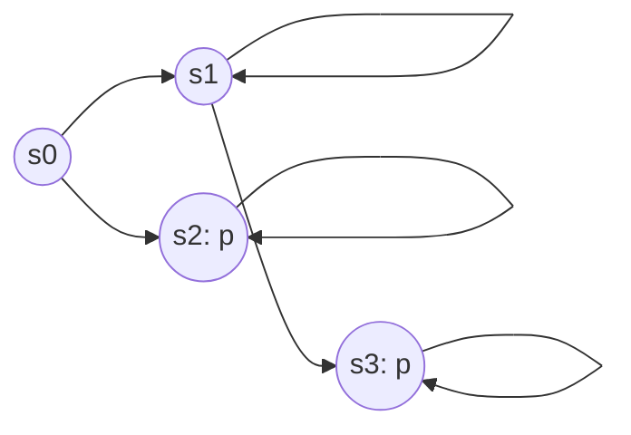

# CSCI5690 Automated Reasoning — 期中考试完整复习讲义

> [!info] 使用说明与覆盖边界
> 整理依据：本项目里可见的 Lecture 3 (SAT Solving)、Lecture 4.1 (FOL)、Lecture 4.2 (FOT)、Lecture 6 Model Checking I/II、Lecture 7 Program Verification，以及对应问答中反复讨论并纠正过的概念。
> **当前无法重新逐页访问此前会话中上传的 PDF 原文件**，因此本资料是按已确认主题组织的、理论上严谨的复习讲义，**不是**声称与 PPT 每页逐字对应的摘录。Lecture 1、2、5 的实际课件未能核实，不擅自填造它们的考试范围。
> 标记：**[Lecture 核心]** = 已确认讨论过的 Lecture 主干；**[相关补充]** = 先前专题/ Tutorial 中出现的工具知识、理解主干很有帮助，但应以授课老师宣布的考试要求为准。
> Obsidian 建议：开启数学公式渲染；可将每一节折叠复习。先完成「闭卷自测」再阅读答案。

## 总目录

1. 知识地图：所有部分到底如何相连
2. 预备：命题逻辑、语义关系、有效性、可满足性与证明
3. Lecture 3 — SAT Solving：CNF、Resolution、DPLL、CDCL、Encodings
4. Lecture 4.1 — First-Order Logic：语法、语义、Interpretation、Model
5. Lecture 4.2 — First-Order Theories：Signature、Axioms、Theory、Equality、Models
6. Lecture 6.1 — Model Checking I：Transition Systems、CTL/LTL/CTL*、Fixed Points
7. Lecture 6.2 — Model Checking II：Bottom-up Marking、Worklist、SCC、Symbolic MC
8. Lecture 7 — Program Verification：Hoare Logic、WP、VC、Invariant、Termination
9. [相关补充] SMT/Z3、BDD、E-graph、BMC/CBMC、PCTL
10. 纵向贯通：SAT、SMT、Model Checking、Program Verification 到底解什么问题
11. 高频易混点、重要定理及证明套路
12. 典型考试题（附逐步解析）
13. 最后复习用的公式与算法速查

---

# 1. 知识地图：课程的统一视角

## 1.1 四层框架

这门课的主要内容可以统一为以下链条：

```text
建模 / Representation
    命题公式、FOL formula、theory、transition system、program
                  ↓
语义 / Semantics
    truth assignment、structure、path、state、program execution
                  ↓
想证明的性质 / Property
    validity、entailment、safety、liveness、Hoare triple
                  ↓
自动化推理 / Algorithms
    SAT/CDCL、SMT、Model Checking、fixed point、VC/CBMC
                  ↓
结果 / Result
    proof / UNSAT / property holds
    or model / countermodel / counterexample / execution trace
```

**注意**：`model` 不是可以随意指代的某个“让 satisfaction 为真的东西”。它总是相对于某个逻辑、signature 和满足关系所允许的一类**语义对象**：命题逻辑中通常是 valuation；FOL 中通常是 structure（对开放公式还需要 assignment）；模型检测中通常是 Kripke structure / transition system。`theory` 是公理集合（连同规定语言的 signature），**本身一般不是它自己的 model**。

## 1.2 贯通五个核心问题

| 问题 | 形式 | 含义 | 常见解法 |
|---|---|---|---|
| SAT | $\exists v\;v\models F$ | 是否有 assignment 让公式为真 | DPLL/CDCL |
| Validity | $\forall v\;v\models F$ | 是否每个 assignment 都满足 | 检查 $\neg F$ 是否 UNSAT |
| Entailment | $\Gamma\models\varphi$ | 所有满足前提的 model 是否也满足结论 | 检查 $\Gamma\land\neg\varphi$ 是否 UNSAT（可表达时） |
| Model checking | $K,s\models\varphi$ | 给定系统的给定状态是否满足时序性质 | CTL marking / automata / fixed point |
| Program verification | $\{P\}\ C\ \{Q\}$ | 满足前置条件的程序执行是否保证后置条件 | Hoare logic、WP、VC、SMT |

> [!important] 跨主题最核心的技巧：把“对所有……成立”转化为“反例不存在”
> 例如 $\Gamma\models\varphi$ 当且仅当 $\Gamma\cup\{\neg\varphi\}$ 不可满足；要证明 $P\Rightarrow Q$，只需证明 $P\land\neg Q$ UNSAT；要找程序 bug，则求满足路径约束并违反断言的执行。

---

# 2. 预备：逻辑、真值与证明

## 2.1 Syntax 与 Semantics

- **Syntax（语法）**：哪些符号串是合法公式；如何根据构造规则生成公式。例如 $p\lor(q\land\neg r)$。
- **Semantics（语义）**：给公式赋予真值所需的数学对象与求值规则。命题逻辑使用 valuation $v:\mathrm{Prop}\to\{\top,\bot\}$。
- **Satisfaction（满足）**：$v\models\varphi$ 表示在 valuation $v$ 下 $\varphi$ 为真。这不是一个“逻辑连接词”，而是 **meta-language** 中关于对象语言公式的关系。
- **Model（模型）**：对公式 $\varphi$ 而言，满足 $\varphi$ 的相应语义对象称作 $\varphi$ 的 model。对理论 $T$ 而言，满足其中全部公理的 structure 是 $T$ 的 model。

**四个量词不要混淆：**

$$
\begin{aligned}
\text{Satisfiable } F &\iff \exists v\;(v\models F),\\
\text{Valid } F &\iff \forall v\;(v\models F),\\
\text{Unsatisfiable } F &\iff \forall v\;(v\not\models F),\\
\Gamma\models\varphi &\iff \forall v\;(v\models\Gamma\Rightarrow v\models\varphi).
\end{aligned}
$$

这里 $v\models\Gamma$ 是指 $v$ 满足 $\Gamma$ 中**所有**公式。

## 2.2 最常用的判定等价关系

$$
\boxed{F\text{ valid}\iff\neg F\text{ UNSAT}}
$$

$$
\boxed{\Gamma\models\varphi\iff\Gamma\cup\{\neg\varphi\}\text{ UNSAT}}
$$

$$
\boxed{F\equiv G\iff(F\oplus G)\text{ UNSAT}}
$$

**常见陷阱**：一个公式 SAT 不代表 VALID；一次 solver 找到一个满足赋值只证明 SAT；一次 solver 证明反例公式 UNSAT 才能得出相应的全称结论。 对有限前提集 $\Gamma$，可以把 $\Gamma$ 中各公式合取写为 $\bigwedge\Gamma$；若 $\Gamma$ 是无限集合，严格表达应使用 $\Gamma\cup\{\neg\varphi\}$ 的不可满足性，而不是假设有一条有限长度的“无限合取公式”。

## 2.3 Proof System、Soundness 和 Completeness

令 $\Gamma\vdash\varphi$ 表示存在形式证明，$\Gamma\models\varphi$ 表示语义蕴涵。

- **Soundness（可靠性）**：$\Gamma\vdash\varphi\implies\Gamma\models\varphi$。**能证明的东西都是真的**，不产生错误的定理。
- **Completeness（完备性）**：$\Gamma\models\varphi\implies\Gamma\vdash\varphi$。**所有真正语义成立的蕴涵原则上都有形式证明**。
- **Decidability（可判定性）**：存在算法对每个输入都**停机**并正确回答 yes/no。与 completeness 不同。

没有前提时，取 $\Gamma=\varnothing$，记为 $\vdash\varphi$ 与 $\models\varphi$。但“无前提”的情形只是一般定义的特例，并不是两套不同的概念。

**之前讨论过的一种反常证明方法**：任选单个 valuation $v_0$，只检查 $v_0\models F$ 就宣称 $F$ valid。对 VALIDITY 判定：它 **complete（凡 VALID 都会通过）但 unsound（SAT 而非 VALID 的公式也可能通过）**。这个例子区分了两种性质。

## 2.4 常用逻辑等价变换

$$
\begin{aligned}
A\to B &\equiv \neg A\lor B,\\
A\leftrightarrow B &\equiv (\neg A\lor B)\land(\neg B\lor A),\\
\neg(A\land B)&\equiv\neg A\lor\neg B,\\
\neg(A\lor B)&\equiv\neg A\land\neg B,\\
A\lor(B\land C)&\equiv(A\lor B)\land(A\lor C).
\end{aligned}
$$

**考试常用**：证明蕴涵时用反例公式；转 CNF 时先消去 $\to,\leftrightarrow$，把否定推到原子上，再分配；但直接分配可能导致指数膨胀，因此 SAT 求解通常用 Tseitin transformation。

---

# 3. Lecture 3 — SAT Solving [Lecture 核心]

## 3.1 SAT 问题与 CNF

- Literal：布尔变量 $p$ 或其否定 $\neg p$。
- Clause：literals 的析取，例如 $(p\lor\neg q\lor r)$。
- CNF：clauses 的合取 $C_1\land\cdots\land C_m$。
- $\square$（空 clause）为 False（UNSAT）；空 clause 集合的合取为 True。
- Assignment 可以是 total 或 partial；partial assignment 下某 clause 可能 already satisfied、falsified 或 unresolved。

**为什么 CNF**：Resolution、unit propagation 和现代 SAT solver 都以 clause 为主要工作单位；任意命题公式可以转换为 CNF（注意普通等价转换可能很大）。

### 手工 CNF 示例

$$
(p\to q)\land\neg(q\land r)
\equiv(\neg p\lor q)\land(\neg q\lor\neg r).
$$

$$
\neg(p\to q)\equiv p\land\neg q.
$$

## 3.2 Tseitin Transformation：线性规模的编码

给子公式增加 fresh variable $t$, 添加定义 $t\leftrightarrow\mathrm{subformula}$，并要求最顶层变量为 true。关键性质：新 CNF 与原公式**equisatisfiable（等可满足）**，不应简单声称是同一语言上的逻辑等价。

对 $t\leftrightarrow(a\land b)$：

$$
\boxed{(\neg t\lor a)\land(\neg t\lor b)\land(t\lor\neg a\lor\neg b)}
$$

对 $t\leftrightarrow(a\lor b)$：

$$
\boxed{(\neg t\lor a\lor b)\land(t\lor\neg a)\land(t\lor\neg b)}
$$

对 $t\leftrightarrow\neg a$：

$$
(\neg t\lor\neg a)\land(t\lor a).
$$

**完整例子**：$F=(p\land q)\lor r$。设 $a\leftrightarrow(p\land q)$，$t\leftrightarrow(a\lor r)$，将上面的子句全部加上单子句 $(t)$，得到 SAT solver 可输入的 CNF。

考试若问“为什么引入辅助变量？”：因为普通 CNF distributivity 可能指数级；definitional CNF 对固定有限元连接词基通常是 **$O(|F|)$ 大小**。

## 3.3 Resolution（归结）

规则：

$$
\frac{(A\lor p)\qquad(B\lor\neg p)}{A\lor B}.
$$

结论叫 resolvent。对 CNF 集合，不断得到空 clause $\square$ 即构造出 UNSAT 证明。命题 Resolution **sound** 且对反驳 UNSAT 是 **refutation-complete**。

**考试式例子**：

$$
\begin{aligned}
C_1&=(p\lor q),&C_2&=(\neg p\lor q),\\
C_3&=(p\lor\neg q),&C_4&=(\neg p\lor\neg q).
\end{aligned}
$$

由 $C_1,C_2$ 对 $p$ 归结出 $(q)$；由 $C_3,C_4$ 对 $p$ 归结出 $(\neg q)$；最后归结出 $\square$。所以四个 clauses 合取 UNSAT。

**注意**：一个 derived clause 由原 clauses 逻辑蕴涵；增加 learned clause 不改变原 CNF 的 model 集合在原变量上的约束。

## 3.4 Unit Propagation（单位传播）

Clause $(p)$ 迫使 $p=\top$。如果 $(\neg p\lor q)$ 且已得 $p=\top$，则该 clause 化简为 $(q)$，迫使 $q=\top$。如果某 clause 的全部 literals 都 False，则产生 conflict。

**例子**：

$$
(p)\land(\neg p\lor q)\land(\neg q\lor r)\land(\neg r).
$$

传播 $p\!=\!\top\Rightarrow q\!=\!\top\Rightarrow r\!=\!\top$，与 $\neg r$ 冲突，所以 UNSAT，完全不必 branching。

区别：Unit propagation 是逻辑强制赋值；decision 是试探赋值；二者都可形成 implication trail，但只有 decision 创造新的 decision level。

## 3.5 DPLL 算法

核心步骤：

```text
DPLL(F, current assignment):
    repeatedly apply unit propagation
    if a clause becomes empty: return UNSAT for this branch
    if all clauses satisfied: return SAT
    optionally eliminate pure literals (classical DPLL)
    choose an unassigned variable p
    if DPLL(F | p = true) SAT: return SAT
    return DPLL(F | p = false)
```

- **Branching**：完整搜索空间，由二元变量取值划分。
- **Unit propagation**：减少搜索。
- **Chronological backtracking**：普通 DPLL 返回上一个 decision 后尝试另一个分支。
- **Pure literal elimination**：某变量只以一种极性出现，可设置使其所出现的 clauses 满足；现代 CDCL 通常不依赖它作为核心步骤。

### DPLL 手工追踪题必须写什么？

1. 现有 clause / partial assignment。
2. 哪个 assignment 是 decision，哪个是 unit-propagated。
3. 每一步化简后的 unit clause 或 conflict。
4. 回溯分支后 SAT model 或 UNSAT 证据。

## 3.6 CDCL（Conflict-Driven Clause Learning）

CDCL = DPLL 的系统化加强，主要加入 conflict analysis、learned clauses、**non-chronological backjumping**、常见还有 restarts 与 branching heuristics。

执行流程：

```text
while true:
    Boolean constraint propagation (BCP)
    if conflict:
        if decision level == 0: return UNSAT
        analyze conflict; derive learned clause
        determine backjump level
        backjump and assert the learned clause
    else if every variable/required clause resolved: return SAT
    else choose a decision literal and increase level
```

### Implication Graph

- Nodes 是带有 decision level 的 literal assignments。
- Decision node 无理由 clause；propagated node 的 reason 是使它变成 unit 的 clause。
- Conflict node 汇集一个被 falsify 的 clause 的相关 assignments。
- **1-UIP（first unique implication point）**：从 conflict 逆向分析，找到当前 decision level 中在所有冲突相关路径上出现的第一个共同节点；常见学习子句使得它在最高 decision level 恰好保留一个 literal。实际求解器根据该学习子句回跳到其余 literals 的最高 decision level。

### 完整的小型学习子句示例

$$
C_1=(\neg a\lor b),\quad
C_2=(\neg a\lor c),\quad
C_3=(\neg b\lor\neg c).
$$

在 level 1 **decide** $a=\top$，传播 $b=\top$ 与 $c=\top$，因此 $C_3$ conflict。

Resolution 链：

$$
\begin{aligned}
(\neg b\lor\neg c)&\quad\text{与 }(\neg a\lor c)\Rightarrow(\neg b\lor\neg a),\\
(\neg b\lor\neg a)&\quad\text{与 }(\neg a\lor b)\Rightarrow(\neg a).
\end{aligned}
$$

学到 **$(\neg a)$**，回跳至 level 0 并传播 $a=\bot$。这不是单纯换一种决策，而是从冲突中发现了以后可以永久复用的约束。

> [!important] CDCL 与 Resolution 的关系
> 冲突分析学习 clause 通常可以看作对 reason clauses 的一系列 resolution；学习子句是原始公式的 logical consequence。CDCL 是一个 search algorithm；Resolution 是 proof rule / proof system，不能等同。

## 3.7 SAT Encoding（复习中常见）[与 Tutorial 1 关联]

问题先抽象出 Boolean variables，再把 constraints 逐一编码为 clauses。

### At least one / At most one / Exactly one

对 $x_1,\dots,x_n$：

- At least one：$(x_1\lor\cdots\lor x_n)$。
- At most one（pairwise）：$\bigwedge_{i<j}(\neg x_i\lor\neg x_j)$，需要 $\binom n2=O(n^2)$ 个二元子句。
- Exactly one：把以上两者合起来。

例如三个候选 $x_1,x_2,x_3$ 必须恰好选一个：

$$
(x_1\lor x_2\lor x_3)
\land(\neg x_1\lor\neg x_2)
\land(\neg x_1\lor\neg x_3)
\land(\neg x_2\lor\neg x_3).
$$

**Sequential counter、cardinality network、binary encoding** 等能够改变辅助变量和 clauses 数量。熟悉 encoding 的**约束语义、正确性、规模**比死记实现更重要。不能说 pairwise 是所有情况都最优。

### Implication 与 Bi-implication encoding

- $x\to y$：$(\neg x\lor y)$。
- $x\leftrightarrow y$：$(\neg x\lor y)\land(\neg y\lor x)$。
- $x\to(y\land z)$：$(\neg x\lor y)\land(\neg x\lor z)$。
- $(x\land y)\to z$：$(\neg x\lor\neg y\lor z)$。

### 验证 encoding 的方法

对每个约束写清：（i）合法实例应有 assignment；（ii）满足 CNF 的 assignment 能解码成合法实例；（iii）辅助变量可能存在多种赋值，通常是存在量化意义上的 equisatisfiable；（iv）计算变量数和 clauses 数。

## 3.8 SAT 高频考点

> [!question] 自测
> - 分辨 SAT / UNSAT / VALID、写出 UNSAT 的 Resolution proof。
> - 把公式转 CNF；给出 Tseitin CNF 并解释“等可满足”与“逻辑等价”。
> - 对 CNF 完成 unit propagation、DPLL branching 与 conflict trace。
> - 理解 CDCL 如何由冲突推导 learned clause 和回跳。
> - 为“恰好一个”等简单约束写 clauses，计算编码规模。

---

## 3.9 SAT 的复杂度与现代求解器优化 [相关扩展]

- **General SAT** 是 NP-complete；给定某个 Boolean assignment，可以在输入规模的多项式时间验证它是否满足 CNF，但没有已知对所有 SAT 实例都有效的 polynomial-time 求解方法。
- **2-SAT**（每 clause 最多 2 literals）可用 implication graph / SCC 多项式时间求解；**Horn SAT**（每 clause 最多一个 positive literal）可以用 forward chaining / propagation 多项式时间求解。它们是 SAT 的重要 tractable fragments。
- **Two-watched literals**：每个非单子句只维护两个被监视的 literals，赋值时只需检查相应 watched clauses；这是 BCP 的经典实现优化，而不是新的逻辑规则。
- **Branching heuristic / VSIDS-like activity**：倾向于选择在最近冲突中活跃的变量；与正确性无关但对性能影响很大。
- **Restarts**：重置当前 decisions，但保留 learned clauses；可以避免被不好的 decision prefix 长时间困住。不是“删掉所有证明进展”。
- **SAT 在 NP 与 Resolution/CDCL 的完备性不是一回事**：前者描述计算复杂度类别，后者描述某一证明/求解过程能否覆盖正确结论。

### Sequential-counter at-most-one 的线性编码示例

与 pairwise 的 $O(n^2)$ 个 clauses 不同，可引入 $s_1,\ldots,s_{n-1}$，表达某个前缀已经选择变量（下面是一个标准版本，假定 $n\ge2$）：

$$
\begin{aligned}
&(\neg x_1\lor s_1),\\
&\text{对 }2\le i\le n-1:\ (\neg x_i\lor s_i)\land(\neg s_{i-1}\lor s_i)\land(\neg x_i\lor\neg s_{i-1}),\\
&(\neg x_n\lor\neg s_{n-1}).
\end{aligned}
$$

这给出 $n-1$ 个 auxiliary variables 和 $3n-4$ 个 clauses，即 $O(n)$。再加 $(x_1\lor\cdots\lor x_n)$ 即可编码 exactly one。**代价是引入辅助变量、结构也更复杂；而 pairwise 在 $n$ 小时可能更简单**。不必假设所有教材都要求记住这个编码的精确子句模板，关键是能检查编码语义与规模。

---

# 4. Lecture 4.1 — First-Order Logic (FOL) [Lecture 核心]

## 4.1 从命题逻辑到一阶逻辑

命题逻辑把 $p,q,r$ 看成没有内部结构的原子命题；FOL 允许描述**对象、对象之间的关系、作用于对象的函数、以及量词**。

例：

$$
\forall x\,\bigl(\mathrm{Human}(x)\to\mathrm{Mortal}(x)\bigr).
$$

这里 $x$ 是一个取遍论域元素的 object variable，不是一个 Boolean proposition。$\forall$ 是对象语言中的量词，$\models$ 则依然是我们在元语言中表达真值的符号。

## 4.2 Signature $\Sigma$：规定有哪些非逻辑符号

一种常用记法：

$$
\Sigma=(F,P,\operatorname{arity}),
$$

其中 $F$ 为函数符号集合，$P$ 为谓词符号集合；$\operatorname{arity}$ 给出每个符号的参数个数。**Constant symbols 可看作 arity 为 0 的函数符号**；有的讲义把常量集合 $C$ 单列，写为 $(C,F,P,\operatorname{arity})$，二者是记号约定，不是实质矛盾。

例如：

$$
\Sigma:\quad 0:\!0,\quad s:\!1,\quad +:\!2,\quad <:\!2.
$$

有的记号把 functions 与 predicates 分开写：$0,s,+\in F$，$<\in P$。Signature 定义的是**符号名称及其 arity**，并没有规定这些符号实际是什么函数、什么集合或关系。

## 4.3 Terms 与 Formulas 的构造

**Terms**（指称对象）：

1. 每个变量 $x,y,\ldots$ 是 term。
2. 每个常量 $c$ 是 term。
3. 若 $f$ 为 $n$ 元函数符号，$t_1,\dots,t_n$ 是 terms，则 $f(t_1,\dots,t_n)$ 是 term。

**Atomic formulas**：$P(t_1,\dots,t_n)$，以及带等号逻辑中的 $t_1=t_2$。

**Well-formed formulas**：由 atomic formulas 经过 $\neg,\land,\lor,\to,\leftrightarrow,\forall x,\exists x$ 递归构成。

**Terms 与 Formulas 的区别**：$f(a)$ 是一个 term，$P(f(a))$ 是一个 formula，不能用“true/false”给纯 term 赋值，也不能把公式当成对象元素，除非你另外构造了编码或高阶系统。

## 4.4 Free Variable、Bound Variable、Sentence

- 在 $P(x)\land\exists y\,R(x,y)$ 中，$x$ 自由，$y$ 被其量词绑定。
- **Sentence（closed formula）**：没有自由变量的公式，例如 $\forall x\exists y\,R(x,y)$。
- **Open formula**：存在自由变量，语义依赖 assignment。
- **Variable capture**：做 substitution 必须避免使原先的自由变量意外落入量词绑定范围。

例：在 $\forall y\,P(x,y)$ 中直接用 $y$ 替换自由的 $x$，得到 $\forall y\,P(y,y)$，通常**不是**合法的 capture-avoiding substitution 的结果；应先把 bound variable $y$ alpha-rename 成 fresh $z$，再得到 $\forall z\,P(y,z)$。

## 4.5 Structure $\mathcal M$ 与 Variable Assignment $s$

对 signature $\Sigma$，一个 $\Sigma$-structure 通常是：

$$
\mathcal M=(D,\{f^{\mathcal M}\}_{f\in F},\{P^{\mathcal M}\}_{P\in P}),
$$

其中：

- $D$ 是非空 domain / universe（经典常用 FOL 约定）。
- $n$ 元函数符号解释为**全函数** $f^{\mathcal M}:D^n\to D$。
- $n$ 元谓词符号解释为关系 $P^{\mathcal M}\subseteq D^n$。
- 常量符号 $c$ 解释为 $c^{\mathcal M}\in D$。
- 带内建 equality 的普通 FOL 中 $=$ 一般被解释为 $D$ 上的真实相等关系。

**Assignment / valuation of variables**：

$$
s:\operatorname{Var}\to D.
$$

FOL 解释开放公式时常使用 **interpretation $\mathcal I=(\mathcal M,s)$** 的说法。有些教材把 interpretation 用来指 $\mathcal M$（对非逻辑符号的解释）本身。是否把 assignment 包进去是**术语习惯**；数学上必须明确你的 satisfaction 关系究竟依赖 $\mathcal M$ 还是 $(\mathcal M,s)$。

## 4.6 Terms 的求值

记 $\llbracket t\rrbracket_{\mathcal M,s}\in D$：

$$
\begin{aligned}
\llbracket x\rrbracket_{\mathcal M,s}&=s(x),\\
\llbracket c\rrbracket_{\mathcal M,s}&=c^{\mathcal M},\\
\llbracket f(t_1,\ldots,t_n)\rrbracket_{\mathcal M,s}&=
 f^{\mathcal M}(\llbracket t_1\rrbracket_{\mathcal M,s},\ldots,\llbracket t_n\rrbracket_{\mathcal M,s}).
\end{aligned}
$$

随后用这些对象决定 atomic formulas 的真值。例如：

$$
\mathcal M,s\models P(t)
\iff \llbracket t\rrbracket_{\mathcal M,s}\in P^{\mathcal M}.
$$

## 4.7 Satisfaction Relation：递归定义（**必背**）

$$
\begin{aligned}
\mathcal M,s\models\neg\varphi
&\iff \mathcal M,s\not\models\varphi,\\
\mathcal M,s\models\varphi\land\psi
&\iff \mathcal M,s\models\varphi\ \text{且}\ \mathcal M,s\models\psi,\\
\mathcal M,s\models\forall x\,\varphi
&\iff \forall d\in D:\ \mathcal M,s[x\mapsto d]\models\varphi,\\
\mathcal M,s\models\exists x\,\varphi
&\iff \exists d\in D:\ \mathcal M,s[x\mapsto d]\models\varphi.
\end{aligned}
$$

**$s[x\mapsto d]$ 只更新 $x$ 的取值**，其他变量取值不变。对 sentence，真值不依赖自由变量赋值，因此写 $\mathcal M\models\varphi$。

### 真正动手算一个 FOL model

令 $D=\{0,1\}$，$c^{\mathcal M}=0$，$f^{\mathcal M}(0)=1$，$f^{\mathcal M}(1)=0$，$P^{\mathcal M}=\{1\}$。

- $\mathcal M\models P(f(c))$，因为 $f(c)$ 的值是 1。
- $\mathcal M\models\forall x\,(P(x)\lor P(f(x)))$，因为 $x=0$ 时后半真，$x=1$ 时前半真。
- $\mathcal M\not\models\forall x\,P(x)$，因为 $0\notin P^{\mathcal M}$。
- $\mathcal M,s\models P(x)$ 依赖 $s(x)$，不能在未指定 $s$ 时武断说它真或假。

## 4.8 Model、Validity、Satisfiability、Entailment 在 FOL 中

- $\mathcal M\models\varphi$：structure $\mathcal M$ 满足 sentence $\varphi$；若为开放公式，要给出变量 assignment 或采用统一的 universal-closure 约定。
- **Satisfiable**：至少有一个合适的 structure（及必要的 assignment）使公式真。
- **Valid**：所有适当的 structures（及 assignment）都满足。
- $\Gamma\models\varphi$：每个 $\Gamma$ 的 model 都满足 $\varphi$。

**关键反例**：

$$
\forall x\exists y\ R(x,y)
\not\models
\exists y\forall x\ R(x,y).
$$

前者允许为每个 $x$ **分别选择** 一个 $y$；后者要求存在**同一个** $y$ 对所有 $x$ 有效。取 $D=\{0,1\}$，$R^{\mathcal M}=\{(0,0),(1,1)\}$，前者真，后者假。

另一个典型题：

$$
\forall x\,(P(x)\to Q(x)),\quad \forall x\,P(x)
\models\forall x\,Q(x).
$$

证明：任取模型 $\mathcal M$ 及任意 $d\in D$，由前提一得 $P(d)\to Q(d)$，由前提二得 $P(d)$，故 $Q(d)$，从而全称成立。

## 4.9 量词逻辑的高频变换

$$
\begin{aligned}
\neg\forall x\,\varphi&\equiv\exists x\,\neg\varphi,\\
\neg\exists x\,\varphi&\equiv\forall x\,\neg\varphi,\\
\forall x\,(\varphi\land\psi)&\equiv(\forall x\,\varphi)\land(\forall x\,\psi),\\
\exists x\,(\varphi\lor\psi)&\equiv(\exists x\,\varphi)\lor(\exists x\,\psi).
\end{aligned}
$$

注意：不能任意交换量词。$\forall x\exists y$ 与 $\exists y\forall x$ **一般不等价**；同类量词通常可交换，如 $\forall x\forall y$。量词外移、变量重命名时必须检查变量是否自由出现。

## 4.10 FOL 的元性质 [视授课具体要求掌握]

经典一阶逻辑 Gödel completeness theorem：在适当的可靠一阶证明系统下，$\Gamma\models\varphi$ 当且仅当 $\Gamma\vdash\varphi$。这**不意味着**存在一个对所有 FOL 公式都终止的 validity decision procedure。一般 FOL validity 是不可判定的，但可证明性可以被枚举（有效可枚举的公理化体系下）。

有时课程会提到 compactness：若理论的所有有限子集都有 model，则整个理论有 model。若老师未涉及证明，识别定义与结论即可，不应擅自当作必考定理。

> [!question] FOL 自测
> 给定一个 signature、一个具体 $\Sigma$-structure 以及 assignment：
> - 分清什么是 term、atomic formula、sentence。
> - 计算 term 的值、判断含 $\forall/\exists$ 的 formula 真伪。
> - 写一个 structure 作 countermodel，以否定某个 entailment。
> - 严格解释 $\mathcal M$、$s$、$\models$、$\vdash$ 的区别。

---

# 5. Lecture 4.2 — First-Order Theories (FOT) [Lecture 核心]

## 5.1 从 FOL Language 到 First-Order Theory

FOL 是一套**一般性的逻辑语言、推导规则与语义框架**；First-Order Theory 用这套语言描述某个特定领域，例如 group、linear order、arithmetic、arrays 或 uninterpreted functions。

老师课件中如果将 theory 写为：

$$
\boxed{T=(\Sigma,A)}
$$

即 **signature $\Sigma$ + 一组 $\Sigma$-sentences 作为 axioms $A$**，这是 axiomatically presented theory 的合理、实用定义。

在 model theory 或 proof theory 的另一种术语习惯中，`theory` 有时特指一个**在语义或证明后果下封闭的公式集合** $\operatorname{Cn}(A)$。因此：

- **Axiom set / presentation**：$A$，或连 signature 记成 $(\Sigma,A)$。
- **Deductive / semantic closure**：$\operatorname{Cn}(A)=\{\varphi:A\models\varphi\}$（在逻辑完备时也可写 $A\vdash\varphi$）。
- **Closed formula**：没有自由变量。
- **Closed theory**：通常表示在逻辑后果下封闭（但具体课件若另有定义以课件为准）。

> [!important] Theory 并不是“有 axioms 因而自己变成 semantics”
> 先为 FOL 给出何谓 $\Sigma$-structure、何谓 $\models$，然后 axioms $A$ 从所有 $\Sigma$-structures 中**筛选出**满足它们的那一类：
>
> $$\operatorname{Mod}(T)=\{\mathcal M:\mathcal M\text{ is a }\Sigma\text{-structure and }\mathcal M\models A\}.$$
>
> 所以 theory 的表示主要位于 syntactic side；其 **class of models** 在 semantic side。

## 5.2 举一个真正的 Theory 例子：群公理

取 signature $\Sigma=\{\cdot:2,e:0,\operatorname{inv}:1\}$，公理：

$$
\begin{aligned}
\forall x,y,z:\ &(x\cdot y)\cdot z=x\cdot(y\cdot z),\\
\forall x:\ &e\cdot x=x\land x\cdot e=x,\\
\forall x:\ &x\cdot\operatorname{inv}(x)=e\land\operatorname{inv}(x)\cdot x=e.
\end{aligned}
$$

实际构造一个 model：$D=\mathbb Z$，$\cdot^{\mathcal M}$ 解释为整数加法，$e^{\mathcal M}=0$，$\operatorname{inv}^{\mathcal M}(x)=-x$。它满足公理，所以是 group theory 的 model。

**同一 signature 可有很多 structures，只有满足 axioms 的才是这一 theory 的 models**。一个 theory 也可能没有 model（inconsistent）；经典语义中若 $\operatorname{Mod}(T)=\varnothing$，则 $T\models\varphi$ 对任意 $\varphi$ 都真（vacuous entailment），这不是说出现了一个神奇的 contradiction model。

## 5.3 Equality、Congruence 与 EUF

标准 equality 支持：

$$
\begin{aligned}
&x=x&&\text{(reflexivity)},\\
&x=y\Rightarrow y=x&&\text{(symmetry)},\\
&x=y\land y=z\Rightarrow x=z&&\text{(transitivity)},\\
&x_i=y_i\ (1\le i\le n)\Rightarrow f(x_1,\dots,x_n)=f(y_1,\dots,y_n)&&\text{(function congruence)}.
\end{aligned}
$$

对 predicates，也有 substitutivity：若对应 arguments 都相等，则 predicate 的真值一致。

**EUF** = Equality with Uninterpreted Functions。`uninterpreted` 不是“函数无意义”或者“可随时任意改变值”，而是函数只受固定函数性和 equality congruence 等约束，没有额外算术解释。

示例：

$$
a=b\ \land\ f(a)\ne f(b)
$$

在 EUF 中 UNSAT，因为 $a=b$ 必须推出 $f(a)=f(b)$。与 $a\ne b$ 不同：$a\ne b$ **不要求** $f(a)\ne f(b)$；uninterpreted functions 不保证 injective。

**Congruence closure**：给定 ground equalities，可用 union-find 风格的等价类维护以及函数应用的 congruence 传播；识别最终某个 disequality 的两端是否被归入同一类。这个概念也连接 Tutorial 3 的 E-graph。

## 5.4 Theories in SMT [与 Z3 Tutorial 关联]

SAT 处理 Boolean structure；SMT (Satisfiability Modulo Theories) 进一步要求 Boolean atoms 在背景 theory 下可同时成立。

例如：

$$
(x>3)\land(x<2)
$$

布尔抽象会把 $(x>3)$ 和 $(x<2)$ 当成两个独立的 Boolean atoms，两者都设 true 看上去不矛盾；但是整数/实数算术 theory 使它 UNSAT。

常见背景 theories：

| Theory | Signature / 约束例子 | 关键差异 |
|---|---|---|
| EUF | $f(a)=b$，$a=c$ | 只用 equality 与 congruence |
| LIA | $x+y\le 4$, $x,y\in\mathbb Z$ | 线性**整数**算术 |
| LRA | $2x-y>0$, $x,y\in\mathbb R$ | 线性**实数**算术 |
| Bit-vectors | $x:\mathrm{BV}_{8}$ | 有限位宽，运算可能 wrap around |
| Arrays | $\operatorname{select}(a,i)$、$\operatorname{store}(a,i,v)$ | 读写一致性与 extensionality |

**SAT solver 与 SMT solver 的关系**：很多现代 SMT 架构会使用 SAT/CDCL 来搜索 Boolean assignment，再让 theory solver 检查 theory consistency，并反馈 theory lemmas。但不是所有 SMT solver 都必须采取同一种架构。

## 5.5 Arrays 的公理性语义

设 $a$ 是一个从 index sort 到 value sort 的 array，定义读 $\operatorname{select}(a,i)$ 和函数式更新 $\operatorname{store}(a,i,v)$：

$$
\operatorname{select}(\operatorname{store}(a,i,v),j)
=
\begin{cases}
v,&i=j,\\
\operatorname{select}(a,j),&i\ne j.
\end{cases}
$$

数组不仅能存**一个** key-value pair。`Store(a,i,v)` 返回一整个新数组；再次 Store 可以更新其他位置：

$$
a_1=\operatorname{store}(a,1,10),\quad
a_2=\operatorname{store}(a_1,2,20).
$$

这对应你之前问过的“a[1]=...、a[2]=...”——**当然可以描述多个 index**。有些理论还包含 **extensionality**：两个数组在所有 index 的取值都相同，则两个数组相同。

## 5.6 FOL、FOT、Universal Algebra、Term Algebra 的联系 [概念整合]

```text
Σ (functions / constants / predicates and arities)
    |
    +--> syntax: terms TΣ(X), formulas L(Σ)
    |          |
    |          +--> axioms A --> first-order theory (Σ, A)
    |
    +--> semantics: Σ-structures M
                  |
                  +--> M ⊨ A  --> Models of T

函数符号部分 Σ_F:
    terms TΣ_F(X) form an absolutely free term algebra
    equations E generate the least congruence ≡E
    quotient TΣ_F(X) / ≡E gives the free algebra modulo E
    (with the usual equational-theory qualifications)
```

**Universal algebra** 的主角是（通常仅由操作符构成 signature 的）algebras，研究 algebraic identities 和 homomorphisms；**Model theory** 可以研究具有 predicates、functions、quantifiers 的更广泛 FOL structures。Term algebra 是 syntax 构成的 algebra；一旦将 term 构造器作为 operations，它同时也是一个具体的 semantic algebraic object。不能绝对地说一个数学对象只能放在 syntax 或 semantics 一边：看它在当前形式化里的**扮演角色**。

- **Term algebra**：形式项组成的代数，如 $f(f(x))$ 与 $f(x)$ 先看作不同的语法项。
- **Equational theory $E$**：指定如 $x+0=x$ 的恒等式。
- **Congruence $\equiv_E$**：被这些 equations 生成、且对所有操作符封闭的最小等价关系。
- **Quotient / free algebra**：通过将相等项归类得到 $T_\Sigma(X)/{\equiv_E}$；更精确说是给定 equational variety 中以 $X$ 作为 generators 的 free algebra。
- **E-graph**（相关补充）：使用共享结构紧凑存储许多 ground terms 的 equality classes，并在 merge 后恢复 congruence。它是 representation/data structure + algorithms，不应无条件认作整个 infinite quotient algebra 的完整显式表示。

> [!question] FOT 自测
> - 从 signature 与 axioms 定义 theory，解释一组 models 如何产生。
> - 给出一个 group theory / partial order theory 的模型和非模型。
> - 利用 congruence 判断 EUF 约束 SAT/UNSAT。
> - 区分 FOL logic、first-order theory、structure、model、interpretation。
> - 理解在算术与 bit-vector 中写同一个表达式可能得出不同结论。

---
# 6. Lecture 6.1 — Model Checking I [Lecture 核心]

## 6.1 Model Checking 的问题形式

**SAT** 通常问一个 Boolean formula 有没有满足赋值；**Model Checking** 则给定一个数学化的系统 $K$ 和时序性质 $\varphi$，判断：

$$
\boxed{K,s\models\varphi}
$$

其中 $s$ 是一个系统状态。若问题是整个系统 $K\models\varphi$，一般意味着规定的**所有 initial states** 都满足 $\varphi$（不同教材会约定一个特定起点或一组起点，审题必须确定）。

## 6.2 Transition System 与 Kripke Structure

常见表示：

$$
K=(S,S_0,R,L),
$$

- $S$：states 集合。
- $S_0\subseteq S$：initial states。
- $R\subseteq S\times S$：transition relation，$sRt$ 表示可以一步从 $s$ 到 $t$。
- $L:S\to2^{AP}$：labeling function，标出各状态满足哪些 atomic propositions。

有的课件写 $TS=(S,Act,\to,I,AP,L)$，包含 actions。不要因为 tuple 元素不同就误认为不同理论；关键是**状态、初始状态、转移、标签**。

CTL/CTL* 的常规 Kripke 语义一般假定 $R$ **total**：每个状态至少存在一个后继，因此每条 maximal path 可以视作 infinite path。如系统允许 deadlock，必须说明补 self-loop、改用 finite-trace semantics，或者显式给出 deadlock convention。

### Paths 与 Reachability

Path：$\pi=s_0s_1s_2\cdots$，满足 $s_iRs_{i+1}$。从初始集合出发的 reachable states：

$$
\operatorname{Reach}(S_0)=\{s:\exists\text{ finite path from some }s_0\in S_0\text{ to }s\}.
$$

**注意**：transition system 与 Kripke structure 是被检查的数学模型，而不是逻辑的 syntax formula。它自身也可以有一套“程序/系统描述到状态图”的语义映射。例如源程序的 operational semantics 生成 transition relation。这是**两个不同抽象层**，不矛盾。

## 6.3 Safety、Liveness 与 Counterexample

- **Safety**：直观地说“坏事永远不发生”。有限前缀一旦见到坏事就足以证伪。例 $AG\neg\mathrm{error}$。
- **Liveness**：直观地说“好事最终发生”。仅靠某个有限前缀不一定能确定违反。例 $AF\mathrm{done}$（对所有路径最终 done）。
- **Reachability**：存在一条路径能到某状态，例如 $EF\mathrm{error}$。
- **Counterexample trace**：违反性质的执行路径/循环（lasso）。对某些 universal CTL/LTL 性质，反例可以是一条具体路径；对任意 CTL 公式，反例有时需要 tree-like witness，而非总能用单路径表示。

注意 $EF\,p$ 与 $AF\,p$ 区别：一个“存在一条成功路径”，另一个“所有路径都最终成功”。

## 6.4 CTL、LTL 与 CTL* 的关系

| Logic | Formula 主要在哪里求值 | 语法特点 | 常见检查手段 |
|---|---|---|---|
| CTL | **state** | 每个时序运算都在相应的路径量词 $A/E$ 作用下，例如 $EX$, $EU$, $AG$ | 按子公式 bottom-up labeling、fixed points |
| LTL | **path**（系统判定时通常对所有初始路径） | $X,F,G,U$ 等沿单条路径解释，不含 CTL 风格的自由交替路径量词 | negation + Büchi automata + product + accepting cycle |
| CTL* | **state + path** | 允许更自由地嵌套 $A/E$ 与路径时序公式 | state-formula 分解 + path / automata procedure |
| PCTL | **state** | $P_{\bowtie q}[\psi]$ 比较路径集合的概率 | state labeling + 概率求解 |

- **CTL 与 LTL 互不包含**（按通常的 state/system property 表达性比较），两者都可嵌入 CTL* 的适当片段。
- $AG\,EF\,p$ 是合法 CTL：对所有 reachable/全路径状态，存在通往 $p$ 的后续路径。
- $A(GF\,p)$ 一般是 **CTL***（不是 CTL 的基本语法），描述每条路径上 $p$ 无穷多次出现。
- CTL 不能简单把 $A$ 和 $E$ 删掉，否则量词意义会消失。

## 6.5 CTL 的语义：从最容易的开始

对 state formula $\varphi$，记 $\operatorname{Sat}(\varphi)=\{s:K,s\models\varphi\}$。路径量词：

- $E$：**there exists a path**。
- $A$：**for all paths**。

时间算子：

- $X$ = ne**X**t（下一步）。
- $F$ = **F**inally / eventually（未来某时刻）。
- $G$ = **G**lobally / always（未来每一步）。
- $U$ = **U**ntil（直到）。

典型语义：

$$
\begin{aligned}
K,s\models EX\varphi
&\iff \exists t:(sRt\land K,t\models\varphi),\\
K,s\models AX\varphi
&\iff \forall t:(sRt\Rightarrow K,t\models\varphi),\\
K,s\models EF\varphi
&\iff\exists\pi\text{ starting at }s,\exists i\ge0:\pi_i\models\varphi,\\
K,s\models AF\varphi
&\iff\forall\pi\text{ starting at }s,\exists i\ge0:\pi_i\models\varphi,\\
K,s\models EG\varphi
&\iff\exists\pi\text{ starting at }s,\forall i\ge0:\pi_i\models\varphi,\\
K,s\models AG\varphi
&\iff\forall\pi\text{ starting at }s,\forall i\ge0:\pi_i\models\varphi.
\end{aligned}
$$

**Strong until** $E[\varphi\ U\ \psi]$：存在一条路径、存在某个有限 $k\ge0$，使 $\psi$ 在 $k$ 成立且 $\varphi$ 在所有 $j<k$ 成立。$A[\varphi\ U\ \psi]$ 则要求**每条路径**最终遇到 $\psi$，之前保持 $\varphi$。

> [!warning] Until 的典型错误
> 把 $\varphi\ U\ \psi$ 理解为“如果 $\psi$ 出现就……”会漏掉 **$\psi$ 必须最终出现** 这一 strong-until 义务。对于 $E[\varphi\ U\ \psi]$，只有无限维持 $\varphi$ 而 $\psi$ 永不出现的路径，不构成 witness。

## 6.6 CTL 常用等价关系（考试很有用）

$$
\begin{aligned}
AX\varphi&\equiv\neg EX\neg\varphi,\\
AG\varphi&\equiv\neg EF\neg\varphi,\\
AF\varphi&\equiv\neg EG\neg\varphi,\\
EF\varphi&\equiv E[\top\ U\ \varphi],\\
AF\varphi&\equiv A[\top\ U\ \varphi],\\
EF\varphi&\equiv\varphi\lor EX(EF\varphi),\\
EG\varphi&\equiv\varphi\land EX(EG\varphi).
\end{aligned}
$$

最后两条是 fixed-point equation，**等式单独不足以唯一确定解**：$EF$ 选 **least fixed point**，$EG$ 选 **greatest fixed point**。

## 6.7 Predecessor Operator：所有算法的基元

给定 $X\subseteq S$：

$$
\operatorname{Pre}_E(X)=\{s\in S:\exists t\in X,\ sRt\}.
$$

$$
\operatorname{Pre}_A(X)=\{s\in S:\forall t,\ sRt\Rightarrow t\in X\}.
$$

直观：$Pre_E(X)$ 是**至少有一条**边进入 $X$ 的 states；$Pre_A(X)$ 是**所有**后继都在 $X$ 的 states。通常：

$$
\operatorname{Sat}(EX\varphi)=\operatorname{Pre}_E(\operatorname{Sat}(\varphi)),
$$

$$
\operatorname{Sat}(AX\varphi)=\operatorname{Pre}_A(\operatorname{Sat}(\varphi)).
$$

集合对偶公式：

$$
\operatorname{Pre}_A(X)=S\setminus\operatorname{Pre}_E(S\setminus X).
$$

即使允许 deadlocks，$AX$ 依上述公式对无后继状态是 vacuously true；如果选择其他 finite-path 语义，须重新核对。

## 6.8 Least Fixed Point (LFP) 与 Greatest Fixed Point (GFP)

**Fixed point**：对于算子 $F:2^S\to2^S$，若 $F(Z)=Z$，则 $Z$ 是 fixed point。若 $F$ monotone（$X\subseteq Y\Rightarrow F(X)\subseteq F(Y)$），在完整格 $(2^S,\subseteq)$ 中存在 least 与 greatest fixed points（Knaster–Tarski）。

记作：

$$
\mu Z.F(Z),\qquad\nu Z.F(Z).
$$

有限 $S$ 上可用 Kleene iteration：

$$
\begin{aligned}
\text{LFP: }&Z_0=\varnothing,\quad Z_{i+1}=F(Z_i),\\
\text{GFP: }&Z_0=S,\quad Z_{i+1}=F(Z_i).
\end{aligned}
$$

因为 monotonicity，前者逐渐增大，后者逐渐减小；在有限状态系统中最终稳定。对 infinite-state，单纯迭代可能需要无限步，甚至不在有限轮收敛。

### 最重要的 CTL fixed-point 公式

令 $P=\operatorname{Sat}(\varphi)$，$Q=\operatorname{Sat}(\psi)$。

**Existential Until**：

$$
\boxed{\operatorname{Sat}(E[\varphi\ U\ \psi])
=\mu Z.\bigl(Q\cup(P\cap\operatorname{Pre}_E(Z))\bigr)}
$$

**Universal Until**（total path 语义）：

$$
\boxed{\operatorname{Sat}(A[\varphi\ U\ \psi])
=\mu Z.\bigl(Q\cup(P\cap\operatorname{Pre}_A(Z))\bigr)}
$$

**Existential Globally**：

$$
\boxed{\operatorname{Sat}(EG\varphi)
=\nu Z.\bigl(P\cap\operatorname{Pre}_E(Z)\bigr)}
$$

**Universal Globally**：

$$
\boxed{\operatorname{Sat}(AG\varphi)
=\nu Z.\bigl(P\cap\operatorname{Pre}_A(Z)\bigr)}
$$

**Eventually**：

$$
\operatorname{Sat}(EF\varphi)
=\mu Z.\bigl(P\cup\operatorname{Pre}_E(Z)\bigr).
$$

$$
\operatorname{Sat}(AF\varphi)
=\mu Z.\bigl(P\cup\operatorname{Pre}_A(Z)\bigr).
$$

**G 与 U 为什么用不同 fixed points？** `Until` 是**有限步到达目标**的归纳定义：先把目标集放进去，逐层吸纳可到目标的状态，故用最小解。`Globally` 是**能无限延续合法路径**的共同递归定义：必须保留可无限延伸的合法状态，故用最大解。选错 $\mu$/$\nu$ 会把性质本身算错。

## 6.9 一个完整的 CTL 手算例子

考虑下图（$p$ 只在 $s_2,s_3$ 成立）：



精确的转移集合是：$R=\{(s_0,s_1),(s_0,s_2),(s_1,s_1),(s_1,s_3),(s_2,s_2),(s_3,s_3)\}$，initial state 为 $s_0$。

**计算 $EF\,p$**：

- $Z_0=\varnothing$。
- $Z_1=\{s_2,s_3\}$。
- $Z_2=\{s_0,s_1,s_2,s_3\}$，因为 $s_0$ 能一步到 $s_2$，$s_1$ 能一步到 $s_3$。
- $Z_3=Z_2$，得到 $\operatorname{Sat}(EF\,p)=S$。

**计算 $AF\,p$**：

- $Z_1=\{s_2,s_3\}$。
- $s_1$ 有 self-loop $s_1\to s_1$，可以永远不进 $p$，所以 $s_1\notin Z_2$。
- $s_0$ 能选到 $s_1$，进而一直 self-loop，所以 $s_0\notin Z_2$。
- 得 $\operatorname{Sat}(AF\,p)=\{s_2,s_3\}$。

**计算 $EG\,\neg p$**：在 $\{s_0,s_1\}$ 中，$s_1$ 有 infinite self-loop，$s_0$ 可先到 $s_1$ 再无限停留，因此：

$$
\operatorname{Sat}(EG\neg p)=\{s_0,s_1\}.
$$

**计算 $AG\,p$**：$s_2,s_3$ 本身 $p$ 且 self-loop；$s_0,s_1$ 本身不满足 $p$，所以 $\operatorname{Sat}(AG\,p)=\{s_2,s_3\}$。

**一眼区别**：虽然所有 states 都满足 $EFp$，但是不是所有 states 都满足 $AFp$。存在一条达到目标的路径 ≠ 所有路径都必须达到目标。

## 6.10 CTL 手算标准流程

1. 写出 $S$、initial states、$R$、$L$，检查是否 total。
2. 将公式拆成**语法树**，叶子是 atomic propositions。
3. 为每个子公式计算满足它的 state set。
4. $\neg$ 做补集；$\land$ 做交集；$EX/AX$ 用 predecessor。
5. $EU/AU/EF/AF/EG/AG$ 用对应 $\mu/\nu$ iteration 或同义的 graph algorithm。
6. 最后只在题目要求的 initial state(s) 上判断。
7. 如果不成立，尽量给出具体 counterexample path，解释哪一个路径量词失败。

---

# 7. Lecture 6.2 — Model Checking II [Lecture 核心]

## 7.1 Bottom-up Marking / State Labeling

**思想**：不是枚举每条（可能无限长）路径，而是从简单的子公式开始，为所有 states 打标签，直到得到目标公式的 truth set。

输入：有限 Kripke structure $K$ 与 CTL formula $\varphi$。对每个子公式 $\psi$ 计算：

$$
\mathrm{Sat}(\psi)=\{s\in S:K,s\models\psi\}.
$$

可按语法树后序（postorder）处理：atomic → Boolean connectives → temporal operators。对于 CTL 的固定时序运算，可使用 worklist、graph search 或 fixed-point iteration 高效实现。

## 7.2 Worklist Algorithm：为什么比朴素扫描快

朴素实现每次 $Z$ 扩大后重新检查整个 state/edge set；**worklist** 只在一个 state 新加入答案时更新与它相关的 predecessor。

### $EF\,p$ / $E[\varphi U\psi]$ 的 reverse reachability 算法

```text
Z := Sat(ψ)
worklist := all states in Z
while worklist not empty:
    t := pop(worklist)
    for each predecessor s of t:
        if s ∈ Sat(φ) and s ∉ Z:
            add s to Z
            push s onto worklist
return Z
```

- 计算 $EFp$ 时令 $\varphi=\top$，$\psi=p$。
- 一个 state 一旦加入 $Z$，不必反复加入；每条 edge 最多被相关循环处理常数次。
- 维护前驱邻接表时，对固定子公式可达 $O(|S|+|R|)$ 的图复杂度。

### $AF\,p$ / $A[\varphi U\psi]$ 的 successor counter 算法

**目标条件**不是“某一个后继已经在 $Z$”，而是“**所有后继**都在 $Z$”。维护 `remaining[s]`：尚未**被 worklist 处理为成功**的 successors 数量。初始 $Z=\mathrm{Sat}(\psi)$，`remaining[s]` 先设为出度，然后依次处理 $Z$ 中的 states；每个被处理的 $t$ 通知各个 predecessor $s$，使其 counter 减少；仅当 $s\in\mathrm{Sat}(\varphi)$ 且 `remaining[s] == 0` 才把 $s$ 加入 $Z$。

```text
Z := Sat(ψ)
for s ∉ Z: remaining[s] := outdegree(s)
worklist := newly included states in Z
while worklist not empty:
    t := pop(worklist)
    for each predecessor s of t:
        if s ∉ Z:
            remaining[s] -= 1
            if s ∈ Sat(φ) and remaining[s] == 0:
                add s to Z
                push s
return Z
```

这里采用 total transition 结构；如有重复边或非标准 predecessor representation，应一致处理 counter 初始化与减少次数。对 $AFp$ 令 $\varphi=\top$。

## 7.3 EG 的 SCC / cycle 算法

$EG\,p$ 要求存在一条 **infinite** path 永远停留在 $p$ states。在有限图中，这等价于：从当前状态出发、沿着全满足 $p$ 的 states，能到达一个**包含有向环**的 strongly connected component (SCC)。

步骤：

1. 保留满足 $p$ 的 states 与其间的 edges，得到 induced subgraph。
2. 求 SCCs（Tarjan / Kosaraju）；**单个节点只有含 self-loop 才是可循环 SCC**。
3. 把位于 cycle SCC 中的 states 标记为好状态。
4. 在子图中沿 predecessor 反向搜索，把所有能到这些 cycle states 的 states 加入答案。

这正对应 $\nu Z.\bigl(\mathrm{Sat}(p)\cap\mathrm{Pre}_E(Z)\bigr)$。

**容易错**：一个仅存在 finite path 且最后走进无后继节点的 state，通常不构成 EG witness；需要 infinite continuation（或给定的 deadlock totalization 规则）。

## 7.4 CTL 模型检测的复杂度

常见显式状态 CTL marking 算法：

$$
\boxed{O\bigl(|\varphi|\cdot(|S|+|R|)\bigr)}
$$

直观原因：对子公式逐个计算集合；每个子公式可用图扫描、worklist 或 SCC，时间对 state/transition 图规模近似线性。具体实现/逻辑算子常数与空间使用需按算法分析。

**State-space explosion** 是核心障碍：若程序有 $n$ 个 Boolean state variables，则潜在状态数可达 $2^n$；时间对显式图线性仍然可能非常大。这是 BDD、SAT-based BMC、abstraction 等 symbolic 方法重要的原因。

## 7.5 LTL：为什么不是经典 CTL marking

LTL 的 $G,F,U,X$ 沿**路径**定义，而 CTL state labeling 是在**单个 state** 上计算 Boolean label；路径的未来条件（特别是 $GFp$、fairness）一般不能只用 CTL 式逐状态一次性标记法处理。

经典 automata-based LTL model checking 流程：

1. 对性质 $\varphi$ 取否定 $\neg\varphi$。
2. 构造接受违反 $\varphi$ 的 infinite words 的 Büchi automaton $\mathcal A_{\neg\varphi}$。
3. 构造系统与自动机的 product $K\times\mathcal A_{\neg\varphi}$。
4. 检查是否存在从初始状态可达的 **accepting cycle**（等价于某个违例 infinite trace）。
5. 若存在，给出 lasso witness（有限前缀 + 循环）；否则系统满足该 universal LTL property。

对于固定 LTL formula，product 图的 emptiness 检查可线性于 product graph；**公式到 Büchi automaton 的转换可能在 formula size 上指数级**。

## 7.6 四种 Logic 计算方法的总对照

| 维度 | CTL | CTL* | LTL | PCTL |
|---|---|---|---|---|
| 主要公式 | State formulas | State + Path formulas | Path formulas | State formulas + 概率路径公式 |
| 经典 bottom-up state labeling | **直接** | 对 state-subformulas，配合更复杂路径处理 | **通常不直接** | **可使用**，概率算子需数值计算 |
| 主要运算 | $Pre_E/Pre_A$, $\mu/\nu$ | 递归 state processing + path procedures | Automata, product, SCC | Probability / linear equations / graph analysis |
| 典型反例 | 状态或路径 / 必要时树状 witness | 路径或更复杂结构 | Infinite lasso path | 未达到概率 threshold 的计算 / witness 解释 |

**重要澄清**：任何语法都可以形式上按语法树递归处理，但“可以做语法递归”**不等于**“经典 CTL bottom-up state-marking 可以直接套用”。这是我们之前专门比较过的容易混淆之处。

## 7.7 Symbolic Model Checking 与 BDD（与相关专题连接）

显式 MC 枚举 states；symbolic MC 用 Boolean formulas / BDD / SAT 等**隐式表示状态集合和转移关系**。

对 Boolean state vector $x$ 与 next-state vector $x'$：

$$
\mathrm{Post}(X)(x')
=\exists x\,\bigl(X(x)\land T(x,x')\bigr).
$$

$$
\mathrm{Pre}_E(X)(x)
=\exists x'\,\bigl(T(x,x')\land X(x')\bigr).
$$

这里 $T(x,x')$ 是 relation 的 Boolean encoding；存在量词相当于消去中间 state variables。这一公式把 CTL predecessor 与 SAT/BDD 连接起来。

---
# 8. Lecture 7 — Program Verification [Lecture 核心]

## 8.1 程序验证是什么？

给定程序 $C$、前置条件 $P$、后置条件 $Q$，证明满足 $P$ 的所有允许初始状态在执行 $C$ 后满足 $Q$（必要时还要证明终止）。把程序执行写成 transition relation，程序验证就与 FOL、SAT/SMT 和 model checking 自然联系起来。

**程序状态**：给变量赋值的 mapping，例如 $\sigma(x)=5$，$\sigma(y)=2$。程序执行改变状态；Assertions / specifications 是 state predicates。

## 8.2 Hoare Triple：Partial vs Total Correctness

$$
\boxed{\{P\}\ C\ \{Q\}}
$$

**Partial correctness**：如果开始时 $P$ 成立、并且 $C$ **终止**，则结束时 $Q$ 成立。它不保证程序终止。

**Total correctness**：同时保证：从满足 $P$ 的初始状态出发，程序终止，且终止后满足 $Q$。

**典型陷阱**：$\{\top\}\texttt{while(true)\{\}}\{\bot\}$ 对于普通 partial-correctness 语义是 vacuously valid（没有 terminating executions 可以违背后置条件），但对于 total correctness 是 false。

如果程序是 nondeterministic，默认通常对**所有允许执行**验证；具体语言可能还包含 abort/error states、exception 或 undefined behavior，应按选用的程序语义处理。

## 8.3 Hoare Logic 推导规则（必背）

### Assignment

$$
\boxed{\{Q[e/x]\}\ x:=e\ \{Q\}}
$$

$Q[e/x]$ 是在 $Q$ 中把自由出现的 $x$ 替换成表达式 $e$（注意无捕获 substitution）。**向后推导**，不是从初始状态开始猜最终值。

例：希望执行 $x:=x+1$ 后 $x\ge5$，则最弱前置条件是 $x+1\ge5$，即 $x\ge4$。

### Sequencing

$$
\frac{\{P\}C_1\{R\}\quad\{R\}C_2\{Q\}}
{\{P\}\ C_1;C_2\ \{Q\}}.
$$

### Conditional

$$
\frac{\{P\land b\}C_1\{Q\}\quad\{P\land\neg b\}C_2\{Q\}}
{\{P\}\ \mathrm{if}\ b\ \mathrm{then}\ C_1\ \mathrm{else}\ C_2\ \{Q\}}.
$$

### While（partial correctness）

$$
\boxed{
\frac{\{I\land b\}\ C\ \{I\}}
{\{I\}\ \mathrm{while}\ b\ \mathrm{do}\ C\ \{I\land\neg b\}}
}
$$

$I$ 是**loop invariant**。这个规则给了 preservation，但还要把程序前置条件与目标后置条件通过 Consequence Rule 接起来。

### Consequence

$$
\frac{P\Rightarrow P'\quad \{P'\}C\{Q'\}\quad Q'\Rightarrow Q}
{\{P\}C\{Q\}}.
$$

这个方向很容易反：**前置条件可以加强**（$P$ 更严格），**后置条件可以减弱**（$Q$ 要求更宽松）。

## 8.4 Weakest Precondition（WP）与 Verification Conditions（VC）

**WP 的思路**：为了保证执行完后 $Q$ 为真，开始状态最少需要满足什么条件？

对确定性且终止的基本语句：

$$
\begin{aligned}
wp(\mathrm{skip},Q)&=Q,\\
wp(x:=e,Q)&=Q[e/x],\\
wp(C_1;C_2,Q)&=wp(C_1,wp(C_2,Q)),\\
wp(\mathrm{if}\ b\ \mathrm{then}\ C_1\ \mathrm{else}\ C_2,Q)
&=(b\Rightarrow wp(C_1,Q))\land(\neg b\Rightarrow wp(C_2,Q)).
\end{aligned}
$$

**规范提醒**：`wp` 严格来说通常包含 termination requirement（total correctness），而对 partial correctness 常使用 **wlp**（weakest liberal precondition）。在无循环、总会终止的简单例子里二者相同。不要把这个语义差别忽略掉。

### 条件分支 WP 示例

```text
if x >= 0:
    y := x
else:
    y := -x
assert(y >= 0)
```

$Q\equiv(y\ge0)$。则：

$$
wp=\bigl(x\ge0\Rightarrow x\ge0\bigr)
\land\bigl(x<0\Rightarrow -x\ge0\bigr)
\equiv\top.
$$

因此所有整数输入都能通过该 assertion（在数学整数语义下；固定宽度有符号整数中最小值取负可能 overflow，需另行分析）。

### Verification Condition

若要验证：

$$
\{P\}\ C\ \{Q\},
$$

通过合适的 WP/WLP 或 Hoare 推导生成义务：

$$
\boxed{P\Rightarrow\mathrm{PreRequired}(C,Q).}
$$

提交给 SAT/SMT solver 时通常取其否定：

$$
\boxed{P\land\neg\mathrm{PreRequired}(C,Q)}.
$$

如果这条反例约束 **UNSAT**，说明在相应程序语义和前提下证明成功；如果 **SAT**，solver 返回的 model 提供一个候选违反实例/路径。若程序建模有不精确的抽象或界限，SAT model 未必是 concrete counterexample，必须核实语义。

## 8.5 Loop Invariant 与 Inductive Invariant（项目内反复讨论的重点）

给定初始状态集 $Init$ 与可达集 $Reach(Init)$。

### Semantic Invariant

$I$ 是一个 invariant，如果：

$$
\boxed{Reach(Init)\subseteq\llbracket I\rrbracket.}
$$

即**所有可达状态**满足 $I$。

### Inductive Invariant

$I$ 是 inductive invariant，如果：

$$
\boxed{Init\subseteq\llbracket I\rrbracket}
$$

且

$$
\boxed{Post(\llbracket I\rrbracket)\subseteq\llbracket I\rrbracket.}
$$

对 while loop，必须对满足 loop guard 的 states 执行 loop body，严格写为：

$$
\boxed{Post_{Body}(\llbracket I\land b\rrbracket)\subseteq\llbracket I\rrbracket.}
$$

于是：

$$
\boxed{\text{inductive invariant}\Rightarrow\text{invariant}.}
$$

反过来**不一定成立**：invariant 只约束 **reachable states**；inductiveness 还要求 $I$ 包含的那些可能**不可达的 states** 执行 transition 后仍留在 $I$ 内。

### 反例：Invariant 但不是 Inductive

令 $S=\{0,1,2\}$、$Init=\{0\}$、$R=\{(0,0),(1,2),(2,2)\}$。有：

$$
Reach(Init)=\{0\}.
$$

取 $I=\{0,1\}$：所有 reachable states 都在 $I$，所以 $I$ 是 invariant；但 $1\in I$ 且 $1\to2\notin I$，所以 $I$ **不是 inductive invariant**。

> [!important] 为什么喜欢 Inductive Invariants？
> 因为它们可以用两种**局部**证明义务（initialization + consecution）证明一个可能涉及无限条执行的**全局**安全性质；这是 automated verification 中避免穷举 reachable states 的关键。

## 8.6 Reachability 的 LFP 与 Inductive Invariant 的关系

定义：

$$
F(X)=Init\cup Post(X).
$$

则：

$$
\boxed{Reach(Init)=\mu X.\bigl(Init\cup Post(X)\bigr).}
$$

若 $I$ inductive，$Init\subseteq I$ 且 $Post(I)\subseteq I$，等价于：

$$
\boxed{F(I)\subseteq I.}
$$

在序理论中这种 $F(I)\subseteq I$ 叫 **pre-fixed point**（注意固定点术语中 *pre* 是按序关系方向定义的，不要凭直觉反叫 postfixed）；最小固定点满足：

$$
\boxed{\mu F\subseteq I.}
$$

所以 **inductive invariant 是对真实 reachable set 的一个 over-approximation**；验证 $I\Rightarrow Safety$ 就能证明所有 reachable states 都满足 Safety。这个关系直接连接 Model Checking 的 fixed points 与 Program Verification。

## 8.7 Loop Invariant 三个标准 Proof Obligations

对

```text
{P}
while (b) {
    body
}
{Q}
```

只需证明 partial correctness 的三个关键条件：

1. **Initialization**：$P\Rightarrow I$。
2. **Preservation / Inductiveness**：$\{I\land b\}\ body\ \{I\}$。
3. **Exit implies postcondition**：$(I\land\neg b)\Rightarrow Q$。

如果第 2 步失败，不一定说明程序错：可能是 candidate invariant 太弱。需要**strengthen** $I$，使其排除不合适的（包括不可达）状态。

## 8.8 完整例题一：倒数循环

```text
pre: x >= 0
while (x > 0) {
    x := x - 1;
}
post: x == 0
```

候选 invariant：$I\equiv x\ge0$。

1. Initialization：$x\ge0\Rightarrow x\ge0$，成立。
2. Preservation：若 $x\ge0\land x>0$ 且整数 $x$，则 $x\ge1$；执行 $x':=x-1$ 后 $x'\ge0$，成立。
3. Exit：$x\ge0\land\neg(x>0)$ 即 $0\le x\le0$，因此 $x=0$，成立。

**证明 termination**：取 loop variant $V=x\in\mathbb N$。进入 loop 时 $x>0$，执行 body 后 $V'=V-1<V$ 且保持非负，故不能无限下降。这样从 partial correctness 进一步得到 total correctness。

## 8.9 完整例题二：累加和的较强 Invariant

```text
pre: n >= 0, n integer
i := 0;
s := 0;
while (i < n) {
    i := i + 1;
    s := s + i;
}
post: 2*s == n*(n+1)
```

选：

$$
\boxed{I\equiv 0\le i\le n\ \land\ 2s=i(i+1).}
$$

**Initialization**：赋值后 $i=0,s=0$，且 $n\ge0$，显然成立。

**Preservation**：假设 $I\land i<n$。执行后：

$$
i'=i+1,\qquad s'=s+i'=s+i+1.
$$

于是：

$$
2s'=i(i+1)+2(i+1)=(i+1)(i+2)=i'(i'+1).
$$

且 $i<n$ 与整数性给出 $i'\le n$，$i'\ge0$。因此 $I$ 被保存。

**Exit**：$I\land i\ge n$ 与 $i\le n$ 合起来推出 $i=n$，代入 $2s=i(i+1)$ 得目标。

**Termination**：变元 $V=n-i\in\mathbb N$ 在 guard 为真时 $V>0$，每次 loop 减少 1，故停机。

这个例题体现：好的 invariant 需要同时“跟踪循环进展”与“联系最终期望的代数性质”，单写 $s\ge0$ 虽然可能保持，却不足以证明 postcondition。

## 8.10 何谓 Invariant Strengthening

例：只写 $I\equiv2s=i(i+1)$，可能不足以从 exit condition $i\ge n$ 推出 $i=n$；补充 $i\le n$ 后才可推出。又如求解器给出一个不可达状态使 consecution 失败，需加入辅助状态关系排除这种状态。

常见候选来源：

- Loop guard 与 postcondition 中变量的关系。
- 守恒量（$x+y=c$ 等）。
- 单调性/取值范围（$0\le i\le n$）。
- 数组 processed prefix（如 $\forall j<i:A[j]$ 已满足性质）。
- 把非 inductive safety property 扩展成更强的 auxiliary invariant。

**Invariant 不一定唯一**；题目往往要求找一个够强、且可 inductively prove 的 candidate，不要求最强 invariant。

## 8.11 Total Correctness 与 Ranking Function

除了 loop invariant，还需要用某个 well-founded order 来阻止无限执行。最常见是非负整数 ranking function $V$：

$$
I\land b\Rightarrow V\ge0,
$$

$$
I\land b\land T(s,s')\Rightarrow V(s')<V(s).
$$

因为 $\mathbb N$ 上不存在无限严格下降链，所以循环终止。注意：只证明“每轮下降”但不保证落在良基集合上不够；在实数上不断减半仍严格下降但可以无限执行。

更一般地，lexicographic ranking 或 well-founded relations 能处理复杂 nested loops。

## 8.12 Symbolic Execution 与 Path Conditions

Symbolic execution 用 symbolic inputs 而非某个具体数值来执行程序；遇到条件分支就分叉，并记录 path condition $PC$。例：

```text
assume(x >= 0)
if (x > 3):
    y := x + 1
else:
    y := 0
assert(y >= 0)
```

then path：$PC=x\ge0\land x>3$，$y=x+1$；else path：$PC=x\ge0\land x\le3$，$y=0$。要找 assertion violation，对每条路径分别检查 $PC\land(y<0)$；两条都 UNSAT。

优势：自动生成 path-sensitive constraints。障碍：branch/path explosion、loops 需要界限/合并/不变式。

## 8.13 Bounded Model Checking (BMC) / CBMC [与 Tutorial 4 关联]

令初始状态谓词为 $Init(s_0)$，一步 relation 为 $T(s_i,s_{i+1})$，安全性质为 $P(s_i)$。**假定 transition relation 已 totalized，使短路径可延伸到长度 $k$**，寻找长度**至多 $k$** 的违反 trace 可以编码成：

$$
\boxed{Init(s_0)\land\bigwedge_{i=0}^{k-1}T(s_i,s_{i+1})
\land\bigvee_{i=0}^{k}\neg P(s_i).}
$$

若原系统允许 deadlock 而未 totalize，则应改用 $\bigvee_{j=0}^{k}(Init(s_0)\land\bigwedge_{i=0}^{j-1}T(s_i,s_{i+1})\land\neg P(s_j))$ 等前缀式编码，以免漏掉提前终止的反例。如果 SAT，得到一条 bounded counterexample；如果 UNSAT，只说明**指定 bound 内没有这种反例**，通常不能声称整个无限状态或无界程序都安全。例外情况需要 completeness threshold、充分的 unwinding coverage、归纳法或其他完整性论证。

**CBMC** 是面向 C/C++ 等程序的 bounded model checking 工具；对程序展开 loops/recursion，转换成约束并调用 SAT/SMT 等后端，能检查 assertion violation、某些内存安全问题等（具体支持取决于工具和配置）。

### Unwinding 细节

- `--unwind k` 一类参数通常限定 loop 展开次数。
- 若没有证明 bound 足够，未发现 violation 不等于无界证明。
- **Unwinding assertion** 的用途是验证在相关执行中到达 bound 时循环不再继续；若 unwinding check 成功，且建模和其他 verification checks 充分，可消除该 loop 未覆盖的顾虑。
- C 的整数位宽、overflow、pointer/memory semantics 不能不加说明地用数学 $\mathbb Z$ 替代。

### $k$-induction 的基本想法

- **Base case**：排除所有长度 $\le k$ 的 bad prefixes。
- **Step case**：假设某条符合 transition relation 的连续 $k$（或 $k+1$，随下标约定）个状态满足 $P$，证明下一状态也满足 $P$。

Step 如果包含不可达的假设 states，可能证明失败，即使真正 reachable states 都安全；通常需要 strengthening invariants。与普通 BMC 只做 bounded reachability 的结论不同。

## 8.14 程序验证考试解题模板

给定代码与 pre/post：

1. 明确变量 sort（数学整数、bit-vector、数组等）。
2. 对无循环程序逆向计算 WP/WLP，并把 $P\Rightarrow wp$ 转成 UNSAT 检查。
3. 对有循环程序猜测 $I$，写出 **Initialization + Preservation + Exit** 三项，分别证明。
4. 若题目要求 total correctness，再写 well-founded variant。
5. 若使用 BMC，要明确 bound，SAT/UNSAT 的**证明范围**。
6. 若出现 counterexample，说明是具体可达路径、抽象伪反例，还是仅不可达的 inductiveness failure。

---
# 9. 与其他专题/Tutorial 相连的补充知识

> [!note] 考试范围提醒
> 下面内容来自这个项目中讨论的 Tutorial 1 MiniSat、Tutorial 2 Z3、Tutorial 3 E-graph/egg、Tutorial 4 CBMC，以及 BDD / PCTL 专题问题。它们可以辅助理解 Lecture，**并不代表确认这些专题各自作为独立 Lecture 出现在期中考试里**。如果时间有限，优先掌握前面的 Lecture 核心。

## 9.1 BDD：Boolean Function 的紧凑图表示

**Binary Decision Diagram** 不是一个单一“求 SAT 算法”，而是一种用 DAG 表示 Boolean functions 的数据结构。每个非终止节点表示一个变量测试，有 low / high 两条边：

$$
f=(\neg x\land f|_{x=0})\lor(x\land f|_{x=1}).
$$

这叫 **Shannon expansion**。

**ROBDD** = Reduced Ordered Binary Decision Diagram：

1. **Ordered**：所有 root-to-leaf paths 遵循相同变量顺序。
2. **Reduction 1**：若同一个节点 low = high，删除该冗余节点。
3. **Reduction 2**：若两个节点变量、low、high 都一样，合并节点（share subgraphs）。
4. 两个 terminal nodes 通常是 $0,1$。

**在固定 variable order 下**，每个 Boolean function 有 canonical ROBDD（考虑具体表示约定）。因此：等价性判断可以很高效（比较规范图）；但**variable order 影响大小极大**，最坏情形可指数级。

例如 $f=x\oplus y$：沿 $x=0$ 分支求 $y$，沿 $x=1$ 分支求 $\neg y$。BDD 没必要列出四行真值表作为独立节点，可以共享 terminals。

**SAT vs BDD**：SAT solver 寻找 assignment / 证明 UNSAT；BDD 可以进行符号 Boolean operations 和存在量化并复用函数表示。两者经常是互补的 symbolic reasoning approaches。

## 9.2 Z3：SMT 求解实践

Python API 示意：

```python
from z3 import *

x, y = Ints('x y')
s = Solver()
s.add(x >= 0, y == x + 1, y < 0)
print(s.check())  # unsat
```

**Z3 三种典型结果**：`sat`、`unsat`、`unknown`。`sat` 后可查询 `model()`；`unsat` 表示在当前编码理论中不满足；`unknown` 不能偷偷当作 SAT 或 UNSAT。

- `IntSort`, `RealSort`：数学整数/实数抽象，不等于固定宽度 C int。
- `BitVecSort(n)`：$n$-bit bit-vector，可能发生 modular wrap-around；比较有 signed / unsigned 区别。
- `ArraySort(I,V)`：索引和值分别有 sorts；`Select(a,i)` 与 `Store(a,i,v)`。
- `Lambda([x], expr)`：在 Z3 的数组表示中，可以以 lambda 形式构造一个以 $x$ 为 index 的 array-like function。例如 $\lambda x.x^2$ 对 index 5 返回 25；它与 lambda calculus 的**函数抽象思想**相关，但不等于 Z3 实现了完整 unrestricted higher-order lambda calculus。
- Quantifiers：`ForAll`、`Exists` 需留意理论/fragment 的 decidability、solver heuristic 与性能。

**Bit-vector 一道常见陷阱**：$8$ 位 bit-vector 中 $255+1=0$（模 $256$），但整数 theory 中 $255+1=256$；因此验证 C unsigned arithmetic 时切不可擅自改成普通数学整数。

## 9.3 E-graph、Congruence Closure 与 Equality Saturation

E-graph (equality graph) 的核心结构：

- **E-node**：一个 operator，指向若干 child e-classes。
- **E-class**：当前被认为相等的一组 e-nodes/terms 的紧凑表示。
- **Merge / Union**：将等价的 e-classes 合并。
- **Congruence closure / rebuild**：若两个函数节点 operator 相同且对应 child classes 相同，它们必须归到一个 e-class。

举例：已有 $a\equiv b$，则 $f(a)\equiv f(b)$。将 $a$、$b$ 合并后，E-graph 的 congruence maintenance 必须传播这个等价，而不是等到每个新表达式被人工重写。

**Equality saturation**：先反复应用可行的等式 rewrite，增加表示在同一 E-graph 内的候选等价表达式，而不是立即选取一个方向执行；随后用 cost model 从 root e-class 提取低成本表达式。它常用于 compiler optimization / program synthesis，与 SAT/SMT 的“是否存在解”不同。

**Term algebra 联系**：E-graph 建模 term equality 并维护 congruence；但通常只维护某次迭代中可见的一组有限项，不是“把所有可能项的无穷 quotient 明确存储出来”。

## 9.4 PCTL / Probabilistic Model Checking

对于离散时间 Markov chain，transition relation 变成概率：

$$
P:S\times S\to[0,1],\qquad\sum_{t\in S}P(s,t)=1.
$$

PCTL 典型性质：

$$
P_{\ge 0.9}[F\,\mathrm{goal}]
$$

表示从当前状态出发，最终到达 `goal` 的**路径测度/概率至少 $0.9$**。它不是“存在一条概率大于 $0.9$ 的单条路径”，也不是“至少 90% 的 states 满足 goal”。

### 到达概率怎么算？

记 $x_s=\Pr_s(F\,goal)$。边界：$goal$ states 的 $x_s=1$；无法到达 goal 的 closed regions 可判为 0。对其他 states：

$$
\boxed{x_s=\sum_{t\in S}P(s,t)x_t.}
$$

需要配合正确的边界/最小解条件处理不含 goal 的 absorbing states 或 BSCCs，不能仅凭欠定线性方程随意选一个解。

例如 $s_0\to s_{goal}$ 概率 $0.7$，$s_0\to s_{fail}$ 概率 $0.3$，且两后继各自 absorbing，则：

$$
\Pr_{s_0}(F\,goal)=0.7.
$$

因此 $P_{\ge0.6}[Fgoal]$ 为真，而 $P_{\ge0.8}[Fgoal]$ 为假。**PCTL 可以沿公式子结构 bottom-up 标记 states，但遇到概率算子需要数值计算**；不能照搬 CTL 单纯 Boolean predecessor 求解。

若系统是 **MDP** 而不是 Markov chain，nondeterministic scheduler 会进一步引入最小/最大达到概率；必须看性质和语义的 scheduler quantification。

---

# 10. 纵向贯通：所有章节围绕同一套逻辑机制

## 10.1 “系统”与“性质”究竟谁是 model，谁是 formula？

| 场景 | 被描述或约束的对象 | 语义对象 / model | 希望检查的 property |
|---|---|---|---|
| Propositional SAT | Boolean formula $F$ | Valuation $v$ | 是否 $v\models F$；是否存在 $v$ |
| FOL | $\Sigma$-formula, theory $T=(\Sigma,A)$ | $\Sigma$-structure $\mathcal M$（开放式还需 assignment） | $\mathcal M\models\varphi$ 或 $T\models\varphi$ |
| Model Checking | Transition system / Kripke $K$ | **给定的系统模型 $K$**（在时序逻辑语义中） | CTL/LTL temporal formula $\varphi$ |
| Program Verification | Program $C$、operational semantics、precondition | States 与 executions（程序诱导的 transition system） | Hoare triple、assertions、safety / termination |
| BMC | 初始约束 + 展开的 transition constraints | SAT/SMT assignment 编码的 bounded trace | 是否存在不满足安全性质的 bounded trace |

### 层级不同，语法与语义的角色也会不同

源程序的 code 是程序语言的 syntax；把它解释为状态转移系统属于 program semantics。对 model checking 来说，已经构造好的 Kripke structure **就是 input model**，而 CTL formula 是要检查的 syntax property。同一个对象可以在上一层是某种 semantics 的结果，在下一层又是一个算法的数据输入。

## 10.2 四种“反例存在”的统一编码

**Proving validity**：

$$
\models F\iff\neg F\ \text{UNSAT}.
$$

**Checking entailment**：

$$
\Gamma\models F\iff\Gamma\land\neg F\ \text{UNSAT}.
$$

**Proving loop preservation**：

$$
I(s)\land b(s)\land T_{body}(s,s')\land\neg I(s')
\quad\text{UNSAT}.
$$

**Finding bounded property violation**：

$$
Init(s_0)\land T(s_0,s_1)\land\cdots\land\neg P(s_j)
\quad\text{SAT for some }j\le k.
$$

**核心模式**：要证明一个 universal guarantee，通常把它的 violation 写成 existential constraints；UNSAT 才能排除所有这类反例。对带界模型必须清楚说明量化范围，仅在 bound 内排除。

## 10.3 SAT vs SMT vs BDD vs E-graph vs Model Checking

| 技术 | 主要处理的对象 | 核心计算 | 返回或维护什么 |
|---|---|---|---|
| SAT/CDCL | CNF Boolean constraints | search + unit propagation + learning | SAT assignment / UNSAT proof |
| SMT | Boolean + background theory constraints | Boolean reasoning + theory consistency | Theory-consistent model / UNSAT / UNKNOWN |
| BDD/ROBDD | Boolean functions | canonical DAG & Boolean operations | 函数表示、等价检查、可达集表示 |
| E-graph/egg | Terms / equality relations | congruence classes + equality saturation | 等价表达式集合与低成本 extraction |
| CTL MC | Transition graph + CTL formula | subformula labels + fixed points | 每个子公式的满足状态集 |
| LTL MC | Transition graph + LTL property | Büchi automata / product / accepting SCC | 是否存在 violating infinite path |
| Deductive verification | Program + specifications | Hoare/WP/VC + solver | 正确性证明或失败义务 |
| BMC/CBMC | Program / transition system | 有限展开 + SAT/SMT | bounded counterexample 或 bounded UNSAT |

## 10.4 对“无限行为”最重要的三个处理思路

1. **数学归纳 / Inductive invariants**：通过局部闭包证明无限执行保持 safety。
2. **Fixed points**：通过 $\mu,\nu$ 描述无限集合或时间行为，在有限状态图上迭代求解。
3. **Automata / cycle detection**：把 infinite trace 问题转成 finite graph 上的 accepting cycle / SCC 查找。

这三者是整个自动推理课程最值得从原理上掌握的共性。

---
# 11. 高频易混点与考题套路

## 11.1 这些概念不能答成同义词

| 容易混淆 | 严格区分 |
|---|---|
| SAT vs VALID | SAT：存在一个满足赋值；VALID：所有赋值满足 |
| SAT model vs FOL model | 分别是布尔赋值与 $\Sigma$-structure（语境相关） |
| $\models$ vs $\vdash$ | 前者是 semantic satisfaction/entailment；后者是 proof relation |
| Soundness vs Completeness | 前者不证明错结论；后者不漏掉语义正确结论 |
| Completeness vs Decidability | 能证明所有 valid 不代表对所有 invalid 输入都能停机回答 |
| Formula vs Theory | Formula 是语言中单个表达式；Theory 可由 signature 和一组 axioms 呈现 |
| Theory vs Model | Theory 给出约束；Model 是满足约束的 semantic structure |
| Structure vs Interpretation | Structure 解释非逻辑符号；对开放公式通常另加 variable assignment |
| Closed formula vs Closed theory | 前者无自由变量；后者常指对 logical consequence 封闭 |
| Term algebra vs arbitrary structure | Term algebra 的元素是形式 terms；其他 structure 赋予 symbols 任意满足 arity 的具体解释 |
| Logical equivalence vs equisatisfiability | 等价要求对应赋值真值相同；等可满足只要求 SAT/UNSAT 一致（Tseitin 经 fresh vars 后） |
| Resolution vs CDCL | 前者是推导 clause 的规则；后者是带学习的 SAT search algorithm |
| DPLL decision vs propagation | 决策是试探；传播是被当前 clauses 强制的取值 |
| CTL vs LTL | CTL 是 branching-time state logic；LTL 是沿路径的 linear-time logic |
| $EFp$ vs $AFp$ | 至少一条路径能到 $p$ vs 每条路径最终到 $p$ |
| $EGp$ vs $AGp$ | 有一条无限路径始终 $p$ vs 每条路径始终 $p$ |
| $\mu F$ vs $\nu F$ | 最小固定点 vs 最大固定点；不只“一个是迭代小，一个是迭代大” |
| $Pre_E$ vs $Pre_A$ | 存在一个后继进入集 vs 所有后继都进入集 |
| Invariant vs inductive invariant | 前者只保证可达状态满足；后者另外要求候选集合 transition-closed |
| Hoare partial vs total | 前者不保证 termination；后者需要 termination |
| WP vs WLP | WP 一般含终止性；WLP 仅保证若终止则符合后置条件 |
| BMC UNSAT vs 无界安全证明 | bounded UNSAT 只排除指定深度反例；除非另有 completeness 论证 |
| Integer arithmetic vs bit-vector | $\mathbb Z$ 无固定位宽 wrap-around；BV 有模运算与 signedness |
| BDD vs E-graph | BDD 表示 Boolean functions；E-graph 表示 term equalities/congruence classes |
| CTL marking vs PCTL labeling | 后者还要解决概率计算/阈值比较，不是只做 Boolean predecessor |

## 11.2 证明一类命题的通用模板

**要证明全称性 $\forall x\,P(x)$**：任取 $x$，由前提推出 $P(x)$；或检查 $\exists x\neg P(x)$ UNSAT。

**要证明 entailment**：假设前提成立、结论不成立，推导矛盾；若反驳失败，试构造 countermodel。

**要证固定点包含**：先证明 $F$ 单调，再证明候选集是 appropriate pre-/post-fixed point，借 $\mu/\nu$ 极小性/极大性得结论。

**要证循环安全**：Initialization，Preservation，Exit，必要时 Variant。

**要证 Algorithm Sound**：对规则每一步检查 preserving correctness，例如 Resolution resolvent 由前提蕴涵。

**要证 Algorithm Complete**：说明搜索/枚举覆盖全部可能解或有适当形式 completeness argument；不能因为“很多例子都解出来”就声称 complete。

## 11.3 临考复习优先级（按基础依赖和典型题型排序，不是对老师出题概率的统计）

**第一优先：必须会手算/证明**

- SAT / validity / entailment 的 UNSAT 互化；CNF、Resolution、Tseitin、unit propagation、DPLL/CDCL 基本步骤。
- $\Sigma$、terms、structures、assignments、$\models$；FOL quantifier semantics；theory 的 axiom/model 区分。
- CTL 的 $EX/AX/EF/AF/EG/AG/EU/AU$ 语义；$Pre_E,Pre_A$；$\mu/\nu$ 公式；在给定状态图上计算 truth sets。
- Hoare triples、WP、loop invariant 三项 VCs、inductive invariant 的集合条件、total correctness 的 variant。

**第二优先：解释机制与复杂度**

- CDCL conflict / learned clause / 1-UIP / backjump 的逻辑理由。
- Worklist 与 SCC 算法为什么正确、为什么优于重复全图扫描。
- CTL / LTL / CTL* / PCTL 的语法与算法差异。
- BMC SAT vs bounded UNSAT 的结论边界。

**第三优先：相关专题（以老师明确要求为准）**

- EUF congruence、SMT theories/bit-vectors/arrays。
- BDD 的 Shannon expansion、reduction、variable ordering。
- E-graph/equality saturation；Z3 与 CBMC 实践细节。

---

# 12. 典型考试题（先做题，再看逐步答案）

## 题 1 — Validity / SAT / UNSAT 的转换

**题目**：令 $F=(p\to q)\land p\land\neg q$。判断 satisfiable / unsatisfiable / valid；给出一个极简反驳。

**解答**：

$$
F=(\neg p\lor q)\land(p)\land(\neg q).
$$

由 $(p)$ 和 $(\neg p\lor q)$ 传播出 $(q)$，与 $(\neg q)$ 冲突。故 **UNSAT**，自然 **不是 VALID**（任何 valid formula 都 SAT，至少在变量域有 valuation 时成立）。如问 $\neg F$ 是否 VALID：是，因为 $F$ UNSAT。

## 题 2 — Tseitin CNF

**题目**：用 auxiliary variables 将 $F=(p\land q)\lor r$ 编为 CNF，并说明新公式与 $F$ 的关系。

**解答**：设 $a\leftrightarrow(p\land q)$，$t\leftrightarrow(a\lor r)$，并 assert $t$。CNF：

$$
\begin{aligned}
&(\neg a\lor p)\land(\neg a\lor q)\land(a\lor\neg p\lor\neg q)\\
&\land(\neg t\lor a\lor r)\land(t\lor\neg a)\land(t\lor\neg r)\land(t).
\end{aligned}
$$

因为每个 $p,q,r$ 赋值都有唯一符合定义的 $a,t$ 延拓，所以该 CNF 对应的投影正好是 $F$ 的满足赋值集合；在扩展变量语言上说 **equisatisfiable** 更准确。

## 题 3 — Resolution UNSAT Proof

**题目**：证明 $\{p\lor q,\neg p\lor q,p\lor\neg q,\neg p\lor\neg q\}$ UNSAT。

**解答**：

$$
\begin{aligned}
(p\lor q),(\neg p\lor q)&\Rightarrow(q),\\
(p\lor\neg q),(\neg p\lor\neg q)&\Rightarrow(\neg q),\\
(q),(\neg q)&\Rightarrow\square.
\end{aligned}
$$

这份 proof 是一个 resolution refutation；不是只列真值表的经验判断。

## 题 4 — CDCL Conflict Learning

**题目**：给定 $C_1=(\neg a\lor b)$，$C_2=(\neg a\lor c)$，$C_3=(\neg b\lor\neg c)$。决策 $a=\top$ 后会怎样？

**解答**：$C_1,C_2$ 单位传播给出 $b=\top,c=\top$，使 $C_3$ false。由 $C_3$ 和 $C_2$ 归结得 $(\neg b\lor\neg a)$，再与 $C_1$ 归结得 $(\neg a)$。学习 $(\neg a)$ 并 backjump 到 root，传播 $a=\bot$。SAT 并不因此变成 UNSAT；只是排除了导致冲突的取值。

## 题 5 — Exactly-one SAT Encoding

**题目**：用最直观的 pairwise CNF 保证 $x_1,x_2,x_3,x_4$ 中恰好一个真。需要几个 clauses？

**解答**：一个 at-least-one：$(x_1\lor x_2\lor x_3\lor x_4)$。六个 at-most-one clauses：$\bigwedge_{1\le i<j\le4}(\neg x_i\lor\neg x_j)$。合计 $1+\binom42=7$ 个 clauses。若题目不是限定 pairwise，可以考虑其他更适合大规模约束的编码。

## 题 6 — FOL Structure 与 Satisfaction

**题目**：$D=\{0,1\}$，$c^M=0$，$f^M(0)=1, f^M(1)=0$，$P^M=\{1\}$。求 $P(f(c))$、$\forall x(P(x)\lor P(f(x)))$、$\forall x P(x)$ 的真值。

**解答**：

- $f(c)$ 求值为 $f^M(0)=1$，$P(1)$ 真。
- $x=0$ 时 $P(f(0))$ 真，$x=1$ 时 $P(1)$ 真，因此全称式真。
- $x=0$ 使 $P(x)$ 假，因此最后全称式假。

## 题 7 — Quantifier Order Countermodel

**题目**：判断 $\forall x\exists y\,R(x,y)\models\exists y\forall x\,R(x,y)$ 是否成立。

**解答**：**不成立**。选 $D=\{0,1\}$ 与 $R^M=\{(0,0),(1,1)\}$。对每个 $x$ 选 $y=x$，第一公式真；但没有同一个 $y$ 同时匹配两个不同的 $x$，第二公式假。一个反模型就足以否定 entailment。

## 题 8 — Soundness 与 Completeness

**题目**：一个方法固定任取一个 assignment $v_0$，若 $v_0\models F$ 就报告 “valid”；否则报告 “not valid”。该方法 sound/complete 吗？

**解答**：对 validity 识别而言，**complete but not sound**。若 $F$ valid，那么任意 $v_0$ 都满足它，所以不会漏报 valid；但选 $F=p$ 且 $v_0(p)=\top$，此时 $F$ 非 valid（另有 $p=\bot$ 反例），方法仍报告 valid。

## 题 9 — First-Order Theory vs Structure

**题目**：令 $\Sigma$ 包含二元函数符号 $\cdot$ 和常量 $e$，$T$ 包含公理 $\forall x(e\cdot x=x)$。$T$ 是 model 吗？若 $D=\mathbb Z$，把 $\cdot$ 解释为 $+$，$e$ 解释为 $0$，是否是 $T$ 的 model？

**解答**：$T$ 是 syntax 约束/axiomatized theory，不是要代入满足关系的 $\Sigma$-structure。所给 $\mathcal M$ 是 $T$ 的 model，因为对任意整数 $x$ 有 $0+x=x$。理论一般有很多不同模型；其 axioms 并未唯一确定一个结构。

## 题 10 — EUF Congruence

**题目**：$(a=b)\land(f(a)=c)\land(f(b)\ne c)$ 在 EUF 中能否 SAT？

**解答**：不能。由 $a=b$ 得 $f(a)=f(b)$；与 $f(a)=c$ 合起来推出 $f(b)=c$；和 $f(b)\ne c$ 冲突。此处不需要知道 $f$ 的实际算术意义。

## 题 11 — 完整 CTL Marking

**题目**：给定 $S=\{s_0,s_1,s_2,s_3\}$，edges：$s_0\to s_1,s_2$；$s_1\to s_1,s_3$；$s_2\to s_2$；$s_3\to s_3$。$p$ 恰好在 $s_2,s_3$ 成立。求 $EXp,AXp,EFp,AFp,EG\neg p,AGp$ 的满足集合。

**解答**：

$$
\begin{aligned}
Sat(EXp)&=\{s_0,s_1,s_2,s_3\},\\
Sat(AXp)&=\{s_2,s_3\},\\
Sat(EFp)&=\{s_0,s_1,s_2,s_3\},\\
Sat(AFp)&=\{s_2,s_3\},\\
Sat(EG\neg p)&=\{s_0,s_1\},\\
Sat(AGp)&=\{s_2,s_3\}.
\end{aligned}
$$

解释关键处：$s_1$ 虽可以去 $s_3$，但也可以 self-loop 永远不去，所以它满足 $EFp$ 而不满足 $AFp$；$s_0$ 继承这个 counterexample path。

## 题 12 — Fixed Point 迭代与 $\mu/\nu$

**题目**：$S=\{a,b,c\}$，edges $a\to b,b\to c,c\to c$，$q$ 只在 $c$ 真。迭代求 $EFq$；另令 $p$ 只在 $a,b$ 真，求 $EGp$。

**解答**：

$EFq$ 的 $F(Z)=\{c\}\cup Pre_E(Z)$：

$$
Z_0=\varnothing,\quad Z_1=\{c\},\quad Z_2=\{b,c\},\quad Z_3=\{a,b,c\}=Z_4.
$$

故 $Sat(EFq)=S$。

$EGp$ 的 $G(Z)=\{a,b\}\cap Pre_E(Z)$，从 $Z_0=S$：

$$
Z_1=\{a,b\},\quad Z_2=\{a\},\quad Z_3=\varnothing=Z_4.
$$

因为所有 $p$-states 最终必须走入非 $p$ 的 $c$，不存在始终 $p$ 的无限路径，因此 $Sat(EGp)=\varnothing$。

## 题 13 — 翻译为 Temporal Logic

**题目**：把下面要求表达出来：（a）永远不会进入 error；（b）从每个未来 state 出发，都存在一条可以最终 recovery 的路径；（c）不管系统如何运行，最终都会 done。

**解答**：

(a) $AG\neg error$；(b) $AG\,EF\,recovery$；(c) $AF\,done$。尤其 (b) 不能误写成 $AG\,AF\,recovery$：后者更强，要求从每一个可达 state 开始**所有**后续路径都最终 recovery。

## 题 14 — Worklist vs SCC

**题目**：你想求 $E[p U q]$ 和 $EGp$，分别最自然使用什么图方法？为什么？

**解答**：$E[p U q]$ 从 $q$ states 出发，沿满足 $p$ 的 predecessor 做 reverse reachability/worklist；到 $q$ 的**有限路径**就足够。$EGp$ 先在 $p$-induced graph 中找可以无限循环的 SCC，然后回溯到它们的 $p$-paths；因为它要求有**无限路径**，仅有一条有限路径不足以成立。

## 题 15 — WP 的逆向推导

**题目**：求使以下 assertion 必定成立的 weakest precondition（数学整数语义）：

```text
y := x + 1;
z := 2*y;
assert(z >= 10);
```

**解答**：从 $Q\equiv z\ge10$ 向后：

$$
wp(z:=2y,Q)=(2y\ge10)\equiv y\ge5.
$$

再后推过 $y:=x+1$：

$$
wp(y:=x+1,y\ge5)=(x+1\ge5)\equiv x\ge4.
$$

所以 $wp=x\ge4$。不要从前往后直接把 $z$ 当作未约束旧值。

## 题 16 — Inductive Invariant 的集合定义

**题目**：$Init=\{0\}$，$R=\{(0,0),(1,2),(2,2)\}$，候选 $I=\{0,1\}$。判断 invariant / inductive invariant。

**解答**：$Reach(Init)=\{0\}\subseteq I$，所以是 invariant。但 $1\in I$ 且 $1\to2\notin I$，违背 $Post(I)\subseteq I$，所以不是 inductive invariant。这个题的重要点是 **inductive 检查范围比 reachable states 更大**。

## 题 17 — 循环验证与 Variant

**题目**：

```text
pre: n >= 0
i := 0
while i < n:
    i := i + 1
post: i == n
```

给出 invariant，并完成 total correctness 简证。

**解答**：取 $I:0\le i\le n$。初始化 $i=0$ 与 $n\ge0$ 成立；若 $i<n$，因为都是整数，执行 $i':=i+1$ 后 $i'\le n$ 且非负；退出时 $i\ge n$ 与 $i\le n$ 联合得 $i=n$。variant $V=n-i\in\mathbb N$，guard 成立时每轮下降 1，所以终止。若 $i,n$ 改成一般实数并仍加 1，则 invariant preservation 的论证需检查可能跨越 $n$，不能直接沿用。

## 题 18 — Bounded Model Checking 的结论范围

**题目**：CBMC 对一个 loop 只展开 $k=5$ 次且没有发现 assertion failure。能否推出所有输入上程序绝对安全？

**解答**：**不能直接推出**。只能说在相关编码、bound 和假设下找不到 violation；第 6 次迭代及更远的 bug 可能未覆盖。若有成功的 unwinding assertion、证明循环最多迭代 5 次，或其他 completeness 证明，则可进一步推断对应范围之外无需考虑。一定要说明程序的 machine integers、memory model 等具体语义。

## 题 19 — BDD 的 Reduction

**题目**：一个 BDD 节点标记 $x$，low 与 high 都指向同一子图 $u$；可做什么？两个变量相同、low/high 子图分别相同的节点怎么办？

**解答**：前者删除冗余测试节点，直接用 $u$ 替代；后者合并两个 isomorphic subgraphs，只保留一个节点。结合固定 variable order 可得到 canonical ROBDD。变量顺序是图大小的重要影响因素。

## 题 20 — PCTL 概率问题

**题目**：Markov chain 中 $s$ 以概率 $0.4$ 跳到 absorbing goal，以概率 $0.6$ 跳到 absorbing fail。判断 $P_{\ge0.5}[Fgoal]$ 和 $P_{\le0.5}[Fgoal]$。

**解答**：目标最终到达概率为 $0.4$。所以前者 false，后者 true。注意不是“总共两个后继，所以概率 1/2”，要使用真实 transition probabilities。

## 题 21 — 数组与函数等式

**题目**：$a_1=Store(a,1,10)$，$a_2=Store(a_1,2,20)$，求 $Select(a_2,1)$、$Select(a_2,2)$。

**解答**：$Select(a_2,1)=Select(a_1,1)=10$，$Select(a_2,2)=20$（假设 index 1、2 不同）。`Store` 不会把数组缩成单个 key-value pair；每次返回整体函数式更新后的 array。

## 题 22 — 一道综合概念题：Unbounded Safety Proof

**题目**：已知程序对应 $TS=(S,Init,R)$，候选谓词 $I$ 满足 $Init\subseteq I$，$Post(I)\subseteq I$，且 $I\subseteq Safe$。能否推出所有 reachable states 满足 $Safe$？需要跑 BMC 到无穷大吗？

**解答**：能。由于 $I$ 是 inductive invariant，按 transition path 长度数学归纳可证每个 reachable state 都在 $I$。又 $I\subseteq Safe$，所以每个 reachable state 都满足 $Safe$。无需无穷展开；这正是 induction、reachability LFP 与 safety proof 的连接。

---

# 13. 临考公式与算法速查

## 13.1 Logic

$$
\boxed{\Gamma\models\varphi\iff\Gamma\land\neg\varphi\text{ UNSAT}}
$$

$$
\boxed{\mathrm{Sound}:\Gamma\vdash\varphi\Rightarrow\Gamma\models\varphi}
\qquad
\boxed{\mathrm{Complete}:\Gamma\models\varphi\Rightarrow\Gamma\vdash\varphi}
$$

$$
\boxed{\mathcal M,s\models\forall x\,\varphi\iff\forall d\in D:\mathcal M,s[x\mapsto d]\models\varphi}
$$

$$
\boxed{\mathcal M,s\models\exists x\,\varphi\iff\exists d\in D:\mathcal M,s[x\mapsto d]\models\varphi}
$$

## 13.2 SAT

$$
\begin{aligned}
t\leftrightarrow(a\land b)&:\quad(\neg t\lor a)\land(\neg t\lor b)\land(t\lor\neg a\lor\neg b),\\
t\leftrightarrow(a\lor b)&:\quad(\neg t\lor a\lor b)\land(t\lor\neg a)\land(t\lor\neg b).
\end{aligned}
$$

$$
\frac{A\lor p,\ B\lor\neg p}{A\lor B}
\qquad
\operatorname{ExactlyOne}(x_i)=\Bigl(\bigvee_i x_i\Bigr)\land\Bigl(\bigwedge_{i<j}(\neg x_i\lor\neg x_j)\Bigr).
$$

**DPLL**：propagate → conflict/satisfied? → decide → recurse/backtrack。

**CDCL**：propagate → analyze conflict → learn clause → nonchronological backjump → continue。

## 13.3 CTL Fixed Points

令 $P=Sat(\varphi)$，$Q=Sat(\psi)$。

$$
\begin{aligned}
Sat(EX\varphi)&=Pre_E(P),\\
Sat(AX\varphi)&=Pre_A(P),\\
Sat(EF\varphi)&=\mu Z.(P\cup Pre_E(Z)),\\
Sat(AF\varphi)&=\mu Z.(P\cup Pre_A(Z)),\\
Sat(EG\varphi)&=\nu Z.(P\cap Pre_E(Z)),\\
Sat(AG\varphi)&=\nu Z.(P\cap Pre_A(Z)),\\
Sat(E[\varphi U\psi])&=\mu Z.(Q\cup(P\cap Pre_E(Z))),\\
Sat(A[\varphi U\psi])&=\mu Z.(Q\cup(P\cap Pre_A(Z))).
\end{aligned}
$$

$$
\boxed{LFP:\ Z_0=\varnothing,\quad GFP:\ Z_0=S}
$$

$$
AG\varphi\equiv\neg EF\neg\varphi,
\quad AF\varphi\equiv\neg EG\neg\varphi,
\quad AX\varphi\equiv\neg EX\neg\varphi.
$$

## 13.4 Program Verification

$$
\boxed{\text{Inductive }I:\quad Init\subseteq I\quad\land\quad Post(I)\subseteq I}
$$

$$
\boxed{Reach(Init)=\mu X.(Init\cup Post(X))\subseteq I\subseteq Safe}
$$

**Loop VCs**：

$$
\boxed{P\Rightarrow I}
\quad
\boxed{\{I\land b\}\ body\ \{I\}}
\quad
\boxed{I\land\neg b\Rightarrow Q}
$$

**WP**：

$$
wp(x:=e,Q)=Q[e/x],
\quad wp(C_1;C_2,Q)=wp(C_1,wp(C_2,Q)).
$$

**Termination**：nonnegative integer / well-founded variant，每轮严格下降。

**BMC**：把 transitions 展开到 $k$，加上 violation，求 SAT；bounded UNSAT 不自动等于 unbounded safety。

---

> [!summary] 考试前最后要能够自己说出的十句话
> 1. 证明 validity 可以转化为证明其否定 UNSAT。
> 2. Resolution 是 sound、refutation-complete 的 clause proof rule；CDCL 把 conflict analysis 与学习整合到搜索中。
> 3. Tseitin transformation 通过新变量把一般公式编码为线性规模的等可满足 CNF。
> 4. FOL signature 只规定符号，structure 给出 domain 与符号解释，assignment 给自由变量赋值。
> 5. Theory 的 axioms 筛选 models；theory 不是它自己的 model。
> 6. Model checking 检查给定 system/model 是否满足 temporal property。
> 7. CTL 的 eventually / until 用 LFP，globally 用 GFP；注意 $E$ 与 $A$ 的区别。
> 8. CTL 用 bottom-up marking / fixed points；LTL 经典方法用 automata + accepting cycle。
> 9. Inductive invariant 比 semantic invariant 强，因为要对全部候选状态保持 transition closure。
> 10. Hoare partial correctness 不保证 termination；BMC 只证明 bounded reachability 范围内不存在反例。

