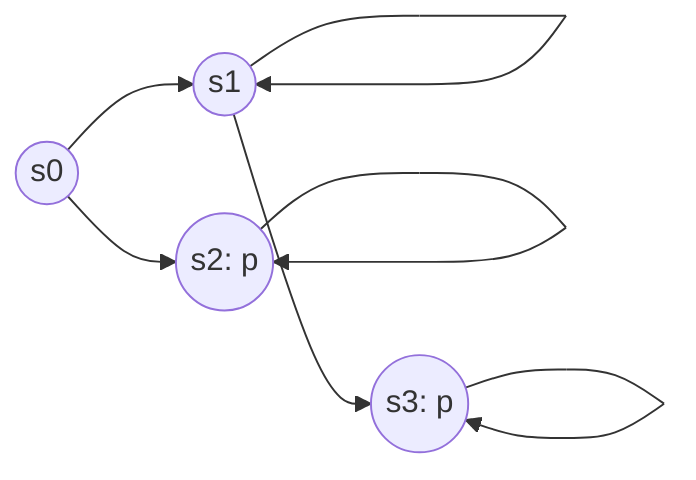

# CSCI5690 Automated Reasoning — 期中考试完整复习讲义（第二版·课件核对增强版）

> [!abstract] 本版的意义
> **已在上一版 2,045 行材料的基础上补充、改正**，不是简单另写一份目录。保留原有 SAT、FOL、FOT、CTL、Hoare Logic、Tutorial 联系与 22 道练习题；把这次上传的 Propositional Logic、SMT Solving & Transition Systems、BDD、SAT-Based Model Checking 作为**正式 Lecture** 重新纳入。新增 BDD/SMT/BMC 的核心算法和 20 道考试风格题（累计 **42 道**）。以课件原始 **slide 编号** 标注内容出处。
>
> **重要限制**：本次已实际核对 8 份新上传课件及此前复习资料。Lecture 3 SAT Solving 的原始 PDF 本次没有随附件重新上传，因此其章节沿用上一版材料与这个项目中已可见的相关讨论；不能声称逐页重新校验 Lecture 3。此前对话中提及的 worklist、SCC、PCTL 等保留，但明确标注哪些是 lecture 内、哪些是讨论扩展。
>
> [!warning] 关于「考题重点」标注
> **[P0] 必会**：能闭卷写定义/公式、手工执行算法、独立给出推导与反例；**[P1] 重点理解**：能解释适用条件、正确性和概念差异；**[P2] 识别和扩展**：先理解目的与框架。等级来自课件密度、算法复杂性及常见可出题形式，**不是老师公布的考试比重或预测出题概率**。

## 🔥 P0 优先复习导航：按「最可能需要动手」排序

| 优先顺序 | 原理/算法 | 必须做到什么 | 本文位置 | 对应训练题 |
|---|---|---|---|---|
| 1 | **BDD / ROBDD** | Shannon、Reduce 两规则、Apply、∃/∀、Image/PreImage、Symbolic BFS、fixed point | §9.1–9.9 | 28–33 |
| 2 | **SAT-Based Model Checking** | 写出 unrolling/BMC SAT 公式、区分 SAT/UNSAT、diameter、simple/k-induction、CBMC SSA | §11.1–11.10 | 34–39 |
| 3 | **CTL Model Checking** | CTL 时序语义、EX/EU/EG、μ/ν、手算状态集和反例 | §6.5–6.12、§7.1–7.4 | 11–14、33 |
| 4 | **SMT CDCL(T)** | Boolean abstraction、T-consistency、theory lemma、回溯与 refinement | §10.1–10.3 | 26 |
| 5 | **Transition System + Inductive Invariant** | state/transition 编码、init/consecution/safety 3 条 UNSAT VC | §10.4–10.6、§8.5–8.7 | 16、22、27、42 |
| 6 | **Hoare / WP / SP / VC** | 逆向 WP、正向 SP、loop invariant、ranking、GC | §8.3–8.11、§8.16–8.19 | 15–17、40 |
| 7 | **SAT/CDCL** | Tseitin、Resolution、unit propagation、DPLL/CDCL 手工跟踪 | §3.1–3.8 | 1–5 |
| 8 | **PL / FOL / FOT 基础** | SAT/valid、quantifier、interpretation/model、EUF、array、公理 | §2、§4、§5 | 6–10、23–25 |

> [!tip] 最省时间的复习路线
> **第一遍**只做上表的 P0 章节和题目。**第二遍**补 P1（Fairness、LTL automata、theory fragment、EqSat）。**第三遍**看 P2 和术语联系。碰到实际老师宣布的考试范围时，优先以公告覆盖本表的主观排序。

## 课件来源、核对范围与“讲义编号”说明

| 原始资料（本次已上传） | 源文件及 slide 范围 | 复习讲义对应章节 |
|---|---|---|
| Propositional Logic | `CSCI5690_2_pl_4up.pdf`，slides 1–33 | §2、§3.2 的 Tseitin 联系 |
| SAT Solving | **沿用上一版/历史对话**；本次未上传原始 PDF | §3 |
| First-Order Logic | `CSCI5690_4.1_Overview_of_FOL (2).pdf`，slides 1–36 | §4 |
| First-Order Theories | `CSCI5690_4.2_FOT_4up.pdf`，slides 1–54 | §5 |
| SMT Solving and Transition Systems | `CSCI5690_6_smt_transition_4up.pdf`，slides 1–74 | §10 |
| BDDs | `CSCI5690_7_bdds_4up.pdf`，slides 1–78（含 appendix） | §9 |
| Model Checking I | `CSCI5690_6_model_checking_1_4up.pdf`，slides 1–55 | §6、§7 的相关部分 |
| SAT-Based Model Checking (MC II) | `CSCI5690_6_model_checking_2_4up.pdf`，slides 1–41 | **§11**；§8.13 仅作概述 |
| Program Verification with Hoare Logic | `CSCI5690_7_pv_4up.pdf`，slides 1–88 | §8 |

本文件的 **§1–§16 是知识整理的章节编号，不等于校方每周 lecture 编号**。`4up` PDF 的一张文件页面通常排列 4 个原始 slides；引用的 slide numbers 是课件自身页码。若源课件展示了仅在图中可见的信息，本版也已结合图页中的算法流程、树、DAG 和 state graph 整理。

## 本版订正记录（看这个可避免误背）

> [!warning] 重要纠正与语义边界
> - 旧版把 BDD、SMT/EqSat 和 SAT-based MC 误放在「相关补充」或过弱的章节地位；现正式提升为 Lecture 的完整复习章。
> - 旧版「Model Checking II = Worklist / SCC」的来源标签不准确；现在 §7 明确是 **CTL 算法深化/讨论延伸**，真正第二份 MC 课件主体在 **§11 SAT-Based Model Checking**。
> - BDD slide 39–40 中 `∀x` 递归经过根变量 $y\ne x$ 的 Shannon 重组，应为 **OR of the two guarded branches**；不是把互斥 guard 的两分支 AND 在一起，见 §9.5。
> - MC I slide 29 的 “eventually acknowledged” LTL 示例印成 $G(req\to ack)$；对应 eventually 的式子应是 $G(req\to F\,ack)$，见 §6.11。
> - Program Verification slides 55/72 把 `assume` 弱前置条件与 `assert` 写法混在一起；对常用 partial-correctness guarded-command 语义分别是 $wlp(assume\ b,Q)=b\to Q$ 与 $wlp(assert\ b,Q)=b\land Q$，见 §8.16。
> - FOT 课件分了 **without / with array extensionality** 两套 axiom systems；不能无条件从 pointwise equality 推出 array equality，见 §5.9。
> - 讲义出现的 `wp` 有时指课程中的 **weakest liberal precondition**（partial correctness），而传统总正确性 WP 包含 termination。看具体语义使用，不要无条件混同。

## 总目录

1. 知识地图与统一 verification 思路
2. **Lecture 2 — Propositional Logic**：syntax/semantics、semantic argument、normal forms、Tseitin
3. **Lecture 3 — SAT Solving**：Resolution、DPLL/CDCL、Encodings
4. **Lecture 4.1 — FOL**：signature、interpretation、quantifiers、substitution、proof rules
5. **Lecture 4.2 — FOT**：theories、EUF、arrays、decidability、congruence closure
6. **Model Checking I**：Kripke、CTL/LTL、marking、fixed points、symbolic CTL
7. **CTL 算法深化**：Worklist、SCC、LTL Büchi（讨论和 MC I 延伸，**非 MC II 原课件主体**）
8. **Program Verification**：Hoare、WP/SP、VC、invariants、guarded commands、ranking
9. **BDDs（完整独立讲）**：Reduce、Apply、quantification、Image、Symbolic BFS
10. **SMT Solving & Transition Systems（完整独立讲）**：CDCL(T)、coding、EqSat/E-graph
11. **SAT-Based Model Checking（MC II，完整独立讲）**：BMC、diameter、induction、CBMC/SSA
12. Tutorials 与拓展：MiniSat、Z3、egg、CBMC、PCTL
13. 纵向贯通：SAT、SMT、BDD、MC、PV 的联系
14. 高频易错点和考题套路
15. **42 道考试风格题，附解析**
16. 临考公式与算法速查

---

# 1. 知识地图：课程的统一视角

## 1.1 四层框架

这门课的主要内容可以统一为以下链条：

```text
建模 / Representation
    命题公式、FOL formula、theory、transition system、program
                  ↓
语义 / Semantics
    truth assignment、structure、path、state、program execution
                  ↓
想证明的性质 / Property
    validity、entailment、safety、liveness、Hoare triple
                  ↓
自动化推理 / Algorithms
    SAT/CDCL、SMT、Model Checking、fixed point、VC/CBMC
                  ↓
结果 / Result
    proof / UNSAT / property holds
    or model / countermodel / counterexample / execution trace
```

**注意**：`model` 不是可以随意指代的某个“让 satisfaction 为真的东西”。它总是相对于某个逻辑、signature 和满足关系所允许的一类**语义对象**：命题逻辑中通常是 valuation；FOL 中通常是 structure（对开放公式还需要 assignment）；模型检测中通常是 Kripke structure / transition system。`theory` 是公理集合（连同规定语言的 signature），**本身一般不是它自己的 model**。

## 1.2 贯通五个核心问题

| 问题 | 形式 | 含义 | 常见解法 |
|---|---|---|---|
| SAT | $\exists v\;v\models F$ | 是否有 assignment 让公式为真 | DPLL/CDCL |
| Validity | $\forall v\;v\models F$ | 是否每个 assignment 都满足 | 检查 $\neg F$ 是否 UNSAT |
| Entailment | $\Gamma\models\varphi$ | 所有满足前提的 model 是否也满足结论 | 检查 $\Gamma\land\neg\varphi$ 是否 UNSAT（可表达时） |
| Model checking | $K,s\models\varphi$ | 给定系统的给定状态是否满足时序性质 | CTL marking / automata / fixed point |
| Program verification | $\{P\}\ C\ \{Q\}$ | 满足前置条件的程序执行是否保证后置条件 | Hoare logic、WP、VC、SMT |

> [!important] 跨主题最核心的技巧：把“对所有……成立”转化为“反例不存在”
> 例如 $\Gamma\models\varphi$ 当且仅当 $\Gamma\cup\{\neg\varphi\}$ 不可满足；要证明 $P\Rightarrow Q$，只需证明 $P\land\neg Q$ UNSAT；要找程序 bug，则求满足路径约束并违反断言的执行。

---

# 2. Lecture 2 — Propositional Logic（命题逻辑完整复习）

## 2.1 [P0] Syntax 与 Semantics

- **Syntax（语法）**：哪些符号串是合法公式；如何根据构造规则生成公式。例如 $p\lor(q\land\neg r)$。
- **Semantics（语义）**：给公式赋予真值所需的数学对象与求值规则。命题逻辑使用 valuation $v:\mathrm{Prop}\to\{\top,\bot\}$。
- **Satisfaction（满足）**：$v\models\varphi$ 表示在 valuation $v$ 下 $\varphi$ 为真。这不是一个“逻辑连接词”，而是 **meta-language** 中关于对象语言公式的关系。
- **Model（模型）**：对公式 $\varphi$ 而言，满足 $\varphi$ 的相应语义对象称作 $\varphi$ 的 model。对理论 $T$ 而言，满足其中全部公理的 structure 是 $T$ 的 model。

**四个量词不要混淆：**

$$
\begin{aligned}
\text{Satisfiable } F &\iff \exists v\;(v\models F),\\
\text{Valid } F &\iff \forall v\;(v\models F),\\
\text{Unsatisfiable } F &\iff \forall v\;(v\not\models F),\\
\Gamma\models\varphi &\iff \forall v\;(v\models\Gamma\Rightarrow v\models\varphi).
\end{aligned}
$$

这里 $v\models\Gamma$ 是指 $v$ 满足 $\Gamma$ 中**所有**公式。

## 2.2 [P0] 最常用的判定等价关系

$$
\boxed{F\text{ valid}\iff\neg F\text{ UNSAT}}
$$

$$
\boxed{\Gamma\models\varphi\iff\Gamma\cup\{\neg\varphi\}\text{ UNSAT}}
$$

$$
\boxed{F\equiv G\iff(F\oplus G)\text{ UNSAT}}
$$

**常见陷阱**：一个公式 SAT 不代表 VALID；一次 solver 找到一个满足赋值只证明 SAT；一次 solver 证明反例公式 UNSAT 才能得出相应的全称结论。 对有限前提集 $\Gamma$，可以把 $\Gamma$ 中各公式合取写为 $\bigwedge\Gamma$；若 $\Gamma$ 是无限集合，严格表达应使用 $\Gamma\cup\{\neg\varphi\}$ 的不可满足性，而不是假设有一条有限长度的“无限合取公式”。

## 2.3 [P0] Proof System、Soundness 和 Completeness

令 $\Gamma\vdash\varphi$ 表示存在形式证明，$\Gamma\models\varphi$ 表示语义蕴涵。

- **Soundness（可靠性）**：$\Gamma\vdash\varphi\implies\Gamma\models\varphi$。**能证明的东西都是真的**，不产生错误的定理。
- **Completeness（完备性）**：$\Gamma\models\varphi\implies\Gamma\vdash\varphi$。**所有真正语义成立的蕴涵原则上都有形式证明**。
- **Decidability（可判定性）**：存在算法对每个输入都**停机**并正确回答 yes/no。与 completeness 不同。

没有前提时，取 $\Gamma=\varnothing$，记为 $\vdash\varphi$ 与 $\models\varphi$。但“无前提”的情形只是一般定义的特例，并不是两套不同的概念。

**之前讨论过的一种反常证明方法**：任选单个 valuation $v_0$，只检查 $v_0\models F$ 就宣称 $F$ valid。对 VALIDITY 判定：它 **complete（凡 VALID 都会通过）但 unsound（SAT 而非 VALID 的公式也可能通过）**。这个例子区分了两种性质。

## 2.4 [P0] 常用逻辑等价变换

$$
\begin{aligned}
A\to B &\equiv \neg A\lor B,\\
A\leftrightarrow B &\equiv (\neg A\lor B)\land(\neg B\lor A),\\
\neg(A\land B)&\equiv\neg A\lor\neg B,\\
\neg(A\lor B)&\equiv\neg A\land\neg B,\\
A\lor(B\land C)&\equiv(A\lor B)\land(A\lor C).
\end{aligned}
$$

**考试常用**：证明蕴涵时用反例公式；转 CNF 时先消去 $\to,\leftrightarrow$，把否定推到原子上，再分配；但直接分配可能导致指数膨胀，因此 SAT 求解通常用 Tseitin transformation。

---

## 2.5 [P0] Lecture 2 原课件：Propositional Logic 的完整知识结构

> [!important] P0｜PL 基础是整门课解题的地基
> 课件：`CSCI5690_2_pl_4up.pdf`，原始 slide 5–33。必须能对一个具体公式写出 interpretation、判断 SAT/VALID、做 semantic argument、转 NNF/CNF、完成 Tseitin encoding。

### PL 语法与语义的严格递归

Atom 可以是 $\top,\bot$ 或 propositional identifier $P,Q,\ldots$；literal 是 atom 或其否定；formula 由 logical connectives $\neg,\land,\lor,\to,\leftrightarrow$ 递归构造。语法只决定 **well-formed**，并不决定公式是否真。

给定解释 $I:\mathrm{Prop}\to\{0,1\}$，原子由 $I$ 决定，复合公式递归求值。特别地：

$$I\models A\to B\iff (I\not\models A)\lor (I\models B),$$

所以 implication **只在前件真而后件假时为假**；“前件为假则 implication 为真”不是从自然语言因果解释得出，而来自 truth-functional semantics。

### Truth table / Semantic argument 两种证明法

真值表枚举 $n$ 个 propositional variables 的 $2^n$ 个解释，全部行取真则 VALID，至少一行取真则 SAT；全假则 UNSAT。

另一种课件明确介绍的方法是 **semantic argument**：为了证明 $F$ valid，假设存在某解释 $I\not\models F$，按布尔语义分解推到矛盾。分支需要**全部**矛盾才能证明 valid；有任一一致分支可构造 countermodel。

例如验证 $F=(P\land Q)\to(P\lor\neg Q)$：若 $I\not\models F$，则 $I\models P\land Q$ 与 $I\not\models P\lor\neg Q$。前者给 $P,Q$ 都真；后者要求 $P$ 假且 $\neg Q$ 假，立即矛盾，因此 $F$ valid。

### Equivalence、Entailment、Equisatisfiability：三个不同层级

$$
\begin{aligned}
F\equiv G &\iff \operatorname{Mod}(F)=\operatorname{Mod}(G),\\
F\models G &\iff \operatorname{Mod}(F)\subseteq\operatorname{Mod}(G),\\
F,G\text{ equisatisfiable}&\iff(F\text{ SAT}\Leftrightarrow G\text{ SAT}).
\end{aligned}
$$

等价比等可满足强得多。添加 Tseitin 辅助变量后，两个公式不在完全相同的 propositional signature 下，因此使用“投影满足赋值相同/等可满足”的表述。示例 $P\land Q$ 与 $R\land(R\leftrightarrow(P\land Q))$ 在后者把 $R$ 视为 fresh 变量时等可满足、并且把后者的 model 投影到 $P,Q$ 后恰好得到前者的 model。

### Soundness、Completeness、Decidability 分工

对证明方法，sound = 任何可证明结论都语义有效；complete = 任何语义有效结论都有证明。对**判定过程**，还需保证在每个输入上停机。命题逻辑 VALID/SAT 可判定（例如 $2^n$ 行真值表）；一般 FOL validity 不可判定。这些性质不能简单互相代替。

## 2.6 [P0] Lecture 2：NNF、DNF、CNF 与 Tseitin 的逐步转换

> [!important] P0｜典型手算：正规形式转换与辅助变量编码
> 对应 PL 课件 slides 21–29。特别注意「逻辑等价转换」与「等可满足编码」不一样。

**NNF (Negation Normal Form)**：只允许 $\neg$ 直接出现在 atom 前。转法：(i) 消去 $\leftrightarrow,\to$；(ii) 消去双重否定；(iii) De Morgan 推进 $\neg$ 到原子，直到不能推进。

**DNF**：若干个 conjunction of literals 的 disjunction：$\bigvee_i\bigwedge_j\ell_{ij}$。**CNF**：若干个 disjunction of literals 的 conjunction：$\bigwedge_i\bigvee_j\ell_{ij}$。空子句 $\bigvee\varnothing=\bot$；空 clauses 集合的合取 $\bigwedge\varnothing=\top$。

例题：

$$\neg(P\to\neg(P\land Q))\equiv\neg(\neg P\lor\neg(P\land Q))\equiv P\land(P\land Q)\equiv P\land Q.$$

另一个要分配才能转 CNF 的例子：

$$
(P\land Q)\lor(R\land S)
\equiv(P\lor R)\land(P\lor S)\land(Q\lor R)\land(Q\lor S).
$$

直接分配可能产生指数数量 clauses，因此引入 fresh atoms。令 $o_1\leftrightarrow(P\land Q),\ o_2\leftrightarrow(R\land S)$，编码 $o_1\lor o_2$ 和两条定义即可得到大小随 formula DAG 近似线性增长的 CNF；**它不是在原变量和新变量共同空间上的逐点等价**。

**Tseitin 三个局部子句模板（背熟）**：

$$
\begin{aligned}
z\leftrightarrow(x\land y)&:\quad (\neg z\lor x)\land(\neg z\lor y)\land(z\lor\neg x\lor\neg y),\\
z\leftrightarrow(x\lor y)&:\quad (\neg z\lor x\lor y)\land(z\lor\neg x)\land(z\lor\neg y),\\
z\leftrightarrow\neg x&:\quad (\neg z\lor\neg x)\land(z\lor x).
\end{aligned}
$$

考试时不能漏掉 **assert 顶层子公式的变量为 true**；否则全部定义式约束虽然一致，却不要求原来的整体公式成立。固定布尔门及其扇入上界时，编码规模 $O(|F|)$。

## 2.7 课件中的 bit-vector 建模与程序语义问题

> [!note] P1｜从 PL 过渡到 SAT/SMT
> 课件 slides 3–5, 30, 33：形式语言用于精确定义程序行为；固定宽度 machine integer 可以拆成 bit-vector $d_{n-1}\dots d_0$，运算电路再做 SAT 编码。数学整数运算和机器有符号溢出 **不是同一语义**。

- Unsigned $n$ 位表示 $\sum_{i=0}^{n-1}2^id_i$；常用固定宽度运算按 $2^n$ 取模（具体运算看机器语言定义）。
- Two's complement signed $n$ 位在通常解释下代表 $-2^{n-1}d_{n-1}+\sum_{i=0}^{n-2}2^id_i$。
- 课件用 C/C++ signed overflow 展示 undefined behavior；必须区分 **C/C++ undefined behavior 不受语言标准约束** 与“运行结果仅由编译器随意选一种定义行为”。后者不够严谨，编译器可做在 undefined-path 上看似反直觉的优化。此项作为修正提示而非考试必背内容。

---

# 3. Lecture 3 — SAT Solving [Lecture 核心]

## 3.1 [P0] SAT 问题与 CNF

- Literal：布尔变量 $p$ 或其否定 $\neg p$。
- Clause：literals 的析取，例如 $(p\lor\neg q\lor r)$。
- CNF：clauses 的合取 $C_1\land\cdots\land C_m$。
- $\square$（空 clause）为 False（UNSAT）；空 clause 集合的合取为 True。
- Assignment 可以是 total 或 partial；partial assignment 下某 clause 可能 already satisfied、falsified 或 unresolved。

**为什么 CNF**：Resolution、unit propagation 和现代 SAT solver 都以 clause 为主要工作单位；任意命题公式可以转换为 CNF（注意普通等价转换可能很大）。

### 手工 CNF 示例

$$
(p\to q)\land\neg(q\land r)
\equiv(\neg p\lor q)\land(\neg q\lor\neg r).
$$

$$
\neg(p\to q)\equiv p\land\neg q.
$$

## 3.2 [P0] Tseitin Transformation：线性规模的编码

给子公式增加 fresh variable $t$, 添加定义 $t\leftrightarrow\mathrm{subformula}$，并要求最顶层变量为 true。关键性质：新 CNF 与原公式**equisatisfiable（等可满足）**，不应简单声称是同一语言上的逻辑等价。

对 $t\leftrightarrow(a\land b)$：

$$
\boxed{(\neg t\lor a)\land(\neg t\lor b)\land(t\lor\neg a\lor\neg b)}
$$

对 $t\leftrightarrow(a\lor b)$：

$$
\boxed{(\neg t\lor a\lor b)\land(t\lor\neg a)\land(t\lor\neg b)}
$$

对 $t\leftrightarrow\neg a$：

$$
(\neg t\lor\neg a)\land(t\lor a).
$$

**完整例子**：$F=(p\land q)\lor r$。设 $a\leftrightarrow(p\land q)$，$t\leftrightarrow(a\lor r)$，将上面的子句全部加上单子句 $(t)$，得到 SAT solver 可输入的 CNF。

考试若问“为什么引入辅助变量？”：因为普通 CNF distributivity 可能指数级；definitional CNF 对固定有限元连接词基通常是 **$O(|F|)$ 大小**。

## 3.3 [P0] Resolution（归结）

规则：

$$
\frac{(A\lor p)\qquad(B\lor\neg p)}{A\lor B}.
$$

结论叫 resolvent。对 CNF 集合，不断得到空 clause $\square$ 即构造出 UNSAT 证明。命题 Resolution **sound** 且对反驳 UNSAT 是 **refutation-complete**。

**考试式例子**：

$$
\begin{aligned}
C_1&=(p\lor q),&C_2&=(\neg p\lor q),\\
C_3&=(p\lor\neg q),&C_4&=(\neg p\lor\neg q).
\end{aligned}
$$

由 $C_1,C_2$ 对 $p$ 归结出 $(q)$；由 $C_3,C_4$ 对 $p$ 归结出 $(\neg q)$；最后归结出 $\square$。所以四个 clauses 合取 UNSAT。

**注意**：一个 derived clause 由原 clauses 逻辑蕴涵；增加 learned clause 不改变原 CNF 的 model 集合在原变量上的约束。

## 3.4 [P0] Unit Propagation（单位传播）

Clause $(p)$ 迫使 $p=\top$。如果 $(\neg p\lor q)$ 且已得 $p=\top$，则该 clause 化简为 $(q)$，迫使 $q=\top$。如果某 clause 的全部 literals 都 False，则产生 conflict。

**例子**：

$$
(p)\land(\neg p\lor q)\land(\neg q\lor r)\land(\neg r).
$$

传播 $p\!=\!\top\Rightarrow q\!=\!\top\Rightarrow r\!=\!\top$，与 $\neg r$ 冲突，所以 UNSAT，完全不必 branching。

区别：Unit propagation 是逻辑强制赋值；decision 是试探赋值；二者都可形成 implication trail，但只有 decision 创造新的 decision level。

## 3.5 [P0] DPLL 算法

核心步骤：

```text
DPLL(F, current assignment):
    repeatedly apply unit propagation
    if a clause becomes empty: return UNSAT for this branch
    if all clauses satisfied: return SAT
    optionally eliminate pure literals (classical DPLL)
    choose an unassigned variable p
    if DPLL(F | p = true) SAT: return SAT
    return DPLL(F | p = false)
```

- **Branching**：完整搜索空间，由二元变量取值划分。
- **Unit propagation**：减少搜索。
- **Chronological backtracking**：普通 DPLL 返回上一个 decision 后尝试另一个分支。
- **Pure literal elimination**：某变量只以一种极性出现，可设置使其所出现的 clauses 满足；现代 CDCL 通常不依赖它作为核心步骤。

### DPLL 手工追踪题必须写什么？

1. 现有 clause / partial assignment。
2. 哪个 assignment 是 decision，哪个是 unit-propagated。
3. 每一步化简后的 unit clause 或 conflict。
4. 回溯分支后 SAT model 或 UNSAT 证据。

## 3.6 [P0] CDCL（Conflict-Driven Clause Learning）

CDCL = DPLL 的系统化加强，主要加入 conflict analysis、learned clauses、**non-chronological backjumping**、常见还有 restarts 与 branching heuristics。

执行流程：

```text
while true:
    Boolean constraint propagation (BCP)
    if conflict:
        if decision level == 0: return UNSAT
        analyze conflict; derive learned clause
        determine backjump level
        backjump and assert the learned clause
    else if every variable/required clause resolved: return SAT
    else choose a decision literal and increase level
```

### Implication Graph

- Nodes 是带有 decision level 的 literal assignments。
- Decision node 无理由 clause；propagated node 的 reason 是使它变成 unit 的 clause。
- Conflict node 汇集一个被 falsify 的 clause 的相关 assignments。
- **1-UIP（first unique implication point）**：从 conflict 逆向分析，找到当前 decision level 中在所有冲突相关路径上出现的第一个共同节点；常见学习子句使得它在最高 decision level 恰好保留一个 literal。实际求解器根据该学习子句回跳到其余 literals 的最高 decision level。

### 完整的小型学习子句示例

$$
C_1=(\neg a\lor b),\quad
C_2=(\neg a\lor c),\quad
C_3=(\neg b\lor\neg c).
$$

在 level 1 **decide** $a=\top$，传播 $b=\top$ 与 $c=\top$，因此 $C_3$ conflict。

Resolution 链：

$$
\begin{aligned}
(\neg b\lor\neg c)&\quad\text{与 }(\neg a\lor c)\Rightarrow(\neg b\lor\neg a),\\
(\neg b\lor\neg a)&\quad\text{与 }(\neg a\lor b)\Rightarrow(\neg a).
\end{aligned}
$$

学到 **$(\neg a)$**，回跳至 level 0 并传播 $a=\bot$。这不是单纯换一种决策，而是从冲突中发现了以后可以永久复用的约束。

> [!important] CDCL 与 Resolution 的关系
> 冲突分析学习 clause 通常可以看作对 reason clauses 的一系列 resolution；学习子句是原始公式的 logical consequence。CDCL 是一个 search algorithm；Resolution 是 proof rule / proof system，不能等同。

## 3.7 [P0] SAT Encoding（复习中常见）[与 Tutorial 1 关联]

问题先抽象出 Boolean variables，再把 constraints 逐一编码为 clauses。

### At least one / At most one / Exactly one

对 $x_1,\dots,x_n$：

- At least one：$(x_1\lor\cdots\lor x_n)$。
- At most one（pairwise）：$\bigwedge_{i<j}(\neg x_i\lor\neg x_j)$，需要 $\binom n2=O(n^2)$ 个二元子句。
- Exactly one：把以上两者合起来。

例如三个候选 $x_1,x_2,x_3$ 必须恰好选一个：

$$
(x_1\lor x_2\lor x_3)
\land(\neg x_1\lor\neg x_2)
\land(\neg x_1\lor\neg x_3)
\land(\neg x_2\lor\neg x_3).
$$

**Sequential counter、cardinality network、binary encoding** 等能够改变辅助变量和 clauses 数量。熟悉 encoding 的**约束语义、正确性、规模**比死记实现更重要。不能说 pairwise 是所有情况都最优。

### Implication 与 Bi-implication encoding

- $x\to y$：$(\neg x\lor y)$。
- $x\leftrightarrow y$：$(\neg x\lor y)\land(\neg y\lor x)$。
- $x\to(y\land z)$：$(\neg x\lor y)\land(\neg x\lor z)$。
- $(x\land y)\to z$：$(\neg x\lor\neg y\lor z)$。

### 验证 encoding 的方法

对每个约束写清：（i）合法实例应有 assignment；（ii）满足 CNF 的 assignment 能解码成合法实例；（iii）辅助变量可能存在多种赋值，通常是存在量化意义上的 equisatisfiable；（iv）计算变量数和 clauses 数。

## 3.8 [P0] SAT 高频考点

> [!question] 自测
> - 分辨 SAT / UNSAT / VALID、写出 UNSAT 的 Resolution proof。
> - 把公式转 CNF；给出 Tseitin CNF 并解释“等可满足”与“逻辑等价”。
> - 对 CNF 完成 unit propagation、DPLL branching 与 conflict trace。
> - 理解 CDCL 如何由冲突推导 learned clause 和回跳。
> - 为“恰好一个”等简单约束写 clauses，计算编码规模。

---

## 3.9 [P1] SAT 的复杂度与现代求解器优化 [相关扩展]

- **General SAT** 是 NP-complete；给定某个 Boolean assignment，可以在输入规模的多项式时间验证它是否满足 CNF，但没有已知对所有 SAT 实例都有效的 polynomial-time 求解方法。
- **2-SAT**（每 clause 最多 2 literals）可用 implication graph / SCC 多项式时间求解；**Horn SAT**（每 clause 最多一个 positive literal）可以用 forward chaining / propagation 多项式时间求解。它们是 SAT 的重要 tractable fragments。
- **Two-watched literals**：每个非单子句只维护两个被监视的 literals，赋值时只需检查相应 watched clauses；这是 BCP 的经典实现优化，而不是新的逻辑规则。
- **Branching heuristic / VSIDS-like activity**：倾向于选择在最近冲突中活跃的变量；与正确性无关但对性能影响很大。
- **Restarts**：重置当前 decisions，但保留 learned clauses；可以避免被不好的 decision prefix 长时间困住。不是“删掉所有证明进展”。
- **SAT 在 NP 与 Resolution/CDCL 的完备性不是一回事**：前者描述计算复杂度类别，后者描述某一证明/求解过程能否覆盖正确结论。

### Sequential-counter at-most-one 的线性编码示例

与 pairwise 的 $O(n^2)$ 个 clauses 不同，可引入 $s_1,\ldots,s_{n-1}$，表达某个前缀已经选择变量（下面是一个标准版本，假定 $n\ge2$）：

$$
\begin{aligned}
&(\neg x_1\lor s_1),\\
&\text{对 }2\le i\le n-1:\ (\neg x_i\lor s_i)\land(\neg s_{i-1}\lor s_i)\land(\neg x_i\lor\neg s_{i-1}),\\
&(\neg x_n\lor\neg s_{n-1}).
\end{aligned}
$$

这给出 $n-1$ 个 auxiliary variables 和 $3n-4$ 个 clauses，即 $O(n)$。再加 $(x_1\lor\cdots\lor x_n)$ 即可编码 exactly one。**代价是引入辅助变量、结构也更复杂；而 pairwise 在 $n$ 小时可能更简单**。不必假设所有教材都要求记住这个编码的精确子句模板，关键是能检查编码语义与规模。

---

# 4. Lecture 4.1 — First-Order Logic (FOL) [Lecture 核心]

## 4.1 [P1] 从命题逻辑到一阶逻辑

命题逻辑把 $p,q,r$ 看成没有内部结构的原子命题；FOL 允许描述**对象、对象之间的关系、作用于对象的函数、以及量词**。

例：

$$
\forall x\,\bigl(\mathrm{Human}(x)\to\mathrm{Mortal}(x)\bigr).
$$

这里 $x$ 是一个取遍论域元素的 object variable，不是一个 Boolean proposition。$\forall$ 是对象语言中的量词，$\models$ 则依然是我们在元语言中表达真值的符号。

## 4.2 [P0] Signature $\Sigma$：规定有哪些非逻辑符号

一种常用记法：

$$
\Sigma=(F,P,\operatorname{arity}),
$$

其中 $F$ 为函数符号集合，$P$ 为谓词符号集合；$\operatorname{arity}$ 给出每个符号的参数个数。**Constant symbols 可看作 arity 为 0 的函数符号**；有的讲义把常量集合 $C$ 单列，写为 $(C,F,P,\operatorname{arity})$，二者是记号约定，不是实质矛盾。

例如：

$$
\Sigma:\quad 0:\!0,\quad s:\!1,\quad +:\!2,\quad <:\!2.
$$

有的记号把 functions 与 predicates 分开写：$0,s,+\in F$，$<\in P$。Signature 定义的是**符号名称及其 arity**，并没有规定这些符号实际是什么函数、什么集合或关系。

## 4.3 [P0] Terms 与 Formulas 的构造

**Terms**（指称对象）：

1. 每个变量 $x,y,\ldots$ 是 term。
2. 每个常量 $c$ 是 term。
3. 若 $f$ 为 $n$ 元函数符号，$t_1,\dots,t_n$ 是 terms，则 $f(t_1,\dots,t_n)$ 是 term。

**Atomic formulas**：$P(t_1,\dots,t_n)$，以及带等号逻辑中的 $t_1=t_2$。

**Well-formed formulas**：由 atomic formulas 经过 $\neg,\land,\lor,\to,\leftrightarrow,\forall x,\exists x$ 递归构成。

**Terms 与 Formulas 的区别**：$f(a)$ 是一个 term，$P(f(a))$ 是一个 formula，不能用“true/false”给纯 term 赋值，也不能把公式当成对象元素，除非你另外构造了编码或高阶系统。

## 4.4 [P0] Free Variable、Bound Variable、Sentence

- 在 $P(x)\land\exists y\,R(x,y)$ 中，$x$ 自由，$y$ 被其量词绑定。
- **Sentence（closed formula）**：没有自由变量的公式，例如 $\forall x\exists y\,R(x,y)$。
- **Open formula**：存在自由变量，语义依赖 assignment。
- **Variable capture**：做 substitution 必须避免使原先的自由变量意外落入量词绑定范围。

例：在 $\forall y\,P(x,y)$ 中直接用 $y$ 替换自由的 $x$，得到 $\forall y\,P(y,y)$，通常**不是**合法的 capture-avoiding substitution 的结果；应先把 bound variable $y$ alpha-rename 成 fresh $z$，再得到 $\forall z\,P(y,z)$。

## 4.5 [P0] Structure $\mathcal M$ 与 Variable Assignment $s$

对 signature $\Sigma$，一个 $\Sigma$-structure 通常是：

$$
\mathcal M=(D,\{f^{\mathcal M}\}_{f\in F},\{P^{\mathcal M}\}_{P\in P}),
$$

其中：

- $D$ 是非空 domain / universe（经典常用 FOL 约定）。
- $n$ 元函数符号解释为**全函数** $f^{\mathcal M}:D^n\to D$。
- $n$ 元谓词符号解释为关系 $P^{\mathcal M}\subseteq D^n$。
- 常量符号 $c$ 解释为 $c^{\mathcal M}\in D$。
- 带内建 equality 的普通 FOL 中 $=$ 一般被解释为 $D$ 上的真实相等关系。

**Assignment / valuation of variables**：

$$
s:\operatorname{Var}\to D.
$$

FOL 解释开放公式时常使用 **interpretation $\mathcal I=(\mathcal M,s)$** 的说法。有些教材把 interpretation 用来指 $\mathcal M$（对非逻辑符号的解释）本身。是否把 assignment 包进去是**术语习惯**；数学上必须明确你的 satisfaction 关系究竟依赖 $\mathcal M$ 还是 $(\mathcal M,s)$。

## 4.6 [P0] Terms 的求值

记 $\llbracket t\rrbracket_{\mathcal M,s}\in D$：

$$
\begin{aligned}
\llbracket x\rrbracket_{\mathcal M,s}&=s(x),\\
\llbracket c\rrbracket_{\mathcal M,s}&=c^{\mathcal M},\\
\llbracket f(t_1,\ldots,t_n)\rrbracket_{\mathcal M,s}&=
 f^{\mathcal M}(\llbracket t_1\rrbracket_{\mathcal M,s},\ldots,\llbracket t_n\rrbracket_{\mathcal M,s}).
\end{aligned}
$$

随后用这些对象决定 atomic formulas 的真值。例如：

$$
\mathcal M,s\models P(t)
\iff \llbracket t\rrbracket_{\mathcal M,s}\in P^{\mathcal M}.
$$

## 4.7 [P0] Satisfaction Relation：递归定义（**必背**）

$$
\begin{aligned}
\mathcal M,s\models\neg\varphi
&\iff \mathcal M,s\not\models\varphi,\\
\mathcal M,s\models\varphi\land\psi
&\iff \mathcal M,s\models\varphi\ \text{且}\ \mathcal M,s\models\psi,\\
\mathcal M,s\models\forall x\,\varphi
&\iff \forall d\in D:\ \mathcal M,s[x\mapsto d]\models\varphi,\\
\mathcal M,s\models\exists x\,\varphi
&\iff \exists d\in D:\ \mathcal M,s[x\mapsto d]\models\varphi.
\end{aligned}
$$

**$s[x\mapsto d]$ 只更新 $x$ 的取值**，其他变量取值不变。对 sentence，真值不依赖自由变量赋值，因此写 $\mathcal M\models\varphi$。

### 真正动手算一个 FOL model

令 $D=\{0,1\}$，$c^{\mathcal M}=0$，$f^{\mathcal M}(0)=1$，$f^{\mathcal M}(1)=0$，$P^{\mathcal M}=\{1\}$。

- $\mathcal M\models P(f(c))$，因为 $f(c)$ 的值是 1。
- $\mathcal M\models\forall x\,(P(x)\lor P(f(x)))$，因为 $x=0$ 时后半真，$x=1$ 时前半真。
- $\mathcal M\not\models\forall x\,P(x)$，因为 $0\notin P^{\mathcal M}$。
- $\mathcal M,s\models P(x)$ 依赖 $s(x)$，不能在未指定 $s$ 时武断说它真或假。

## 4.8 [P0] Model、Validity、Satisfiability、Entailment 在 FOL 中

- $\mathcal M\models\varphi$：structure $\mathcal M$ 满足 sentence $\varphi$；若为开放公式，要给出变量 assignment 或采用统一的 universal-closure 约定。
- **Satisfiable**：至少有一个合适的 structure（及必要的 assignment）使公式真。
- **Valid**：所有适当的 structures（及 assignment）都满足。
- $\Gamma\models\varphi$：每个 $\Gamma$ 的 model 都满足 $\varphi$。

**关键反例**：

$$
\forall x\exists y\ R(x,y)
\not\models
\exists y\forall x\ R(x,y).
$$

前者允许为每个 $x$ **分别选择** 一个 $y$；后者要求存在**同一个** $y$ 对所有 $x$ 有效。取 $D=\{0,1\}$，$R^{\mathcal M}=\{(0,0),(1,1)\}$，前者真，后者假。

另一个典型题：

$$
\forall x\,(P(x)\to Q(x)),\quad \forall x\,P(x)
\models\forall x\,Q(x).
$$

证明：任取模型 $\mathcal M$ 及任意 $d\in D$，由前提一得 $P(d)\to Q(d)$，由前提二得 $P(d)$，故 $Q(d)$，从而全称成立。

## 4.9 [P0] 量词逻辑的高频变换

$$
\begin{aligned}
\neg\forall x\,\varphi&\equiv\exists x\,\neg\varphi,\\
\neg\exists x\,\varphi&\equiv\forall x\,\neg\varphi,\\
\forall x\,(\varphi\land\psi)&\equiv(\forall x\,\varphi)\land(\forall x\,\psi),\\
\exists x\,(\varphi\lor\psi)&\equiv(\exists x\,\varphi)\lor(\exists x\,\psi).
\end{aligned}
$$

注意：不能任意交换量词。$\forall x\exists y$ 与 $\exists y\forall x$ **一般不等价**；同类量词通常可交换，如 $\forall x\forall y$。量词外移、变量重命名时必须检查变量是否自由出现。

## 4.10 [P1] FOL 的元性质 [视授课具体要求掌握]

经典一阶逻辑 Gödel completeness theorem：在适当的可靠一阶证明系统下，$\Gamma\models\varphi$ 当且仅当 $\Gamma\vdash\varphi$。这**不意味着**存在一个对所有 FOL 公式都终止的 validity decision procedure。一般 FOL validity 是不可判定的，但可证明性可以被枚举（有效可枚举的公理化体系下）。

有时课程会提到 compactness：若理论的所有有限子集都有 model，则整个理论有 model。若老师未涉及证明，识别定义与结论即可，不应擅自当作必考定理。

> [!question] FOL 自测
> 给定一个 signature、一个具体 $\Sigma$-structure 以及 assignment：
> - 分清什么是 term、atomic formula、sentence。
> - 计算 term 的值、判断含 $\forall/\exists$ 的 formula 真伪。
> - 写一个 structure 作 countermodel，以否定某个 entailment。
> - 严格解释 $\mathcal M$、$s$、$\models$、$\vdash$ 的区别。

---

## 4.11 [P1] FOL 课件中原先遗漏：Proof Systems 与 Derivability

> [!important] P1｜区分 $\vdash$ 与 $\models$，理解 inference rules
> `CSCI5690_4.1_Overview_of_FOL (2).pdf` slides 25–32。

**Inference rule**：由零个或多个 premises 以及一个 conclusion 组成；零前提规则是 **axiom**。Proof / derivation 是一棵应用规则得到结论的树。若某分支叶子只是未经证明的 assumption，必须明确写在哪个 assumptions 下可导。

$$\Gamma\vdash\varphi\qquad\text{（syntactic derivability）},\qquad
\Gamma\models\varphi\qquad\text{（semantic entailment）}.$$

常见规则包括 $\land$ introduction/elimination、modus ponens、double-negation elimination、universal instantiation（$\forall x.P\Rightarrow P[t/x]$，需安全代换），以及 existential generalization（$P[t/x]\Rightarrow\exists x.P$）。**不是看到 $\forall$ 就可以随意把一个自由变量改成别的变量**；必须检查 scope 和 capture。

## 4.12 [P0] Free Variables、Capture-Avoiding Substitution 与 PNF

> [!important] P0｜量词作用域及 substitution 手算易出错
> FOL 课件 slides 9–12, 22–24, 31, 35。

递归规则：$fv(\forall x.F)=fv(F)\setminus\{x\}$、$fv(\exists x.F)=fv(F)\setminus\{x\}$；$fv(F\land G)=fv(F)\cup fv(G)$。

**安全代换** $F[t/x]$ 只替换自由出现的 $x$，且要先做 alpha-renaming，避免把 term $t$ 中自由的变量意外绑定。例如 $(\forall y.P(x,y))[y/x]$ 应先改名 $\forall z.P(x,z)$ 再得到 $\forall z.P(y,z)$，而不是 $\forall y.P(y,y)$。

**PNF (Prenex Normal Form)**：将所有量词放到公式最前方的 $Q_1x_1\dots Q_nx_n.G$，$G$ quantifier-free。变换前要调整 bound variables，并满足相应 free-variable side conditions，不能机械把量词跨过不相关连接词而改变含义。

$$\neg\forall x.F\equiv\exists x.\neg F,\qquad \neg\exists x.F\equiv\forall x.\neg F.$$

**句子 (sentence)**：无 free variables；**ground formula**：无 free variables、无 quantifiers（按这份课件的定义）；区分“闭公式”与“无变量项”，二者并不总是同义。

## 4.13 [P0] 反模型构造策略与两个量词考法

> [!tip] P0｜遇到「是否 valid」先尝试一个两元素 domain

证明 $\forall x.P(x)\leftrightarrow\neg\exists x.\neg P(x)$ 是 valid：沿语义定义双向推导，或者假设 biconditional 失败，分两种情况均推出矛盾。

证明 $\forall x.P(x,x)\to\exists x\forall y.P(x,y)$ **invalid**：取 $D=\{0,1\}$，只让关系 $P$ 在 $(0,0),(1,1)$ 为真。每个元素都与自己有关系，但不存在某个元素与所有元素有关系。这是课件 slide 21 的 countermodel。

**考试模板**：写 signature / domain / functions and predicates 的具体解释；对前件逐个量词验证；对后件给出失败 witness 或说明为何所有候选都失败。切忌只写“看起来不成立”。

---

# 5. Lecture 4.2 — First-Order Theories (FOT) [Lecture 核心]

## 5.1 [P0] 从 FOL Language 到 First-Order Theory

FOL 是一套**一般性的逻辑语言、推导规则与语义框架**；First-Order Theory 用这套语言描述某个特定领域，例如 group、linear order、arithmetic、arrays 或 uninterpreted functions。

老师课件中如果将 theory 写为：

$$
\boxed{T=(\Sigma,A)}
$$

即 **signature $\Sigma$ + 一组 $\Sigma$-sentences 作为 axioms $A$**，这是 axiomatically presented theory 的合理、实用定义。

在 model theory 或 proof theory 的另一种术语习惯中，`theory` 有时特指一个**在语义或证明后果下封闭的公式集合** $\operatorname{Cn}(A)$。因此：

- **Axiom set / presentation**：$A$，或连 signature 记成 $(\Sigma,A)$。
- **Deductive / semantic closure**：$\operatorname{Cn}(A)=\{\varphi:A\models\varphi\}$（在逻辑完备时也可写 $A\vdash\varphi$）。
- **Closed formula**：没有自由变量。
- **Closed theory**：通常表示在逻辑后果下封闭（但具体课件若另有定义以课件为准）。

> [!important] Theory 并不是“有 axioms 因而自己变成 semantics”
> 先为 FOL 给出何谓 $\Sigma$-structure、何谓 $\models$，然后 axioms $A$ 从所有 $\Sigma$-structures 中**筛选出**满足它们的那一类：
>
> $$\operatorname{Mod}(T)=\{\mathcal M:\mathcal M\text{ is a }\Sigma\text{-structure and }\mathcal M\models A\}.$$
>
> 所以 theory 的表示主要位于 syntactic side；其 **class of models** 在 semantic side。

## 5.2 [P1] 举一个真正的 Theory 例子：群公理

取 signature $\Sigma=\{\cdot:2,e:0,\operatorname{inv}:1\}$，公理：

$$
\begin{aligned}
\forall x,y,z:\ &(x\cdot y)\cdot z=x\cdot(y\cdot z),\\
\forall x:\ &e\cdot x=x\land x\cdot e=x,\\
\forall x:\ &x\cdot\operatorname{inv}(x)=e\land\operatorname{inv}(x)\cdot x=e.
\end{aligned}
$$

实际构造一个 model：$D=\mathbb Z$，$\cdot^{\mathcal M}$ 解释为整数加法，$e^{\mathcal M}=0$，$\operatorname{inv}^{\mathcal M}(x)=-x$。它满足公理，所以是 group theory 的 model。

**同一 signature 可有很多 structures，只有满足 axioms 的才是这一 theory 的 models**。一个 theory 也可能没有 model（inconsistent）；经典语义中若 $\operatorname{Mod}(T)=\varnothing$，则 $T\models\varphi$ 对任意 $\varphi$ 都真（vacuous entailment），这不是说出现了一个神奇的 contradiction model。

## 5.3 [P0] Equality、Congruence 与 EUF

标准 equality 支持：

$$
\begin{aligned}
&x=x&&\text{(reflexivity)},\\
&x=y\Rightarrow y=x&&\text{(symmetry)},\\
&x=y\land y=z\Rightarrow x=z&&\text{(transitivity)},\\
&x_i=y_i\ (1\le i\le n)\Rightarrow f(x_1,\dots,x_n)=f(y_1,\dots,y_n)&&\text{(function congruence)}.
\end{aligned}
$$

对 predicates，也有 substitutivity：若对应 arguments 都相等，则 predicate 的真值一致。

**EUF** = Equality with Uninterpreted Functions。`uninterpreted` 不是“函数无意义”或者“可随时任意改变值”，而是函数只受固定函数性和 equality congruence 等约束，没有额外算术解释。

示例：

$$
a=b\ \land\ f(a)\ne f(b)
$$

在 EUF 中 UNSAT，因为 $a=b$ 必须推出 $f(a)=f(b)$。与 $a\ne b$ 不同：$a\ne b$ **不要求** $f(a)\ne f(b)$；uninterpreted functions 不保证 injective。

**Congruence closure**：给定 ground equalities，可用 union-find 风格的等价类维护以及函数应用的 congruence 传播；识别最终某个 disequality 的两端是否被归入同一类。这个概念也连接 Tutorial 3 的 E-graph。

## 5.4 [P1] Theories in SMT [与 Z3 Tutorial 关联]

SAT 处理 Boolean structure；SMT (Satisfiability Modulo Theories) 进一步要求 Boolean atoms 在背景 theory 下可同时成立。

例如：

$$
(x>3)\land(x<2)
$$

布尔抽象会把 $(x>3)$ 和 $(x<2)$ 当成两个独立的 Boolean atoms，两者都设 true 看上去不矛盾；但是整数/实数算术 theory 使它 UNSAT。

常见背景 theories：

| Theory | Signature / 约束例子 | 关键差异 |
|---|---|---|
| EUF | $f(a)=b$，$a=c$ | 只用 equality 与 congruence |
| LIA | $x+y\le 4$, $x,y\in\mathbb Z$ | 线性**整数**算术 |
| LRA | $2x-y>0$, $x,y\in\mathbb R$ | 线性**实数**算术 |
| Bit-vectors | $x:\mathrm{BV}_{8}$ | 有限位宽，运算可能 wrap around |
| Arrays | $\operatorname{select}(a,i)$、$\operatorname{store}(a,i,v)$ | 读写一致性与 extensionality |

**SAT solver 与 SMT solver 的关系**：很多现代 SMT 架构会使用 SAT/CDCL 来搜索 Boolean assignment，再让 theory solver 检查 theory consistency，并反馈 theory lemmas。但不是所有 SMT solver 都必须采取同一种架构。

## 5.5 [P0] Arrays 的公理性语义

设 $a$ 是一个从 index sort 到 value sort 的 array，定义读 $\operatorname{select}(a,i)$ 和函数式更新 $\operatorname{store}(a,i,v)$：

$$
\operatorname{select}(\operatorname{store}(a,i,v),j)
=
\begin{cases}
v,&i=j,\\
\operatorname{select}(a,j),&i\ne j.
\end{cases}
$$

数组不仅能存**一个** key-value pair。`Store(a,i,v)` 返回一整个新数组；再次 Store 可以更新其他位置：

$$
a_1=\operatorname{store}(a,1,10),\quad
a_2=\operatorname{store}(a_1,2,20).
$$

这对应你之前问过的“a[1]=...、a[2]=...”——**当然可以描述多个 index**。有些理论还包含 **extensionality**：两个数组在所有 index 的取值都相同，则两个数组相同。

## 5.6 [P1] FOL、FOT、Universal Algebra、Term Algebra 的联系 [概念整合]

```text
Σ (functions / constants / predicates and arities)
    |
    +--> syntax: terms TΣ(X), formulas L(Σ)
    |          |
    |          +--> axioms A --> first-order theory (Σ, A)
    |
    +--> semantics: Σ-structures M
                  |
                  +--> M ⊨ A  --> Models of T

函数符号部分 Σ_F:
    terms TΣ_F(X) form an absolutely free term algebra
    equations E generate the least congruence ≡E
    quotient TΣ_F(X) / ≡E gives the free algebra modulo E
    (with the usual equational-theory qualifications)
```

**Universal algebra** 的主角是（通常仅由操作符构成 signature 的）algebras，研究 algebraic identities 和 homomorphisms；**Model theory** 可以研究具有 predicates、functions、quantifiers 的更广泛 FOL structures。Term algebra 是 syntax 构成的 algebra；一旦将 term 构造器作为 operations，它同时也是一个具体的 semantic algebraic object。不能绝对地说一个数学对象只能放在 syntax 或 semantics 一边：看它在当前形式化里的**扮演角色**。

- **Term algebra**：形式项组成的代数，如 $f(f(x))$ 与 $f(x)$ 先看作不同的语法项。
- **Equational theory $E$**：指定如 $x+0=x$ 的恒等式。
- **Congruence $\equiv_E$**：被这些 equations 生成、且对所有操作符封闭的最小等价关系。
- **Quotient / free algebra**：通过将相等项归类得到 $T_\Sigma(X)/{\equiv_E}$；更精确说是给定 equational variety 中以 $X$ 作为 generators 的 free algebra。
- **E-graph**（相关补充）：使用共享结构紧凑存储许多 ground terms 的 equality classes，并在 merge 后恢复 congruence。它是 representation/data structure + algorithms，不应无条件认作整个 infinite quotient algebra 的完整显式表示。

> [!question] FOT 自测
> - 从 signature 与 axioms 定义 theory，解释一组 models 如何产生。
> - 给出一个 group theory / partial order theory 的模型和非模型。
> - 利用 congruence 判断 EUF 约束 SAT/UNSAT。
> - 区分 FOL logic、first-order theory、structure、model、interpretation。
> - 理解在算术与 bit-vector 中写同一个表达式可能得出不同结论。

---
## 5.7 [P1] First-Order Theory 的两种课件表述方式

> [!important] P1｜老师两份讲义的术语需要同时记住
> FOL slides 33–34 以 $(\Sigma,A)$ 定义公理化理论；FOT slides 5–8 也使用“signature + T-models”的语义化表述，并说可用 axioms 提供含义。

- **Axiomatic presentation**：$T=(\Sigma,A_T)$，$A_T$ 为 closed $\Sigma$-formulas。
- **Model class presentation**：指定 $\Sigma$ 和一类允许的 $\Sigma$-structures $\mathcal K_T$。
- 当 $\mathcal K_T=\operatorname{Mod}(A_T)$ 时，两种表示描述同一 model class；并非任意结构类都能在指定逻辑中用一组公理刻画。
- $F$ is **T-SAT** iff $\exists M\in\mathcal K_T,\exists\rho:\ M,\rho\models F$；$F$ is **T-valid** iff $\forall M\in\mathcal K_T,\forall\rho:\ M,\rho\models F$。若式子是 sentence，$\rho$ 不影响其真值。

**Fragment** 是在某背景 theory 内施加语法限制（例如 QF = 无量词；QF conjunctive = 无量词且是约束的合取）。full theory 不可判定，不意味着 QF fragment 不可判定。

## 5.8 [P0] Theory Solvers 的基础算法与可判定性对照

> [!important] P0｜EUF congruence closure、QF fragments；P1｜各 theory 可判定性
> FOT slides 9–12, 16–24, 27–40。

| 理论 | 典型符号 | 完整带量词理论 | Quantifier-free | 课件要点 |
|---|---|---|---|---|
| Equality / EUF | $=,f,g$ | 不可判定 | 可判定 | ground congruence closure；QF conjunctive 很高效 |
| Peano arithmetic | $+,\times$ on $\mathbb N$ | 不可判定 | 不可判定（一般非线性整数） | 任意乘法导致根本差异 |
| Presburger arithmetic | $+$ on $\mathbb N$ | 可判定 | 可判定 | 没有变量间乘法 |
| Linear integer arithmetic | $+,<,$ 常数乘法 on $\mathbb Z$ | 可判定 | 可判定 | QF 可用整数约束法，通常比 LRA 困难 |
| Linear rational arithmetic | 有理数上线性运算 | 可判定 | 可判定 | QF conjunction 可用 LP/simplex |
| Real closed fields | $+,\times$ on $\mathbb R$ | 可判定 | 可判定 | 比线性实数算术一般昂贵 |
| Arrays | $select,store$ | 讲义所述完整理论不可判定 | 可判定 | 不同 array theory 是否含 extensionality 要写清 |
| Fixed-width bit-vectors | 位宽固定、位运算 | 有限域可判定 | 可判定 | bit-blasting 连接 SAT |

在 EUF 下处理 $a=b,b=c,d=e,b=s,d=t,a\ne s$：按 equality 合并等价类，得 $[a]=[b]=[c]=[s]$、$[d]=[e]=[t]$；由于 $a\ne s$ 两端在同一类，故 UNSAT。若再有 $f(a,g(d))\ne f(b,g(e))$，由 $a=b,d=e$ 得 $g(d)=g(e)$，进而 congruence 得两个 $f$-terms 相等，出现冲突。

```text
CongruenceClosure(equalities, disequalities):
    初始化每个 ground term 的等价类
    对每条 s=t 执行 union(class(s), class(t))
    repeat:
        寻找同一函数符号 f 的节点 f(a1,...,an)、f(b1,...,bn)
        如果每个 class(ai)=class(bi)，合并这两个节点的类
    until 无变化
    若某个 disequality s!=t 的两端同类: UNSAT
    否则该组 ground EUF constraints SAT
```

实际算法用 union-find、signature table 和增量合并优化，不需暴力枚举所有可能等式。

## 5.9 [P1] Arrays：不带 Extensionality 与带 Extensionality

> [!important] P1｜两种 array 语义是 FOT slides 49–51 的明确区别

`TA` 具有 select/store 读写公理，例如 $select(store(a,i,v),i)=v$，以及 $j\ne i\Rightarrow select(store(a,i,v),j)=select(a,j)$。仅有这两条读写公理 **不能推出整个 array 相等**：

$$select(a,i)=v\quad\not\models_{T_A}\quad store(a,i,v)=a.$$

加入 extensionality 得 $T_A^=$：

$$\forall a,b.\bigl(\forall i.\ select(a,i)=select(b,i)\bigr)\to a=b.$$

这样上述 array equality 可以推导。在实际 SMT-LIB `Array` 理论中通常包含 extensionality；考试若按讲义提问，务必指出 `TA` / `TA=` 的区别。对于 QF 公式两种相关片段可判定，但完整带量词的 array theory 此处讲义标为不可判定。

## 5.10 [P1] Theory Abstraction 的适用性边界

> [!note] P1｜FOT slides 13–15 的 program equivalence 例题

在 program equivalence 中，用 uninterpreted function `sq(x)` 代替具体乘法 `x*x`，可以只依赖参数相等性推输出相等，无需 bit-blast 32-bit 乘法；但如果程序内部变换用 XOR 等算子，抽象掉 XOR 的实际 algebraic properties 可能无法证明等价。**抽象保留哪些事实**，直接决定是否能成功证明性质；“更抽象”往往便宜，但也更不精确。

---

# 6. Lecture 6.1 — Model Checking I [Lecture 核心]

## 6.1 [P1] Model Checking 的问题形式

**SAT** 通常问一个 Boolean formula 有没有满足赋值；**Model Checking** 则给定一个数学化的系统 $K$ 和时序性质 $\varphi$，判断：

$$
\boxed{K,s\models\varphi}
$$

其中 $s$ 是一个系统状态。若问题是整个系统 $K\models\varphi$，一般意味着规定的**所有 initial states** 都满足 $\varphi$（不同教材会约定一个特定起点或一组起点，审题必须确定）。

## 6.2 [P0] Transition System 与 Kripke Structure

常见表示：

$$
K=(S,S_0,R,L),
$$

- $S$：states 集合。
- $S_0\subseteq S$：initial states。
- $R\subseteq S\times S$：transition relation，$sRt$ 表示可以一步从 $s$ 到 $t$。
- $L:S\to2^{AP}$：labeling function，标出各状态满足哪些 atomic propositions。

有的课件写 $TS=(S,Act,\to,I,AP,L)$，包含 actions。不要因为 tuple 元素不同就误认为不同理论；关键是**状态、初始状态、转移、标签**。

CTL/CTL* 的常规 Kripke 语义一般假定 $R$ **total**：每个状态至少存在一个后继，因此每条 maximal path 可以视作 infinite path。如系统允许 deadlock，必须说明补 self-loop、改用 finite-trace semantics，或者显式给出 deadlock convention。

### Paths 与 Reachability

Path：$\pi=s_0s_1s_2\cdots$，满足 $s_iRs_{i+1}$。从初始集合出发的 reachable states：

$$
\operatorname{Reach}(S_0)=\{s:\exists\text{ finite path from some }s_0\in S_0\text{ to }s\}.
$$

**注意**：transition system 与 Kripke structure 是被检查的数学模型，而不是逻辑的 syntax formula。它自身也可以有一套“程序/系统描述到状态图”的语义映射。例如源程序的 operational semantics 生成 transition relation。这是**两个不同抽象层**，不矛盾。

## 6.3 [P0] Safety、Liveness 与 Counterexample

- **Safety**：直观地说“坏事永远不发生”。有限前缀一旦见到坏事就足以证伪。例 $AG\neg\mathrm{error}$。
- **Liveness**：直观地说“好事最终发生”。仅靠某个有限前缀不一定能确定违反。例 $AF\mathrm{done}$（对所有路径最终 done）。
- **Reachability**：存在一条路径能到某状态，例如 $EF\mathrm{error}$。
- **Counterexample trace**：违反性质的执行路径/循环（lasso）。对某些 universal CTL/LTL 性质，反例可以是一条具体路径；对任意 CTL 公式，反例有时需要 tree-like witness，而非总能用单路径表示。

注意 $EF\,p$ 与 $AF\,p$ 区别：一个“存在一条成功路径”，另一个“所有路径都最终成功”。

## 6.4 [P0] CTL、LTL 与 CTL* 的关系

| Logic | Formula 主要在哪里求值 | 语法特点 | 常见检查手段 |
|---|---|---|---|
| CTL | **state** | 每个时序运算都在相应的路径量词 $A/E$ 作用下，例如 $EX$, $EU$, $AG$ | 按子公式 bottom-up labeling、fixed points |
| LTL | **path**（系统判定时通常对所有初始路径） | $X,F,G,U$ 等沿单条路径解释，不含 CTL 风格的自由交替路径量词 | negation + Büchi automata + product + accepting cycle |
| CTL* | **state + path** | 允许更自由地嵌套 $A/E$ 与路径时序公式 | state-formula 分解 + path / automata procedure |
| PCTL | **state** | $P_{\bowtie q}[\psi]$ 比较路径集合的概率 | state labeling + 概率求解 |

- **CTL 与 LTL 互不包含**（按通常的 state/system property 表达性比较），两者都可嵌入 CTL* 的适当片段。
- $AG\,EF\,p$ 是合法 CTL：对所有 reachable/全路径状态，存在通往 $p$ 的后续路径。
- $A(GF\,p)$ 一般是 **CTL***（不是 CTL 的基本语法），描述每条路径上 $p$ 无穷多次出现。
- CTL 不能简单把 $A$ 和 $E$ 删掉，否则量词意义会消失。

## 6.5 [P0] CTL 的语义：从最容易的开始

对 state formula $\varphi$，记 $\operatorname{Sat}(\varphi)=\{s:K,s\models\varphi\}$。路径量词：

- $E$：**there exists a path**。
- $A$：**for all paths**。

时间算子：

- $X$ = ne**X**t（下一步）。
- $F$ = **F**inally / eventually（未来某时刻）。
- $G$ = **G**lobally / always（未来每一步）。
- $U$ = **U**ntil（直到）。

典型语义：

$$
\begin{aligned}
K,s\models EX\varphi
&\iff \exists t:(sRt\land K,t\models\varphi),\\
K,s\models AX\varphi
&\iff \forall t:(sRt\Rightarrow K,t\models\varphi),\\
K,s\models EF\varphi
&\iff\exists\pi\text{ starting at }s,\exists i\ge0:\pi_i\models\varphi,\\
K,s\models AF\varphi
&\iff\forall\pi\text{ starting at }s,\exists i\ge0:\pi_i\models\varphi,\\
K,s\models EG\varphi
&\iff\exists\pi\text{ starting at }s,\forall i\ge0:\pi_i\models\varphi,\\
K,s\models AG\varphi
&\iff\forall\pi\text{ starting at }s,\forall i\ge0:\pi_i\models\varphi.
\end{aligned}
$$

**Strong until** $E[\varphi\ U\ \psi]$：存在一条路径、存在某个有限 $k\ge0$，使 $\psi$ 在 $k$ 成立且 $\varphi$ 在所有 $j<k$ 成立。$A[\varphi\ U\ \psi]$ 则要求**每条路径**最终遇到 $\psi$，之前保持 $\varphi$。

> [!warning] Until 的典型错误
> 把 $\varphi\ U\ \psi$ 理解为“如果 $\psi$ 出现就……”会漏掉 **$\psi$ 必须最终出现** 这一 strong-until 义务。对于 $E[\varphi\ U\ \psi]$，只有无限维持 $\varphi$ 而 $\psi$ 永不出现的路径，不构成 witness。

## 6.6 [P0] CTL 常用等价关系（考试很有用）

$$
\begin{aligned}
AX\varphi&\equiv\neg EX\neg\varphi,\\
AG\varphi&\equiv\neg EF\neg\varphi,\\
AF\varphi&\equiv\neg EG\neg\varphi,\\
EF\varphi&\equiv E[\top\ U\ \varphi],\\
AF\varphi&\equiv A[\top\ U\ \varphi],\\
EF\varphi&\equiv\varphi\lor EX(EF\varphi),\\
EG\varphi&\equiv\varphi\land EX(EG\varphi).
\end{aligned}
$$

最后两条是 fixed-point equation，**等式单独不足以唯一确定解**：$EF$ 选 **least fixed point**，$EG$ 选 **greatest fixed point**。

## 6.7 [P0] Predecessor Operator：所有算法的基元

给定 $X\subseteq S$：

$$
\operatorname{Pre}_E(X)=\{s\in S:\exists t\in X,\ sRt\}.
$$

$$
\operatorname{Pre}_A(X)=\{s\in S:\forall t,\ sRt\Rightarrow t\in X\}.
$$

直观：$Pre_E(X)$ 是**至少有一条**边进入 $X$ 的 states；$Pre_A(X)$ 是**所有**后继都在 $X$ 的 states。通常：

$$
\operatorname{Sat}(EX\varphi)=\operatorname{Pre}_E(\operatorname{Sat}(\varphi)),
$$

$$
\operatorname{Sat}(AX\varphi)=\operatorname{Pre}_A(\operatorname{Sat}(\varphi)).
$$

集合对偶公式：

$$
\operatorname{Pre}_A(X)=S\setminus\operatorname{Pre}_E(S\setminus X).
$$

即使允许 deadlocks，$AX$ 依上述公式对无后继状态是 vacuously true；如果选择其他 finite-path 语义，须重新核对。

## 6.8 [P0] Least Fixed Point (LFP) 与 Greatest Fixed Point (GFP)

**Fixed point**：对于算子 $F:2^S\to2^S$，若 $F(Z)=Z$，则 $Z$ 是 fixed point。若 $F$ monotone（$X\subseteq Y\Rightarrow F(X)\subseteq F(Y)$），在完整格 $(2^S,\subseteq)$ 中存在 least 与 greatest fixed points（Knaster–Tarski）。

记作：

$$
\mu Z.F(Z),\qquad\nu Z.F(Z).
$$

有限 $S$ 上可用 Kleene iteration：

$$
\begin{aligned}
\text{LFP: }&Z_0=\varnothing,\quad Z_{i+1}=F(Z_i),\\
\text{GFP: }&Z_0=S,\quad Z_{i+1}=F(Z_i).
\end{aligned}
$$

因为 monotonicity，前者逐渐增大，后者逐渐减小；在有限状态系统中最终稳定。对 infinite-state，单纯迭代可能需要无限步，甚至不在有限轮收敛。

### 最重要的 CTL fixed-point 公式

令 $P=\operatorname{Sat}(\varphi)$，$Q=\operatorname{Sat}(\psi)$。

**Existential Until**：

$$
\boxed{\operatorname{Sat}(E[\varphi\ U\ \psi])
=\mu Z.\bigl(Q\cup(P\cap\operatorname{Pre}_E(Z))\bigr)}
$$

**Universal Until**（total path 语义）：

$$
\boxed{\operatorname{Sat}(A[\varphi\ U\ \psi])
=\mu Z.\bigl(Q\cup(P\cap\operatorname{Pre}_A(Z))\bigr)}
$$

**Existential Globally**：

$$
\boxed{\operatorname{Sat}(EG\varphi)
=\nu Z.\bigl(P\cap\operatorname{Pre}_E(Z)\bigr)}
$$

**Universal Globally**：

$$
\boxed{\operatorname{Sat}(AG\varphi)
=\nu Z.\bigl(P\cap\operatorname{Pre}_A(Z)\bigr)}
$$

**Eventually**：

$$
\operatorname{Sat}(EF\varphi)
=\mu Z.\bigl(P\cup\operatorname{Pre}_E(Z)\bigr).
$$

$$
\operatorname{Sat}(AF\varphi)
=\mu Z.\bigl(P\cup\operatorname{Pre}_A(Z)\bigr).
$$

**G 与 U 为什么用不同 fixed points？** `Until` 是**有限步到达目标**的归纳定义：先把目标集放进去，逐层吸纳可到目标的状态，故用最小解。`Globally` 是**能无限延续合法路径**的共同递归定义：必须保留可无限延伸的合法状态，故用最大解。选错 $\mu$/$\nu$ 会把性质本身算错。

## 6.9 [P0] 一个完整的 CTL 手算例子

考虑下图（$p$ 只在 $s_2,s_3$ 成立）：



精确的转移集合是：$R=\{(s_0,s_1),(s_0,s_2),(s_1,s_1),(s_1,s_3),(s_2,s_2),(s_3,s_3)\}$，initial state 为 $s_0$。

**计算 $EF\,p$**：

- $Z_0=\varnothing$。
- $Z_1=\{s_2,s_3\}$。
- $Z_2=\{s_0,s_1,s_2,s_3\}$，因为 $s_0$ 能一步到 $s_2$，$s_1$ 能一步到 $s_3$。
- $Z_3=Z_2$，得到 $\operatorname{Sat}(EF\,p)=S$。

**计算 $AF\,p$**：

- $Z_1=\{s_2,s_3\}$。
- $s_1$ 有 self-loop $s_1\to s_1$，可以永远不进 $p$，所以 $s_1\notin Z_2$。
- $s_0$ 能选到 $s_1$，进而一直 self-loop，所以 $s_0\notin Z_2$。
- 得 $\operatorname{Sat}(AF\,p)=\{s_2,s_3\}$。

**计算 $EG\,\neg p$**：在 $\{s_0,s_1\}$ 中，$s_1$ 有 infinite self-loop，$s_0$ 可先到 $s_1$ 再无限停留，因此：

$$
\operatorname{Sat}(EG\neg p)=\{s_0,s_1\}.
$$

**计算 $AG\,p$**：$s_2,s_3$ 本身 $p$ 且 self-loop；$s_0,s_1$ 本身不满足 $p$，所以 $\operatorname{Sat}(AG\,p)=\{s_2,s_3\}$。

**一眼区别**：虽然所有 states 都满足 $EFp$，但是不是所有 states 都满足 $AFp$。存在一条达到目标的路径 ≠ 所有路径都必须达到目标。

## 6.10 [P0] CTL 手算标准流程

1. 写出 $S$、initial states、$R$、$L$，检查是否 total。
2. 将公式拆成**语法树**，叶子是 atomic propositions。
3. 为每个子公式计算满足它的 state set。
4. $\neg$ 做补集；$\land$ 做交集；$EX/AX$ 用 predecessor。
5. $EU/AU/EF/AF/EG/AG$ 用对应 $\mu/\nu$ iteration 或同义的 graph algorithm。
6. 最后只在题目要求的 initial state(s) 上判断。
7. 如果不成立，尽量给出具体 counterexample path，解释哪一个路径量词失败。

---

## 6.11 [P1] LTL、Fairness、CTL* 的课件要点

> [!important] P1｜时序公式翻译；P2｜Fairness 类型
> Model Checking I slides 17–35。CTL 每个 temporal operator 必须有 $A/E$ 与之配对；LTL 是 path formulas，给系统评价通常意味着所有初始路径都满足。

- $AG(req\to AF\ ack)$：在每个可达状态，若有请求，则所有未来路径最终确认。
- $GF\,p$：每条考虑的路径上 $p$ infinitely often（反复出现）。
- $FG\,p$：存在某个有限时刻以后一直 $p$（eventually stable）。
- $AF\,AG\,p$ 与 $AG\,AF\,p$ 含义不同：前者沿所有路径最终进入一个**所有后续路径都**一直 $p$ 的状态；后者从每个可达状态出发在所有路径上都最终能够到 $p$，不意味着最终稳定。
- **Strong fairness**（示意）：若 process infinitely often enabled，则它 infinitely often executes；**weak fairness**：若从某个时刻起一直 enabled，则不能永远不执行。

**校读提醒**：MC I slides 29 的 LTL 文本“request eventually acknowledged”旁印的式子是 $G(request\to acknowledge)$（少了 $F$）。按自然语言“eventually”，应写成 $G(request\to F\ acknowledge)$；前一个式子要求请求发生的**同一时刻**已经确认，明显更强。此处复习以文字语义和时序算子定义为准。

## 6.12 [P0] Symbolic CTL Fixed Points 与 BDD 的连接

> [!important] P0｜Model Checking I slides 44–51

令 $V$ 是现在状态变量，$V'$ 为后继变量；$T(V,V')$ 是关系的 characteristic function。对 Boolean formula $Z(V)$：

$$EX(Z)(V)=\exists V'.\ T(V,V')\land Z(V').$$

若 $H(V)$ 表示满足 atomic/property $h$ 的状态，则

$$
\begin{aligned}
EG\,h &= \nu Z.\bigl(H(V)\land EX(Z)(V)\bigr),\\
E[g\ U\ h]&=\mu Z.\bigl(H(V)\lor(G(V)\land EX(Z)(V))\bigr).
\end{aligned}
$$

**迭代流程**：$EG$ 从 $Z_0(V)=\top$ 向下逼近；$EU$ 从 $Z_0(V)=\bot$ 向上逼近。每步用 BDD AND/OR/NOT、existential quantification 及重命名操作，**直到连续两个 ROBDD 相同**。ROBDD 在固定 variable ordering 下 canonical，因此比较节点指针（使用 canonical manager 时）可以快速测试 convergence。

MC I slides 45–49 是将 $\mathrm{Sat}(f)$ 对应到特征函数 $F(V)$ 的核心桥梁。SMV/BDD 方法保存整个状态集合的符号表示；下一讲 SAT-BMC 则改为搜索有限长度的单条轨迹，无需维护所有中间 $F_i$ state sets。

---

# 7. CTL 算法深化：Worklist / SCC / LTL Automata（MC I 延伸与此前讨论）

> [!note] 来源分清楚
> 这一章保留上一版与此前对话中对 CTL Worklist、AF-successor counters、EG-SCC 和 LTL automata 的算法解释；它们是理解 Model Checking I 标记和固定点的自然算法深化。**第二份名为 Model Checking 的课件 `CSCI5690_6_model_checking_2_4up.pdf` 实际主讲 SAT-Based BMC**，现已独立放在第 11 章。不要在笔记中把两者混同。


## 7.1 [P0] Bottom-up Marking / State Labeling

**思想**：不是枚举每条（可能无限长）路径，而是从简单的子公式开始，为所有 states 打标签，直到得到目标公式的 truth set。

输入：有限 Kripke structure $K$ 与 CTL formula $\varphi$。对每个子公式 $\psi$ 计算：

$$
\mathrm{Sat}(\psi)=\{s\in S:K,s\models\psi\}.
$$

可按语法树后序（postorder）处理：atomic → Boolean connectives → temporal operators。对于 CTL 的固定时序运算，可使用 worklist、graph search 或 fixed-point iteration 高效实现。

## 7.2 [P0] Worklist Algorithm：为什么比朴素扫描快

朴素实现每次 $Z$ 扩大后重新检查整个 state/edge set；**worklist** 只在一个 state 新加入答案时更新与它相关的 predecessor。

### $EF\,p$ / $E[\varphi U\psi]$ 的 reverse reachability 算法

```text
Z := Sat(ψ)
worklist := all states in Z
while worklist not empty:
    t := pop(worklist)
    for each predecessor s of t:
        if s ∈ Sat(φ) and s ∉ Z:
            add s to Z
            push s onto worklist
return Z
```

- 计算 $EFp$ 时令 $\varphi=\top$，$\psi=p$。
- 一个 state 一旦加入 $Z$，不必反复加入；每条 edge 最多被相关循环处理常数次。
- 维护前驱邻接表时，对固定子公式可达 $O(|S|+|R|)$ 的图复杂度。

### $AF\,p$ / $A[\varphi U\psi]$ 的 successor counter 算法

**目标条件**不是“某一个后继已经在 $Z$”，而是“**所有后继**都在 $Z$”。维护 `remaining[s]`：尚未**被 worklist 处理为成功**的 successors 数量。初始 $Z=\mathrm{Sat}(\psi)$，`remaining[s]` 先设为出度，然后依次处理 $Z$ 中的 states；每个被处理的 $t$ 通知各个 predecessor $s$，使其 counter 减少；仅当 $s\in\mathrm{Sat}(\varphi)$ 且 `remaining[s] == 0` 才把 $s$ 加入 $Z$。

```text
Z := Sat(ψ)
for s ∉ Z: remaining[s] := outdegree(s)
worklist := newly included states in Z
while worklist not empty:
    t := pop(worklist)
    for each predecessor s of t:
        if s ∉ Z:
            remaining[s] -= 1
            if s ∈ Sat(φ) and remaining[s] == 0:
                add s to Z
                push s
return Z
```

这里采用 total transition 结构；如有重复边或非标准 predecessor representation，应一致处理 counter 初始化与减少次数。对 $AFp$ 令 $\varphi=\top$。

## 7.3 [P0] EG 的 SCC / cycle 算法

$EG\,p$ 要求存在一条 **infinite** path 永远停留在 $p$ states。在有限图中，这等价于：从当前状态出发、沿着全满足 $p$ 的 states，能到达一个**包含有向环**的 strongly connected component (SCC)。

步骤：

1. 保留满足 $p$ 的 states 与其间的 edges，得到 induced subgraph。
2. 求 SCCs（Tarjan / Kosaraju）；**单个节点只有含 self-loop 才是可循环 SCC**。
3. 把位于 cycle SCC 中的 states 标记为好状态。
4. 在子图中沿 predecessor 反向搜索，把所有能到这些 cycle states 的 states 加入答案。

这正对应 $\nu Z.\bigl(\mathrm{Sat}(p)\cap\mathrm{Pre}_E(Z)\bigr)$。

**容易错**：一个仅存在 finite path 且最后走进无后继节点的 state，通常不构成 EG witness；需要 infinite continuation（或给定的 deadlock totalization 规则）。

## 7.4 [P0] CTL 模型检测的复杂度

常见显式状态 CTL marking 算法：

$$
\boxed{O\bigl(|\varphi|\cdot(|S|+|R|)\bigr)}
$$

直观原因：对子公式逐个计算集合；每个子公式可用图扫描、worklist 或 SCC，时间对 state/transition 图规模近似线性。具体实现/逻辑算子常数与空间使用需按算法分析。

**State-space explosion** 是核心障碍：若程序有 $n$ 个 Boolean state variables，则潜在状态数可达 $2^n$；时间对显式图线性仍然可能非常大。这是 BDD、SAT-based BMC、abstraction 等 symbolic 方法重要的原因。

## 7.5 [P1] LTL：为什么不是经典 CTL marking

LTL 的 $G,F,U,X$ 沿**路径**定义，而 CTL state labeling 是在**单个 state** 上计算 Boolean label；路径的未来条件（特别是 $GFp$、fairness）一般不能只用 CTL 式逐状态一次性标记法处理。

经典 automata-based LTL model checking 流程：

1. 对性质 $\varphi$ 取否定 $\neg\varphi$。
2. 构造接受违反 $\varphi$ 的 infinite words 的 Büchi automaton $\mathcal A_{\neg\varphi}$。
3. 构造系统与自动机的 product $K\times\mathcal A_{\neg\varphi}$。
4. 检查是否存在从初始状态可达的 **accepting cycle**（等价于某个违例 infinite trace）。
5. 若存在，给出 lasso witness（有限前缀 + 循环）；否则系统满足该 universal LTL property。

对于固定 LTL formula，product 图的 emptiness 检查可线性于 product graph；**公式到 Büchi automaton 的转换可能在 formula size 上指数级**。

## 7.6 [P1] 四种 Logic 计算方法的总对照

| 维度 | CTL | CTL* | LTL | PCTL |
|---|---|---|---|---|
| 主要公式 | State formulas | State + Path formulas | Path formulas | State formulas + 概率路径公式 |
| 经典 bottom-up state labeling | **直接** | 对 state-subformulas，配合更复杂路径处理 | **通常不直接** | **可使用**，概率算子需数值计算 |
| 主要运算 | $Pre_E/Pre_A$, $\mu/\nu$ | 递归 state processing + path procedures | Automata, product, SCC | Probability / linear equations / graph analysis |
| 典型反例 | 状态或路径 / 必要时树状 witness | 路径或更复杂结构 | Infinite lasso path | 未达到概率 threshold 的计算 / witness 解释 |

**重要澄清**：任何语法都可以形式上按语法树递归处理，但“可以做语法递归”**不等于**“经典 CTL bottom-up state-marking 可以直接套用”。这是我们之前专门比较过的容易混淆之处。

## 7.7 [P0] Symbolic Model Checking 与 BDD（与相关专题连接）

显式 MC 枚举 states；symbolic MC 用 Boolean formulas / BDD / SAT 等**隐式表示状态集合和转移关系**。

对 Boolean state vector $x$ 与 next-state vector $x'$：

$$
\mathrm{Post}(X)(x')
=\exists x\,\bigl(X(x)\land T(x,x')\bigr).
$$

$$
\mathrm{Pre}_E(X)(x)
=\exists x'\,\bigl(T(x,x')\land X(x')\bigr).
$$

这里 $T(x,x')$ 是 relation 的 Boolean encoding；存在量词相当于消去中间 state variables。这一公式把 CTL predecessor 与 SAT/BDD 连接起来。

---
# 8. Program Verification with Hoare Logic [Lecture 核心]

## 8.1 [P1] 程序验证是什么？

给定程序 $C$、前置条件 $P$、后置条件 $Q$，证明满足 $P$ 的所有允许初始状态在执行 $C$ 后满足 $Q$（必要时还要证明终止）。把程序执行写成 transition relation，程序验证就与 FOL、SAT/SMT 和 model checking 自然联系起来。

**程序状态**：给变量赋值的 mapping，例如 $\sigma(x)=5$，$\sigma(y)=2$。程序执行改变状态；Assertions / specifications 是 state predicates。

## 8.2 [P0] Hoare Triple：Partial vs Total Correctness

$$
\boxed{\{P\}\ C\ \{Q\}}
$$

**Partial correctness**：如果开始时 $P$ 成立、并且 $C$ **终止**，则结束时 $Q$ 成立。它不保证程序终止。

**Total correctness**：同时保证：从满足 $P$ 的初始状态出发，程序终止，且终止后满足 $Q$。

**典型陷阱**：$\{\top\}\texttt{while(true)\{\}}\{\bot\}$ 对于普通 partial-correctness 语义是 vacuously valid（没有 terminating executions 可以违背后置条件），但对于 total correctness 是 false。

如果程序是 nondeterministic，默认通常对**所有允许执行**验证；具体语言可能还包含 abort/error states、exception 或 undefined behavior，应按选用的程序语义处理。

## 8.3 [P0] Hoare Logic 推导规则（必背）

### Assignment

$$
\boxed{\{Q[e/x]\}\ x:=e\ \{Q\}}
$$

$Q[e/x]$ 是在 $Q$ 中把自由出现的 $x$ 替换成表达式 $e$（注意无捕获 substitution）。**向后推导**，不是从初始状态开始猜最终值。

例：希望执行 $x:=x+1$ 后 $x\ge5$，则最弱前置条件是 $x+1\ge5$，即 $x\ge4$。

### Sequencing

$$
\frac{\{P\}C_1\{R\}\quad\{R\}C_2\{Q\}}
{\{P\}\ C_1;C_2\ \{Q\}}.
$$

### Conditional

$$
\frac{\{P\land b\}C_1\{Q\}\quad\{P\land\neg b\}C_2\{Q\}}
{\{P\}\ \mathrm{if}\ b\ \mathrm{then}\ C_1\ \mathrm{else}\ C_2\ \{Q\}}.
$$

### While（partial correctness）

$$
\boxed{
\frac{\{I\land b\}\ C\ \{I\}}
{\{I\}\ \mathrm{while}\ b\ \mathrm{do}\ C\ \{I\land\neg b\}}
}
$$

$I$ 是**loop invariant**。这个规则给了 preservation，但还要把程序前置条件与目标后置条件通过 Consequence Rule 接起来。

### Consequence

$$
\frac{P\Rightarrow P'\quad \{P'\}C\{Q'\}\quad Q'\Rightarrow Q}
{\{P\}C\{Q\}}.
$$

这个方向很容易反：**前置条件可以加强**（$P$ 更严格），**后置条件可以减弱**（$Q$ 要求更宽松）。

## 8.4 [P0] Weakest Precondition（WP）与 Verification Conditions（VC）

**WP 的思路**：为了保证执行完后 $Q$ 为真，开始状态最少需要满足什么条件？

对确定性且终止的基本语句：

$$
\begin{aligned}
wp(\mathrm{skip},Q)&=Q,\\
wp(x:=e,Q)&=Q[e/x],\\
wp(C_1;C_2,Q)&=wp(C_1,wp(C_2,Q)),\\
wp(\mathrm{if}\ b\ \mathrm{then}\ C_1\ \mathrm{else}\ C_2,Q)
&=(b\Rightarrow wp(C_1,Q))\land(\neg b\Rightarrow wp(C_2,Q)).
\end{aligned}
$$

**规范提醒**：`wp` 严格来说通常包含 termination requirement（total correctness），而对 partial correctness 常使用 **wlp**（weakest liberal precondition）。在无循环、总会终止的简单例子里二者相同。不要把这个语义差别忽略掉。

### 条件分支 WP 示例

```text
if x >= 0:
    y := x
else:
    y := -x
assert(y >= 0)
```

$Q\equiv(y\ge0)$。则：

$$
wp=\bigl(x\ge0\Rightarrow x\ge0\bigr)
\land\bigl(x<0\Rightarrow -x\ge0\bigr)
\equiv\top.
$$

因此所有整数输入都能通过该 assertion（在数学整数语义下；固定宽度有符号整数中最小值取负可能 overflow，需另行分析）。

### Verification Condition

若要验证：

$$
\{P\}\ C\ \{Q\},
$$

通过合适的 WP/WLP 或 Hoare 推导生成义务：

$$
\boxed{P\Rightarrow\mathrm{PreRequired}(C,Q).}
$$

提交给 SAT/SMT solver 时通常取其否定：

$$
\boxed{P\land\neg\mathrm{PreRequired}(C,Q)}.
$$

如果这条反例约束 **UNSAT**，说明在相应程序语义和前提下证明成功；如果 **SAT**，solver 返回的 model 提供一个候选违反实例/路径。若程序建模有不精确的抽象或界限，SAT model 未必是 concrete counterexample，必须核实语义。

## 8.5 [P0] Loop Invariant 与 Inductive Invariant（项目内反复讨论的重点）

给定初始状态集 $Init$ 与可达集 $Reach(Init)$。

### Semantic Invariant

$I$ 是一个 invariant，如果：

$$
\boxed{Reach(Init)\subseteq\llbracket I\rrbracket.}
$$

即**所有可达状态**满足 $I$。

### Inductive Invariant

$I$ 是 inductive invariant，如果：

$$
\boxed{Init\subseteq\llbracket I\rrbracket}
$$

且

$$
\boxed{Post(\llbracket I\rrbracket)\subseteq\llbracket I\rrbracket.}
$$

对 while loop，必须对满足 loop guard 的 states 执行 loop body，严格写为：

$$
\boxed{Post_{Body}(\llbracket I\land b\rrbracket)\subseteq\llbracket I\rrbracket.}
$$

于是：

$$
\boxed{\text{inductive invariant}\Rightarrow\text{invariant}.}
$$

反过来**不一定成立**：invariant 只约束 **reachable states**；inductiveness 还要求 $I$ 包含的那些可能**不可达的 states** 执行 transition 后仍留在 $I$ 内。

### 反例：Invariant 但不是 Inductive

令 $S=\{0,1,2\}$、$Init=\{0\}$、$R=\{(0,0),(1,2),(2,2)\}$。有：

$$
Reach(Init)=\{0\}.
$$

取 $I=\{0,1\}$：所有 reachable states 都在 $I$，所以 $I$ 是 invariant；但 $1\in I$ 且 $1\to2\notin I$，所以 $I$ **不是 inductive invariant**。

> [!important] 为什么喜欢 Inductive Invariants？
> 因为它们可以用两种**局部**证明义务（initialization + consecution）证明一个可能涉及无限条执行的**全局**安全性质；这是 automated verification 中避免穷举 reachable states 的关键。

## 8.6 [P0] Reachability 的 LFP 与 Inductive Invariant 的关系

定义：

$$
F(X)=Init\cup Post(X).
$$

则：

$$
\boxed{Reach(Init)=\mu X.\bigl(Init\cup Post(X)\bigr).}
$$

若 $I$ inductive，$Init\subseteq I$ 且 $Post(I)\subseteq I$，等价于：

$$
\boxed{F(I)\subseteq I.}
$$

在序理论中这种 $F(I)\subseteq I$ 叫 **pre-fixed point**（注意固定点术语中 *pre* 是按序关系方向定义的，不要凭直觉反叫 postfixed）；最小固定点满足：

$$
\boxed{\mu F\subseteq I.}
$$

所以 **inductive invariant 是对真实 reachable set 的一个 over-approximation**；验证 $I\Rightarrow Safety$ 就能证明所有 reachable states 都满足 Safety。这个关系直接连接 Model Checking 的 fixed points 与 Program Verification。

## 8.7 [P0] Loop Invariant 三个标准 Proof Obligations

对

```text
{P}
while (b) {
    body
}
{Q}
```

只需证明 partial correctness 的三个关键条件：

1. **Initialization**：$P\Rightarrow I$。
2. **Preservation / Inductiveness**：$\{I\land b\}\ body\ \{I\}$。
3. **Exit implies postcondition**：$(I\land\neg b)\Rightarrow Q$。

如果第 2 步失败，不一定说明程序错：可能是 candidate invariant 太弱。需要**strengthen** $I$，使其排除不合适的（包括不可达）状态。

## 8.8 [P0] 完整例题一：倒数循环

```text
pre: x >= 0
while (x > 0) {
    x := x - 1;
}
post: x == 0
```

候选 invariant：$I\equiv x\ge0$。

1. Initialization：$x\ge0\Rightarrow x\ge0$，成立。
2. Preservation：若 $x\ge0\land x>0$ 且整数 $x$，则 $x\ge1$；执行 $x':=x-1$ 后 $x'\ge0$，成立。
3. Exit：$x\ge0\land\neg(x>0)$ 即 $0\le x\le0$，因此 $x=0$，成立。

**证明 termination**：取 loop variant $V=x\in\mathbb N$。进入 loop 时 $x>0$，执行 body 后 $V'=V-1<V$ 且保持非负，故不能无限下降。这样从 partial correctness 进一步得到 total correctness。

## 8.9 [P0] 完整例题二：累加和的较强 Invariant

```text
pre: n >= 0, n integer
i := 0;
s := 0;
while (i < n) {
    i := i + 1;
    s := s + i;
}
post: 2*s == n*(n+1)
```

选：

$$
\boxed{I\equiv 0\le i\le n\ \land\ 2s=i(i+1).}
$$

**Initialization**：赋值后 $i=0,s=0$，且 $n\ge0$，显然成立。

**Preservation**：假设 $I\land i<n$。执行后：

$$
i'=i+1,\qquad s'=s+i'=s+i+1.
$$

于是：

$$
2s'=i(i+1)+2(i+1)=(i+1)(i+2)=i'(i'+1).
$$

且 $i<n$ 与整数性给出 $i'\le n$，$i'\ge0$。因此 $I$ 被保存。

**Exit**：$I\land i\ge n$ 与 $i\le n$ 合起来推出 $i=n$，代入 $2s=i(i+1)$ 得目标。

**Termination**：变元 $V=n-i\in\mathbb N$ 在 guard 为真时 $V>0$，每次 loop 减少 1，故停机。

这个例题体现：好的 invariant 需要同时“跟踪循环进展”与“联系最终期望的代数性质”，单写 $s\ge0$ 虽然可能保持，却不足以证明 postcondition。

## 8.10 [P1] 何谓 Invariant Strengthening

例：只写 $I\equiv2s=i(i+1)$，可能不足以从 exit condition $i\ge n$ 推出 $i=n$；补充 $i\le n$ 后才可推出。又如求解器给出一个不可达状态使 consecution 失败，需加入辅助状态关系排除这种状态。

常见候选来源：

- Loop guard 与 postcondition 中变量的关系。
- 守恒量（$x+y=c$ 等）。
- 单调性/取值范围（$0\le i\le n$）。
- 数组 processed prefix（如 $\forall j<i:A[j]$ 已满足性质）。
- 把非 inductive safety property 扩展成更强的 auxiliary invariant。

**Invariant 不一定唯一**；题目往往要求找一个够强、且可 inductively prove 的 candidate，不要求最强 invariant。

## 8.11 [P0] Total Correctness 与 Ranking Function

除了 loop invariant，还需要用某个 well-founded order 来阻止无限执行。最常见是非负整数 ranking function $V$：

$$
I\land b\Rightarrow V\ge0,
$$

$$
I\land b\land T(s,s')\Rightarrow V(s')<V(s).
$$

因为 $\mathbb N$ 上不存在无限严格下降链，所以循环终止。注意：只证明“每轮下降”但不保证落在良基集合上不够；在实数上不断减半仍严格下降但可以无限执行。

更一般地，lexicographic ranking 或 well-founded relations 能处理复杂 nested loops。

## 8.12 [P1] Symbolic Execution 与 Path Conditions

Symbolic execution 用 symbolic inputs 而非某个具体数值来执行程序；遇到条件分支就分叉，并记录 path condition $PC$。例：

```text
assume(x >= 0)
if (x > 3):
    y := x + 1
else:
    y := 0
assert(y >= 0)
```

then path：$PC=x\ge0\land x>3$，$y=x+1$；else path：$PC=x\ge0\land x\le3$，$y=0$。要找 assertion violation，对每条路径分别检查 $PC\land(y<0)$；两条都 UNSAT。

优势：自动生成 path-sensitive constraints。障碍：branch/path explosion、loops 需要界限/合并/不变式。

## 8.13 [P0] Bounded Model Checking (BMC) / CBMC [与 Tutorial 4 关联]

令初始状态谓词为 $Init(s_0)$，一步 relation 为 $T(s_i,s_{i+1})$，安全性质为 $P(s_i)$。**假定 transition relation 已 totalized，使短路径可延伸到长度 $k$**，寻找长度**至多 $k$** 的违反 trace 可以编码成：

$$
\boxed{Init(s_0)\land\bigwedge_{i=0}^{k-1}T(s_i,s_{i+1})
\land\bigvee_{i=0}^{k}\neg P(s_i).}
$$

若原系统允许 deadlock 而未 totalize，则应改用 $\bigvee_{j=0}^{k}(Init(s_0)\land\bigwedge_{i=0}^{j-1}T(s_i,s_{i+1})\land\neg P(s_j))$ 等前缀式编码，以免漏掉提前终止的反例。如果 SAT，得到一条 bounded counterexample；如果 UNSAT，只说明**指定 bound 内没有这种反例**，通常不能声称整个无限状态或无界程序都安全。例外情况需要 completeness threshold、充分的 unwinding coverage、归纳法或其他完整性论证。

**CBMC** 是面向 C/C++ 等程序的 bounded model checking 工具；对程序展开 loops/recursion，转换成约束并调用 SAT/SMT 等后端，能检查 assertion violation、某些内存安全问题等（具体支持取决于工具和配置）。

### Unwinding 细节

- `--unwind k` 一类参数通常限定 loop 展开次数。
- 若没有证明 bound 足够，未发现 violation 不等于无界证明。
- **Unwinding assertion** 的用途是验证在相关执行中到达 bound 时循环不再继续；若 unwinding check 成功，且建模和其他 verification checks 充分，可消除该 loop 未覆盖的顾虑。
- C 的整数位宽、overflow、pointer/memory semantics 不能不加说明地用数学 $\mathbb Z$ 替代。

### $k$-induction 的基本想法

- **Base case**：排除所有长度 $\le k$ 的 bad prefixes。
- **Step case**：假设某条符合 transition relation 的连续 $k$（或 $k+1$，随下标约定）个状态满足 $P$，证明下一状态也满足 $P$。

Step 如果包含不可达的假设 states，可能证明失败，即使真正 reachable states 都安全；通常需要 strengthening invariants。与普通 BMC 只做 bounded reachability 的结论不同。

## 8.14 [P1] 程序验证考试解题模板

给定代码与 pre/post：

1. 明确变量 sort（数学整数、bit-vector、数组等）。
2. 对无循环程序逆向计算 WP/WLP，并把 $P\Rightarrow wp$ 转成 UNSAT 检查。
3. 对有循环程序猜测 $I$，写出 **Initialization + Preservation + Exit** 三项，分别证明。
4. 若题目要求 total correctness，再写 well-founded variant。
5. 若使用 BMC，要明确 bound，SAT/UNSAT 的**证明范围**。
6. 若出现 counterexample，说明是具体可达路径、抽象伪反例，还是仅不可达的 inductiveness failure。

---
## 8.15 [P1] 课件补齐：Operational Semantics vs Axiomatic Semantics

> [!important] P1｜Program Verification slides 4–12

程序状态是 $(pc,\text{local/global variables},\text{stack},\text{heap})$ 等分量组成的配置；**operational semantics** 描述状态之间的执行步骤，进而定义 transition relation $T\subseteq S\times S$；**axiomatic semantics** 用 Hoare triples 描述语句对断言的影响；**denotational semantics** 用数学域上的函数等对象描述程序。

Big-step judgment $\langle e,s\rangle\Downarrow v$ 表示表达式在状态 $s$ 下求得值 $v$；赋值语句 $x:=e$ 结束后的状态为 $s[x\mapsto v]$。一个 transition system 是系统执行的**数学语义模型**；在另一层抽象中，定义某种 transition-system DSL 时它也可以拥有自己的 syntax 与 interpretation——两种层级不矛盾。

## 8.16 [P0] Strongest Postcondition (SP)：从前往后计算

> [!important] P0｜WP/SP 对偶与手算，PV slides 43–63

课件把 WP 视作 backward predicate transformer，SP 视作 forward predicate transformer：

$$
\begin{aligned}
\{P\}S\{Q\}\text{ valid}&\iff P\Rightarrow wlp(S,Q),\\
\{P\}S\{Q\}\text{ valid}&\iff sp(S,P)\Rightarrow Q.
\end{aligned}
$$

其中课程有时把 weakest **liberal** precondition 也记为 `wp`，专门讨论 partial correctness 时需要注意 termination 约定。

$$\boxed{sp(x:=e,P)=\exists x_{old}.\bigl(x=e[x_{old}/x]\bigr)\land P[x_{old}/x]}$$

`x_old` 是执行前变量，左边无下标的 $x$ 是执行后变量；不要误写为 $P\land(x=e)$，若右端 $e$ 又包含 $x$ 则旧值会被混淆。例：

$$sp(x:=x+1,\ x\le10)=\exists u.(x=u+1\land u\le10)\equiv x\le11$$

（数学整数/实数场景）。

| Statement | Weakest liberal precondition（对 partial correctness） | Strongest postcondition |
|---|---|---|
| `skip` | $Q$ | $P$ |
| `x:=e` | $Q[e/x]$ | $\exists u.(x=e[u/x])\land P[u/x]$ |
| `S1;S2` | $wlp(S_1,wlp(S_2,Q))$ | $sp(S_2,sp(S_1,P))$ |
| `if b then S else T` | $(b\to wlp(S,Q))\land(\neg b\to wlp(T,Q))$ | $sp([b];S,P)\lor sp([\neg b];T,P)$ |
| `assume b` | $b\to Q$ | $P\land b$ |
| `assert b` | $b\land Q$（将 assertion failure 作为违例） | $P\land b$（仅成功执行状态） |

> [!warning] 课件校读：`assume` 的 WP / WLP
> 原课件的表格 slides 55/72 把 `[R]` 的一行弱前置条件排版成了 $R\land Q$，但当 `[R]` 真正表示 **assume(R)**、即阻断 $\neg R$ 路径且对 partial correctness 忽略这条执行时，标准 **wlp** 为 $R\to Q$，**不是** $R\land Q$。$R\land Q$ 对应 `assert(R)` 的安全检查。上表明确按此标准语义区分，两者不可混写。

## 8.17 [P0] Program Verification：GC、Havoc、VC Generation

> [!important] P0｜由 invariant 生成 Verification Conditions；P1｜Guarded Commands
> PV slides 37–54, 69–72。

**Loop-free Guarded Commands** 包括 `assume b`, `assert b`, `havoc x`（把 $x$ 赋成任意允许值）, sequencing 和 nondeterministic choice。把 loop annotated with invariant $I$ 转成验证用 GC 的典型伪代码：

```text
assert I;                     // initiation 必须成立
havoc all_variables_modified_by_body;
assume I;                     // 从任意满足 I 的循环头状态出发
choose:
    assume guard;
    execute body;
    assert I;                 // preservation
    assume false;             // 此分支不继续退出
or:
    assume not guard;         // exit branch 后检查 Q
```

三个 VC 可以通过 SAT/SMT 检查其否定是否 UNSAT：

$$
\begin{aligned}
\mathrm{InitVC}:&\quad P\land\neg I,\\
\mathrm{StepVC}:&\quad I(V)\land b(V)\land T_{body}(V,V')\land\neg I(V'),\\
\mathrm{ExitVC}:&\quad I\land\neg b\land\neg Q.
\end{aligned}
$$

**全部 UNSAT** 则获得部分正确性证明（在建模、annotations 与 solver 假设下）。若 StepVC 为 SAT，那个 assignment 可能代表一个在 candidate invariant 范围内、但从程序真实入口 **不可达** 的状态，不能直接当作真实程序 bug。

## 8.18 [P0] Basic Paths、Termination、Lexicographic Ranking

> [!important] P0｜复合 Ranking Function，PV slides 75–86

Inductive assertion method 先在 loop head 等关键位置贴 assertions，把程序分解为从一个 annotation 到下一 annotation、内部不重复经过 loop 的 **basic paths**，逐条检查 $\{F\}S\{G\}$ 的 VC。

证明 total correctness 时，可给每个 loop 一个 ranking function $\delta$ 取值于 **well-founded** 集合，保证 guard 成立的每次 body 执行都严格下降。自然数严格小于是 well-founded，整数 $\mathbb Z$ 上的普通 $<$ 不是。对嵌套或复杂循环，可使用 $\mathbb N^k$ 的 lexicographic order。

讲义求平方的第二个程序中，$i,j\ge0$，某些轮次 $j$ 下降，另一些轮次 $i$ 下降而 $j$ 可能重新变大；rank $\delta=(i,j)$ 按字典序严格下降就能证明终止。**字典序不要求两个分量每一步都下降**：第一分量下降即可，不论第二分量如何变化；第一分量不变时第二分量必须下降。

## 8.19 [P0] Loop Invariant 与 WP/VC 的“必要 vs 充分”区别

> [!warning] P0｜PV slides 50–52 专门强调：VC generated from chosen invariant is sufficient, not generally necessary

对没有 loop 的程序，正确语义的 WLP 可以精确表征最弱条件；对 loop，课件用人工提供的 invariant $I$ 构造 `awp` 近似 WLP，并生成额外 VC：

$$
\bigl(\models VC(S,Q)\bigr)\quad\land\quad\bigl(\models P\Rightarrow awp(S,Q)\bigr)
\quad\Longrightarrow\quad\models\{P\}S\{Q\}.
$$

但反向**不一定**成立：程序可能正确，只是提供的 $I$ 不够强、不 inductive、或者无法推出 $Q$。因此验证失败可以是 **false alarm / insufficient annotation**，而不是可靠的反例。与 BMC “UNSAT only up to bound”、SMT “Boolean abstraction SAT 但 theory conflict”这两种不同的不确定性要区分。

---

# 9. Binary Decision Diagrams（BDD / ROBDD）【独立 Lecture，重点新增】

> [!important] 本章优先级：P0 ★★★｜必须可以**手工画图 + 执行算法**
> 来源：`CSCI5690_7_bdds_4up.pdf`（原始 slides 3–78）。最优先学：**9.2 Reduce、9.4 Apply、9.5 Exist/Forall、9.7 Image/Pre-Image、9.8 Symbolic Reachability**。不要只停留在“BDD 是压缩版真值表”的概念层。

## 9.1 [P0] BDT → OBDD → ROBDD：三种表示的区别

对 $f:\{0,1\}^n\to\{0,1\}$：

- **BDT (Binary Decision Tree)**：每个内部节点问一个 Boolean variable，low 分支代表赋 0，high 分支代表赋 1；一个 full ordered BDT 有指数规模。
- **BDD (Binary Decision Diagram)**：允许子图共享，形成 **DAG** 而不是 tree，仍表示同一个 Boolean function。
- **OBDD (Ordered BDD)**：规定**所有从根到终端的路径变量测试顺序一致**，可跳过不相关变量；不能存在违反顺序的路径。
- **ROBDD (Reduced Ordered BDD)**：在 OBDD 上继续删除冗余节点并合并重复子图；对于**固定全局变量顺序**，Boolean function 的 ROBDD 是 canonical（终端、节点唯一化约定一致时）。

节点 $v$ 用三元组表示：

$$v=(\mathrm{index}(v),\mathrm{low}(v),\mathrm{high}(v)).$$

`low`/`high` 的意义由 0/1 边方向决定；不是左边子图一定更小。两个终端为 $\mathbf0,\mathbf1$。

**Shannon expansion（所有 BDD 递归算法的公式）**：

$$\boxed{f=(\neg x\land f|_{x=0})\lor(x\land f|_{x=1}).}$$

其中 $f|_{x=0}$ 与 $f|_{x=1}$ 是 cofactors。若两个 cofactors 相同，则 $x$ 的决定对 $f$ 没有影响。

## 9.2 [P0] ROBDD Reduce 算法：两条规则与手工构造

> [!important] 对应 BDD slides 11–20；典型考题：给一张非简化 OBDD，化成 ROBDD

**规则 R1：Eliminate redundant node**：若 $\mathrm{low}(v)=\mathrm{high}(v)=u$，把所有指向 $v$ 的边改为指向 $u$，删除 $v$。

**规则 R2：Merge identical subgraphs**：若两个节点 $v,w$ 具有相同 `index`、相同 `low`、相同 `high`，只保留一个，把所有指向另一节点的边重定向。

概念性 bottom-up Reduce 伪代码：

```text
REDUCE(ordered BDT or non-reduced OBDD):
    建立唯一的终端 0、1
    自叶子层向根节点处理每个 non-terminal node v
    u0 := canonical(low(v)); u1 := canonical(high(v))
    if u0 == u1:
        canonical(v) := u0              // R1：skip tested variable
    else if UniqueTable 已有 key(var(v), u0, u1):
        canonical(v) := UniqueTable[key] // R2：merge duplicate node
    else:
        canonical(v) := fresh_node(var(v),u0,u1)
        UniqueTable[key] := canonical(v)
    return canonical(root)
```

**为什么终止？** 每次处理有限个节点，重复消除会减少活节点；bottom-up 过程中不会产生 cycle。为什么得到 canonical？固定 ordering + Shannon cofactors 唯一 + 每个三元组由 unique table 唯一表示。

### 一个必须能手算的例子

$$f=(x\land y)\lor(x\land\neg y).$$

对变量顺序 $x<y$ 展开，$f|_{x=0}=0$，$f|_{x=1}=y\lor\neg y=1$。因此 ROBDD 只有一个标记 $x$ 的非终端节点：`low(x)=0, high(x)=1`。虽然原公式包含 $y$，ROBDD 去掉所有 $y$ tests，因为这个函数本身等价于 $x$。

`f` 是否 SAT？ROBDD 根不是终端 0，所以 SAT；是否 VALID？根不是终端 1，所以并非 VALID。找 model：沿根的 `high` 边取 $x=1$，其余未测试变量任意。

## 9.3 [P0] ROBDD Canonical 性与复杂度、变量顺序

> [!important] 对应 slides 21–24, 41–46

在固定 ordering 和标准 reduced 表示下：

$$f\equiv g\quad\Longleftrightarrow\quad \operatorname{ROBDD}(f)=\operatorname{ROBDD}(g).$$

若 BDD manager 使用 unique table，两个对象常可通过 root node ID/指针比较而判断相等，成本接近 $O(1)$；否则检查两个 DAG 同构可在其规模线性时间完成。

$$\begin{aligned}
F\text{ unsatisfiable}&\iff\operatorname{ROBDD}(F)=0,\\
F\text{ valid}&\iff\operatorname{ROBDD}(F)=1.
\end{aligned}$$

**注意限定**：BDD 是对 Boolean functions 的紧凑 canonical **representation**，不是保证任何 SAT 问题都能在多项式时间解决的魔法。给定公式构造 ROBDD **可能指数耗时/耗空间**；某些函数对某顺序线性、对另一顺序指数，甚至某些函数在所有顺序下都指数大。固定顺序后，构造出的 ROBDD 不取决于构造的 rewrite 次序，但其大小会强烈取决于 ordering。

对 $f=(x_1y_1)\lor(x_2y_2)\lor(x_3y_3)$ 一类按 pairs 分组的公式，通常将相关的 $x_i,y_i$ 邻近排列比把全部 $x_i$ 与全部 $y_i$ 分开排列有利；严格节点数要通过给定具体函数和 ordering 的 reduction 计算。`CUDD`、`BuDDy` 等软件可使用 dynamic reordering，但调整 ordering 本身有成本。

## 9.4 [P0] BDD Apply（AND/OR）递归算法

> [!important] BDD slides 25–40, appendix 60–72。核心算法题！

**Apply(op,u,v)** 返回 $\mathrm{op}(f_u,f_v)$ 的 canonical ROBDD；使用 Shannon expansion 对较早的 variable 分解，再递归解决 low/high cofactors，最后按 Reduce 规则重新建节点。

```text
APPLY(op, u, v):
    if (u,v,op) in ComputedTable:
        return cached result
    if op on terminal/identity inputs can be simplified:
        return terminal or other operand

    x := earlier_of(rootvar(u), rootvar(v)) in global ordering
    u0,u1 := cofactor(u, x=0), cofactor(u, x=1)
    v0,v1 := cofactor(v, x=0), cofactor(v, x=1)
    lo := APPLY(op, u0, v0)
    hi := APPLY(op, u1, v1)
    ans := MK(x, lo, hi)           // MK applies R1 and R2
    ComputedTable[(op,u,v)] := ans
    return ans
```

其中 `cofactor(u,x=b)` 在 node `u` 的根变量就是 $x$ 时取 `low/high`；若 node 在 ordering 上已经晚于 $x$，则 $u$ 在该变量下不受影响：两个 cofactor 都是 $u$。`MK(x,lo,hi)` 的规则：`lo==hi` 直接返回子图，否则从 UniqueTable 取同一 `(x,lo,hi)` 的唯一节点。

**递归两个场景**：

1. 若两个 root variables 相同 $x$，结果 low 分支是 `APPLY(op,low(u),low(v))`，high 是对应两个 high 的 Apply。
2. 若 `rootvar(u) < rootvar(v)`，先对 $u$ 作 cofactor，$v$ 在两个分支中原样传递；反之亦然。

常用恒等：$f\land0=0$、$f\land1=f$、$f\lor0=f$、$f\lor1=1$。而 OR 可由 $\neg(\neg f\land\neg g)$ 得到。**有 computed-table memoization 时**，二元 Apply 的典型上界按输入 BDD 节点数记为 $O(|u|\,|v|)$；不能无条件说整个 Boolean SAT 问题多项式，因为输入 BDD 本身可能指数大。

**手算例子**：$u=x\land y$，$v=x\land\neg y$，求 `APPLY(OR,u,v)`。在变量 $x$ 的 0-cofactor，两者均 0；在 1-cofactor，子问题变成 $y\lor\neg y=1$；`MK(x,0,1)` 返回单节点 $x$，所以得到前一节的 ROBDD。

## 9.5 [P0] Restriction / Existential / Universal Quantification

> [!important] BDD slides 31–40，考试常考把这些公式用到 reachability

**Restriction（cofactor）**：$f[x:=b]$ 是把 $x$ 固定为 $b$；遇到 $x$-node 就沿相应边跳过该节点，其他节点递归重建。对于 BDD $u$，`Restrict(u,x,b)` 只访问必要节点并 memoize。

**Quantification**：

$$
\boxed{\exists x\,f=f[x:=0]\lor f[x:=1]},\qquad
\boxed{\forall x\,f=f[x:=0]\land f[x:=1]}.
$$

- $\exists x$：只要选择 $x$ 的某个值就能令 $f$ 成立，故对两支取 **OR**。
- $\forall x$：两种 $x$ 取值都得成立，故两支取 **AND**。
- $\exists V$ 是对 $V$ 中**所有变量**重复做此操作，并非 FOL 的无穷 domain 量词；这里量化的是有限 Boolean bit variables。

例：$f(x,y)=(x\leftrightarrow y)$，则

$$\exists x\,f=(\neg y)\lor y=\top,\qquad \forall x\,f=(\neg y)\land y=\bot.$$

### 如果 BDD 根变量不是被量化的变量呢？

设 $f=(\neg y\land A)\lor(y\land B)$ 且 $y\ne x$，则

$$\exists x\,f=(\neg y\land\exists x A)\lor(y\land\exists x B),$$

$$\forall x\,f=(\neg y\land\forall x A)\lor(y\land\forall x B).$$

**校正课件排版疑点**：BDD 课件 slides 39–40 的 `Forall` 在根节点 $y\ne x$ 的递归分支中使用了两个互斥分支的 **AND** 重组；按 Shannon expansion，正确应是上面的 **OR** 重组。只有在 **根节点就是被量化变量 $x$** 时，才使用 $\forall x f=AND(low,high)$。这个小点十分重要，不能把一个明显错误的式子硬背下来。

## 9.6 [P1] BDD 数据结构：Unique Table 与 Computed Table

> BDD slides 42、60 与 Apply appendix

- `UniqueTable` key 通常是 `(variable_index, low_id, high_id)`，保证相同节点永远被共享（实现 R2）。
- `MK` 创建节点前检查 `low==high`（实现 R1），之后才查 unique table。
- `ComputedTable` 缓存 `APPLY(op,u,v)` 或 `Quantify(u,vars)` 的结果，避免 DAG 不同路径重复计算同一子问题。
- Dynamic variable reordering 可以显著缩小 BDD，也可能增加额外计算成本；强 canonical 表示是**在所用 ordering 固定后**成立。
- Complemented edges（某些包采用）可让 NOT 近乎常数时间；若普通未使用 complement edges 的 ROBDD，则交换/重建到终端的路径可能需要访问节点。不要对所有 BDD 实现武断写 `NOT O(1)`。

## 9.7 [P0] Symbolic Representation：Transition、Image、Pre-Image

> [!important] BDD slides 48–55；与 Model Checking I slides 45–49 完全衔接

用 $n$ 位 Boolean vector $V=(v_0,\ldots,v_{n-1})$ 编码一个状态；用 **不同名字** 的 primed vector $V'=(v'_0,\ldots,v'_{n-1})$ 表示下一状态。集合 $P\subseteq S$ 转成 Boolean characteristic function $P(V)$；关系 $T\subseteq S\times S$ 转成 Boolean formula $T(V,V')$。

**Forward Image**：

$$\boxed{Image(P,T)(V')=\exists V.\bigl(P(V)\land T(V,V')\bigr).}$$

结果是所有从 $P$ 出发**一步**可到达的后继状态（当前变量 $V$ 被消去）；为了下一轮迭代，需把结果里的 $V'$ **重命名** 成 $V$：$Image(P,T)[V/V']$。

**Backward Pre-Image**：

$$\boxed{PreImage(N,T)(V)=\exists V'.\bigl(T(V,V')\land N(V')\bigr).}$$

结果是所有一步可以进入目标集 $N$ 的前驱状态（后继变量 $V'$ 被消去）。**二者存在量词消去的方向正好相反！**

**三个最易错的混淆**：

1. $Image(P,T)$ 的输出变量是 $V'$，$PreImage(N,T)$ 的输出变量是 $V$。
2. $Image$/`PreImage` 对**状态集合**做运算，不只是单个 state。
3. `image` 可能包含不可达的原始 state 吗？如果输入 $P$ 是从初始状态可达集，则其 forward image 当然仍是可达；如果输入 $P$ 是任意 overapproximation，则不一定。

## 9.8 [P0] BDD-based Reachability / Symbolic BFS 的完整算法

> [!important] BDD slides 51–57：至少要能写循环、解释收敛和安全验证

$$
R_0(V)=Init(V),\qquad
R_{i+1}(V)=R_i(V)\lor Image(R_i,T)(V')[V/V'].
$$

```text
SYMBOLIC_REACHABILITY(Init(V), T(V,V')):
    R := BDD(Init(V))
    loop:
        N_prime := EXISTS(V, AND(R(V), T(V,V')))
        N := RENAME(N_prime, V' -> V)
        R_next := OR(R, N)
        if R_next == R: return R
        R := R_next
```

`R` 是**至多**某步数可达状态的累计集合。若仅想记录**恰好** $i$ 步的前沿，可使用 `frontier` 变量，不能把两者混为一谈。有限状态集合上 $R_i$ 单调递增，至多有限次新增状态就稳定；用 canonical BDD 判断 `R_next==R`。

$$\boxed{Reach(Init)=\mu R.\bigl(Init\lor Image(R,T)[V/V']\bigr).}$$

**安全性质检验**：令 $Bad(V)$ 为违例集合，检查

$$\boxed{R_*(V)\land Bad(V)\equiv0.}$$

若 ROBDD 为 terminal 0，则不存在 reachable bad state。Backward reachability 同样正确：从 $Bad$ 出发重复 $PreImage$，若最终 backward set 与 $Init$ 交为空，则安全。

### Symbolic BFS 完整小例题

状态两位编码 $00=a,01=b,10=c,11=d$；初始为 $a$；转移为 $a\to b,b\to c,c\to c$（为了 totalization，可令 $d\to d$）。定义：

$$Init(V)=(\neg v_1\land\neg v_0),$$

$$T(V,V')=\mathrm{enc}(a,b)\lor\mathrm{enc}(b,c)\lor\mathrm{enc}(c,c)\lor\mathrm{enc}(d,d),$$

这里 $\mathrm{enc}(s,t)$ 是现在状态等于 $s$ 与下一状态等于 $t$ 的逐位合取。逐步得到：

$$R_0=\{a\},\quad R_1=\{a,b\},\quad R_2=\{a,b,c\},\quad R_3=R_2.$$

若 $Bad=\{d\}$，则 $R_*\cap Bad=\varnothing$，**SAFE**；若 $Bad=\{c\}$，则 $R_*\cap Bad\ne\varnothing$，有 concrete counterexample $a\to b\to c$。可以把每个中间集合对应的 characteristic function 画成 reduced BDD。

## 9.9 [P0] BDD-based CTL Symbolic Model Checking

> [!important] 结合 BDD slides 48–57 与 MC I slides 45–49

CTL 最小算子集可用 $\{\bot,\neg,\land,EX,E[U],EG\}$。令 $Ex(Z)=PreImage(Z,T)$，那么：

$$
\begin{aligned}
Sat(EX\,\varphi)&=Ex(Sat(\varphi)),\\
Sat(E[\varphi U\psi])&=\mu Z.\bigl(Sat(\psi)\lor(Sat(\varphi)\land Ex(Z))\bigr),\\
Sat(EG\,\varphi)&=\nu Z.\bigl(Sat(\varphi)\land Ex(Z)\bigr).
\end{aligned}
$$

这些集合用 BDD 的 **Apply + Exist + Rename** 操作实现。`EU` 初始化 $Z=0$ 向上迭代；`EG` 初始化 $Z=1$ 向下迭代。此处计算的是**满足一整个 CTL 子公式的所有状态**，而不只是某条路径的 SAT witness。

## 9.10 [P1] BDD vs SAT：各自长处及为什么需要 BMC

| 比较维度 | ROBDD / BDD-based MC | SAT-based BMC |
|---|---|---|
| 数据结构 | 固定 ordering 的 canonical DAG | CNF clauses、CDCL solver |
| 基本对象 | 所有满足条件的 **states set** 的紧凑表示 | 有界长度的 **execution path** 约束 |
| 典型计算 | Apply、quantify、Image、PreImage、fixpoint | Time-frame unrolling、SAT query |
| 典型输出 | reachable set / state label sets / whole-space result | 单条违反性质的路径（counterexample） |
| 主要优势 | 集合共享、精确符号运算、可推导全可达集 | 高效 bug finding，往往更适用于深组合电路/许多变量 |
| 主要挑战 | Variable ordering、BDD blowup、quantification | Bound/completeness、公式随 $k$ 增长 |
| `UNSAT`/终止解释 | 迭代真正稳定后可证明 finite-state reachability 全部覆盖 | 仅指定 bound 无反例，未必推出无界安全 |

课件对 BDD 方法的经验性比较是其规模可能迅速暴涨，尤其在中间运算过程中；**不要把某个时代的变量数量经验阈值当成数学定理**。很多现代技术混合 BDD/SAT/SMT，选型依问题结构。

## 9.11 [P2] BDD 变体与应用

BDD slides 43–46 简要介绍 MTBDD/ADD（终端不必是 0/1，可表示数值函数）、ZBDD（适于某些稀疏集合）、CFLOBDD（层次共享）。应用包括逻辑电路 equivalence、symbolic simulation、symbolic model checking、QBF 和概率系统。这部分优先知道**扩展目的**，无需背所有历史例子。

> [!question] 本章闭卷核查：不得只口述，要动笔
> 1. 为什么 OBDD/ROBDD 固定 ordering 以后可以检查函数 equivalence？
> 2. 画出 $(x\land y)\lor(x\land\neg y)$ 的最简 ROBDD，并写 Reduce 的两条规则。
> 3. 用 Shannon cofactor 描述 `Apply(AND,u,v)` 在两个 roots 相同或不同时怎么递归。
> 4. 计算 $\exists x.(x\leftrightarrow y)$、$\forall x.(x\leftrightarrow y)$。
> 5. 独立写出 $Image$ / $PreImage$ 中消去哪些 variables，并用 Symbolic BFS 算出可达集。
> 6. 给出 $EU$ 的 LFP 与 $EG$ 的 GFP，解释二者起始 BDD 为什么分别是 0、1。

---

# 10. SMT Solving、Transition Systems 与 Equality Saturation【独立 Lecture，重点新增】

> [!important] 本章优先级：P0 ★★★｜尤其是 **CDCL(T)** 与 **Transition System 编码**
> 来源：`CSCI5690_6_smt_transition_4up.pdf`（原始 slides 6–74）。FOT 课件介绍有哪些 background theories；本章解释现代 SMT 如何组合 Boolean solving 和 theory solving，以及为何需要 symbolic transition representations。最后的 EqSat/E-graph 是同一课件的正式组成部分，不再只是 Tutorial 知识。

## 10.1 [P0] SAT vs. SMT：Boolean Abstraction 为什么是 Over-approximation

对 SMT 公式，例如：

$$F=(x=z)\land((y=z\land x=z+1)\lor\neg(x=z)),$$

先为**不同的 theory atoms** 引入 Boolean atoms：

$$b_1\leftrightarrow(x=z),\quad b_2\leftrightarrow(y=z),\quad b_3\leftrightarrow(x=z+1).$$

得到 Boolean abstraction：

$$\boxed{B(F)=b_1\land((b_2\land b_3)\lor\neg b_1).}$$

抽象步骤保留了公式的 $\neg,\land,\lor$ **Boolean skeleton**，暂时丢掉这些 atoms 之间的算术或函数关系（如 $x=z$ 与 $x=z+1$ 不能同时为真）。

- $B(F)$ **UNSAT** $\Rightarrow F$ **T-UNSAT**：连宽松的 Boolean 条件都无法满足，真实 theory constraints 更不可能满足。
- $B(F)$ **SAT** $\not\Rightarrow F$ **T-SAT**：Boolean candidate 可能 theory-inconsistent。
- $F$ T-SAT 要求不仅 Boolean formula 成立，还需所有 selected theory literals 在**同一个** theory model 中同时成立。

这正是 abstract interpretation / over-approximation 的常见方向：允许的候选赋值更多，所以 UNSAT 可靠，SAT 需要 refine。

## 10.2 [P0] CDCL(T) 完整算法（Boolean solver + Theory solver）

> [!important] SMT 课件 slides 7–19，是高优先级算法题

**输入**：formula $F$ over background theory $T$。**输出**：SAT model / UNSAT / 某些理论或超时情况下 UNKNOWN。

```text
CDCL_T(F):
    B := BOOLEAN_ABSTRACTION(F)
    while true:
        status, assignment A := CDCL_SAT(B)
        if status == UNSAT:
            return T_UNSAT

        theory_literals := INVERSE_ABSTRACTION(A)
        theory_status, explanation := THEORY_SOLVE(theory_literals)
        if theory_status == SAT:
            return T_SAT with theory-consistent model
        if theory_status == UNKNOWN:
            return UNKNOWN                  // 不能当作 theory UNSAT

        // A 是 Boolean SAT，但 theory-inconsistent
        C := THEORY_CONFLICT_CLAUSE(explanation)
        B := B AND C
        // add learned theory lemma; SAT solver backtracks and searches further
```

课件最基本版本可用 $C=\neg A$ 排除整个当前 full assignment；优化版本从**minimal/small unsat core** 学习更短的 theory conflict clause。紧密集成的现代 CDCL(T) 也能对 **partial Boolean assignment** 提早调用 theory solver，并提供 theory propagation lemmas；它是可增量、可 backtrack 的。

对前述例子，Boolean SAT solver 得到 $A=b_1\land b_2\land b_3$。理论 solver 需要检查

$$x=z\land y=z\land x=z+1,$$

对常见整数理论它 UNSAT。单用 $x=z$ 与 $x=z+1$ 两条已经冲突，因此可学到更简短的 valid theory lemma：

$$\boxed{\neg b_1\lor\neg b_3.}$$

加入后原 Boolean structure 强制 $b_1$，从而强制 $b_2,b_3$，与 lemma 冲突；整个 SMT 公式 UNSAT。**Theory conflict clause 不应错误写成从 Boolean 本身的 Resolution 就能导出**：它依赖 background theory 的不可满足关系。

### 证明 CDCL(T) 基本版本为什么终止/正确

有限 formula 含有限个 theory atoms，所以 Boolean abstraction 的 total assignments 有限；每次学到 $\neg A$ 都永久删除至少当前候选。因此，基本枚举-排除循环最终要么发现某个 T-consistent assignment，要么耗尽 Boolean models（此处假设 theory-solver 对选定 QF fragment 是正确且可判定的）。

**Soundness**：`T-SAT` 一定找到 Boolean 与 theory 都一致的模型；`T-UNSAT` 意味着所有 Boolean candidates 都被有效 theory lemmas 排除。**Performance**：短 conflict lemmas、backjumping、theory propagation 和 incremental solving 比逐个 full assignment 更高效。

## 10.3 [P1] CDCL(T) 与其他算法的连接

> SMT slides 16–20, 27

| 技术 | Candidate / Abstract state | 检验及 Refinement |
|---|---|---|
| SAT/CDCL | 决策的 Boolean partial assignment | Unit propagation 冲突 → 学 clause |
| SMT/CDCL(T) | 把 theory atoms 当布尔变量的 Boolean assignment | Theory consistency 检查 → Theory conflict lemma |
| CEGAR（概念） | 由 over-approximation 找到抽象反例 | 检查是否真实；伪反例则 refine abstraction |
| BMC | 搜索固定 $k$ 的 symbolic execution | 有界 formula SAT → 反例；UNSAT → 排除该 bound |

- SAT solver 擅长 Boolean search and clause learning；theory solver 擅长专门领域的 conjunction of literals，如 EUF、LIA、LRA、array、bit-vector。
- Theory propagation：若当前 theory literals 蕴涵另一 atom，则把它以带 explanation 的形式通知 CDCL，而不仅在 theory conflict 时发消息。
- Equality solver 依赖 congruence closure；linear real arithmetic 常用 simplex；bit-vectors 可以 bit-blast 成 Boolean circuits。

## 10.4 [P0] Transition System 的数学定义与 Kripke Structure 关系

> [!important] SMT/Transition slides 29–38；连接 Model Checking 和 Program Verification 的关键

一个 transition system 可以定义为：

$$\boxed{M=\langle S,T,I\rangle},$$

其中 $S$ 是状态集合（可能有限或无限），$T\subseteq S\times S$ 是一步 transition relation，$I\subseteq S$ 是 initial states。**Path** 是连续满足 $T(s_i,s_{i+1})$ 的状态序列；**Execution** 要求首状态在 $I$；**Reachable** 是某 execution 可以到达的最后状态。

Kripke structure 通常为 $K=\langle S,S_0,T,L\rangle$，在 transition system 基础上多了原子命题标签 $L:S\to2^{AP}$，用于评价 CTL/LTL。Program 或 transition-system **语言** 是 syntax；它们表达的 execution graph / transition structure 是语义对象。不要用“TS 必然属于语法侧”或“TS 必然只属于语义侧”这种跨层次绝对表述。

### 三层关系

```text
Program / Transition-system specification   (syntax)
                | semantics / modeling
                v
Transition System (S, T, I)                  (operational model)
                | add AP and labeling L
                v
Kripke Structure (S, S0, T, L)              (for temporal-logic semantics)
                | satisfaction
                v
K, s ⊨ CTL formula φ                        (verification judgment)
```

## 10.5 [P0] Characteristic Function 与 Symbolic Transition Relation 编码

> [!important] SMT/Transition slides 35–38 + BDD slides 48–51

令有 $n$ 个 state bits $V=(v_0,...,v_{n-1})$。一个集合 $X\subseteq S$ 可以表示为 $\chi_X(V)$：当且仅当编码状态 $V$ 在 $X$ 中值为 1。一个关系 $T\subseteq S\times S$ 是 pairs 的集合，故用 $T(V,V')$ 表示。于是集合运算直接对应逻辑：

$$
\begin{aligned}
X\cup Y&\leftrightarrow \chi_X\lor\chi_Y,\\
X\cap Y&\leftrightarrow \chi_X\land\chi_Y,\\
S\setminus X&\leftrightarrow \chi_S\land\neg\chi_X,\\
X\subseteq Y&\leftrightarrow \models(\chi_X\to\chi_Y).
\end{aligned}
$$

**注意**：若 bit vectors 中有非法/未使用 encodings，则 complement 要相对于合法全集 $S(V)$ 计算，而不应把所有 $2^n$ bit patterns 默认都是合法状态。

Traffic light 小例（one-hot encoding）：

$$red=100,\quad green=010,\quad yellow=001.$$

初始谓词 $I(V)=r\land\neg g\land\neg y$；合法状态谓词

$$S(V)=(r\land\neg g\land\neg y)\lor(\neg r\land g\land\neg y)\lor(\neg r\land\neg g\land y).$$

每条 transition 编为 `present state equality` 与 `next state equality` 的合取。若转移为 $red\to green\to yellow\to red$，则

$$T(V,V')=\mathrm{enc}(red,green)\lor\mathrm{enc}(green,yellow)\lor\mathrm{enc}(yellow,red).$$

例如 $\mathrm{enc}(red,green)=r\land\neg g\land\neg y\land\neg r'\land g'\land\neg y'$。这使 **SAT/SMT 约束** 和 **BDD symbolic model checking** 可以共享同一数学编码，只是在算法策略上不同。

## 10.6 [P0] Reachability、Inductive Invariant 与 Safety Proof

> [!important] SMT/Transition slides 29–34；与 PV 和 BMC 连成统一主题

系统安全的充要条件（对 exact reachability）：

$$Reach(I)\cap Bad=\varnothing,$$

但计算所有 reachable states 可能困难。用 candidate predicate $Inv$ 替代精确可达集，做三个局部检查：

$$
\begin{array}{ll}
\mathrm{Initiation}: & I(V)\Rightarrow Inv(V),\\
\mathrm{Consecution}: & Inv(V)\land T(V,V')\Rightarrow Inv(V'),\\
\mathrm{Safety}: & Inv(V)\Rightarrow\neg Bad(V).
\end{array}
$$

转换为 SAT/SMT 查询分别是：

$$
\begin{aligned}
I(V)\land\neg Inv(V)&\quad UNSAT?,\\
Inv(V)\land T(V,V')\land\neg Inv(V')&\quad UNSAT?,\\
Inv(V)\land Bad(V)&\quad UNSAT?
\end{aligned}
$$

全部 UNSAT 则安全：因为 $Inv$ 包含初始状态并在所有转移下 closed，因此 $Reach(I)\subseteq Inv\subseteq Safe$。若 `Consecution` SAT，有可能只是 candidate invariant 包含一个不可达状态；需要 invariant strengthening 或检查 concrete path。

## 10.7 [P1] Equality Saturation：Phase Ordering Problem → E-graph

> [!important] SMT/Transition slides 41–63：正式 Lecture 主体，建议至少能解释算法步骤

传统 compiler rewrite 是**destructive** 的：一次优化替换掉原 term 后，可能使另一条本来有用的 rewrite 不再匹配。例如先把 $x\times2$ 改成 $x\ll1$，就可能失去对 $(x\times2)/2\to x$ 的简化机会，这叫 **phase ordering problem**。

**Equality Saturation (EqSat)** 的方案是不立即销毁旧 term，而是维护一组同时存在的 equivalent representations，通过 rewrite 扩充等价空间直到 saturated（或达到 resource limit），最后按成本模型提取最优 term。

核心循环：

```text
EQUALITY_SATURATION(original_term, rewrite_rules):
    eg := EGRAPH(original_term)
    repeat:
        match patterns against existing E-Classes
        add RHS E-Nodes and equivalence merges
        rebuild/congruence closure; hash-cons to deduplicate
    until no new equivalences found OR resource limit reached
    return EXTRACT_MIN_COST_TERM(eg)
```

- **E-node**：例如 `+(classA,classB)`，其孩子指向 **E-Classes**，不是某个固定 AST 子节点。
- **E-class**：由等价 E-nodes 组成的集合，表示一类等价 terms。
- **Congruence**：如果 $a=b$，则 $f(a)=f(b)$；这是 E-graph 与 EUF theory solver 的共同基础。
- **Hash-consing**：规范化相同 `(operator,children_eclasses)` 结构，避免重复构造。
- **Rebuild**：在等价类 merge 后恢复一致的 congruence-closure 不变量。
- **Extraction**：给 E-nodes 成本 $c(n)$，选择总成本尽可能小的代表 term。

课件讨论 **greedy extraction** 与基于 ILP 的 global extraction。因为 common subexpressions 共享时，一个局部最优选择可能导致全局更高的成本；课件 slides 61–62 对比了 greedy 得分 15 与真正最优 11。

## 10.8 [P1] Conditional Rewrite：不是什么代数恒等式都无条件成立

> SMT/Transition slides 57–60

$$x/x\to1$$

若 $x=0$ 会出问题；$x/c\to x\gg\log_2(c)$ 也必须先检查除数是否符合条件，并考虑整除/舍入、符号、溢出等**具体 arithmetic semantics**。因此可以在 E-Class Analysis 中为等价类维护 static facts，例如 `Const(Some(8))` 或 `nonzero=true`，将其用作 rewrite side conditions。

**结构保持**：Equality Saturation 推导的是某个 theory/program semantics 下的 equality，不会凭“更短”就改变程序功能。若 rewrite 不 sound，E-graph 即使维护 congruence 也不能修复错误等式。

## 10.9 [P2] SMT Solver 功能清单

SMT 课件 appendix slides 65–74 还列出了 model/assignment、SAT cores、UNSAT cores、checkable proof objects、interpolation、quantifier elimination、abduction 和 optimization。多数复习重点在**功能意义**，不是算法实现：

- **Unsat core**：输入中某个已经足以 UNSAT 的 constraint 子集；不保证 solver 返回的是严格最小 core。
- **Interpolant**（标准 Craig setting）：若 $A\land B$ UNSAT，找 $J$ 满足 $A\models J$、$J\land B$ UNSAT 且 $J$ 只含 $A,B$ 的共有非逻辑符号；可帮助推断 over-approximate intermediate state invariants。
- **Quantifier elimination**：将 $\exists x.F$ 投影为等价的、尽可能不含 $x$ 的式子（只有某些 theories/fragments 可做）。
- **Optimization**：满足 constraints 的同时最小化/最大化 objective。

> [!question] 本章闭卷核查
> 1. 为什么 $B(F)$ SAT 不保证 $F$ T-SAT，而 $B(F)$ UNSAT 保证 $F$ T-UNSAT？
> 2. 给出 $x=z$、$x=z+1$ 对应的 theory conflict clause，并解释为何可加入 Boolean CNF。
> 3. 用 $r,g,y,r',g',y'$ 写出红灯跳到绿灯的转移公式。
> 4. 将 $Init\Rightarrow Inv$、$Inv\land T\Rightarrow Inv'$、$Inv\Rightarrow Safe$ 各写为一次 UNSAT 查询。
> 5. 解释 E-node / E-class、hash-consing、congruence、cost-based extraction 四者角色。

---

# 11. SAT-Based Model Checking（BMC、Induction、CBMC）【Model Checking II 原课件重点新增】

> [!important] 本章优先级：P0 ★★★｜**核心考题算法，必须独立推导公式、解释结果**
> 来源：`CSCI5690_6_model_checking_2_4up.pdf`（原始 slides 3–40）。本章是此前复习资料最需要补充的内容之一。优先级：**11.1 BMC encoding → 11.2 SAT/UNSAT 含义 → 11.4 simple/k-induction → 11.6 CBMC pipeline → 11.7 SSA/claim checking**。

## 11.1 [P0] Bounded Model Checking：Time-Frame Unrolling 与 SAT 公式

系统 $M=(S,T,I)$，Boolean state vector $V$；安全性质是 $AG\,q$，其中 $q(V)$ 表示该 state 安全，$Bad(V)=\neg q(V)$。

定义长度 $k$ 的 symbolic path constraint：

$$
\boxed{Path_k=I(V_0)\land\bigwedge_{i=0}^{k-1}T(V_i,V_{i+1}).}
$$

这叫将 transition relation **unroll $k$ time frames**。每个 $V_i$ 是一份新的、互相独立命名的 state variables；相邻 frame 之间才通过 $T$ 联系。**不能把不同时刻的变量都写成同一组 $V$，否则变成错误的单步约束**。

若检查第 $k$ 步本身是否出错：

$$\boxed{BMC_{=k}=Path_k\land\neg q(V_k).}$$

若检查 **至多 $k$ 步有任一步出错**（并假设 transitions total，或采用正确的前缀编码）：

$$\boxed{BMC_{\le k}=Path_k\land\bigvee_{i=0}^{k}\neg q(V_i).}$$

**重要约定**：很多课件和工具是循环检查每个 $k=0,1,\dots$ 的 `BMC_=k`；若要一次 query 覆盖所有较短路径，可以用 `BMC_≤k` 或把 bad 变成 absorbing state / 允许适当 stuttering。在可能提前停机的原系统里，不能不经处理就要求所有短路径延长到 $k$ 帧——那会漏掉 deadlock 之前的 bad states。

## 11.2 [P0] BMC 算法伪代码、SAT/UNSAT 的含义

> 对应 MC II slides 4–9。

```text
FIND_BOUNDED_COUNTEREXAMPLE(I, T, q, max_bound):
    for k = 0 ... max_bound:
        F_k := I(V0) AND (AND_{i=0}^{k-1} T(Vi,Vi+1)) AND NOT(q(Vk))
        result := SAT_SOLVER(F_k)
        if result == SAT:
            return (UNSAFE, model of all V0...Vk = counterexample trace)
    return (NO_COUNTEREXAMPLE_WITHIN_CHECKED_BOUNDS)
```

- **SAT**：存在满足路径约束且违反性质的 **concrete bounded execution**（前提是编码对程序语义是 faithful）；可从 model 中读出 $V_0,\ldots,V_k$。
- **UNSAT**：在本次 query 对应的路径长度/检查语义中**不存在违例**；单次 UNSAT 通常不能证明整个系统 $AG\,q$。
- **UNKNOWN**（若调用支持 unknown 的 SMT backend）：不能直接当 SAT 或 UNSAT。
- **从 $k=0$ 递增** 找到的第一个反例在对应建模与边数定义下通常是最短的反例长度。

课件强调 BMC 与 BDD-symbolic MC 的核心区别：BDD approach 迭代维护 *sets of reachable states* $R_0,R_1,\dots$ 到 fixed point；BMC 不显式计算或存储这些中间 state sets，而是**构造一个有限长度 path 的可满足性问题**。这也是它常常善于较快发现深层 bug 的原因。

### 一题算到尾：小型计数器

系统 states $S=\{0,1,2,3\}$，$I=\{0\}$；$T:0\to1,1\to2,2\to3,3\to3$。性质 $q(s)\equiv(s\ne2)$。

- $k=0$：$Path_0$ 只约束 $V_0=0$，而 $\neg q(V_0)$ 要求 $V_0=2$，UNSAT。
- $k=1$：路径被强制为 $0\to1$，终点非 2，UNSAT。
- $k=2$：满足 $0\to1\to2$，且 $V_2=2$，SAT；trace 是 counterexample。
- 注意：当 $k=3$ 时仅检查**末端状态**，终点 3，又可能 UNSAT；不能因为最后一步恢复安全就忽略第 2 步的 violation。因此要检查所有较小 $k$ 或使用 `BMC_≤k`。

## 11.3 [P0] Completeness Threshold / Diameter：何时由 bounded 变 unbounded？

> MC II slides 4、9；此处是关键概念边界。

对一个**有限** transition graph，定义从初始集合 $I$ 出发的 reachability **diameter**：

$$d=\max_{s\in Reach(I)}\operatorname{dist}(I,s),$$

其中 $\operatorname{dist}(I,s)$ 是从某个 initial state 到 $s$ 的**最短**路径长度。因此，任何 reachable state 都有一条长度 $\le d$ 的路径到达；若已无遗漏地排除所有 $0\le k\le d$ 的 bad-state reachability，则所有 reachable states 都安全。

**Recurrence diameter**：最长的 loop-free path length（存在多种按 initial/reachability 与重复状态约定的定义），通常不小于上面的最短路 diameter。使用它或其他 completeness threshold 能给出安全证明的长度界，但可能很大，实际常无法算出/展开到界。

**重要结论**：

$$\bigl(\forall k\in\{0,\ldots,d\},\ BMC_{=k}\text{ UNSAT}\bigr)\Rightarrow AG\,q$$

（对有限状态和所用模型语义）。**不是**“某个任意 $k$ 公式 UNSAT 就无界安全”。

## 11.4 [P0] SAT-Based Simple Induction 与 k-Induction

> [!important] 对应 MC II slides 10–12。一定背会 **base 和 step 两个反例 SAT queries**

**Simple induction** 要证明 $q$ 本身为 inductive invariant：

$$\boxed{I(V)\to q(V)}\qquad\boxed{q(V)\land T(V,V')\to q(V').}$$

两个要检查 **UNSAT** 的反例式：

$$
\begin{aligned}
BaseBad &= I(V)\land\neg q(V),\\
StepBad &= q(V)\land T(V,V')\land\neg q(V').
\end{aligned}
$$

- `BaseBad UNSAT`：所有 initial states 都安全。
- `StepBad UNSAT`：任意满足 $q$ 的 states（**包含未必可达的 states**）执行一步仍满足 $q$。
- 二者都 UNSAT $\Rightarrow$ 由数学归纳法可证 $AG\,q$。
- `StepBad SAT` **不意味着程序有真实 bug**：找到的起始 state 可能从 initial states 根本不可达。这意味着 $q$ 不是 1-inductive，通常需要强化 $q$ 为含辅助信息的 invariant。

**k-induction** 通过连续 $k$ 个时刻都满足 $q$ 的强化假设改善归纳证明能力。一种常见下标约定（$k\ge1$）是：

$$
\begin{aligned}
Base_k&=I(V_0)\land\bigwedge_{i=0}^{k-2}T(V_i,V_{i+1})\land\bigvee_{i=0}^{k-1}\neg q(V_i),\\
Step_k&=\bigwedge_{i=0}^{k-1}q(V_i)\land\bigwedge_{i=0}^{k-1}T(V_i,V_{i+1})\land\neg q(V_k).
\end{aligned}
$$

这里像一般 BMC 一样，要对可能提前终止的路径采用适当 totalization 或独立的较短深度检查。`Base_k UNSAT` 表示所有 initial paths 的前 $k$ 个位置安全；`Step_k UNSAT` 表示**任意**连续 $k$ 个 $q$-states 之后也必定满足 $q$（从任意 state 起步，不是只从 $I$ 起步）。二者都 UNSAT 则 $q$ 获得无界证明。资料或算法对 $k$ 的 off-by-one 命名可能不同，考试应按**写清楚的路径帧数**判定。

**可能的限制**：有些 k-induction variant 会加入 simple-path/no-repeat constraints 以排除无意义回路；不要把这些优化误作普通 induction 的必需定义。

### 反例：Safety 为真但 Simple Induction 失败

$S=\{s_0,s_1,s_2\}$，$I=\{s_0\}$，转移 $s_0\to s_0,s_1\to s_2,s_2\to s_2$，性质 $q(s)$ 当且仅当 $s\in\{s_0,s_1\}$。

实际上只有 $s_0$ reachable，故 $AG\,q$ 为真；但是 $s_1$ 满足 $q$ 且一步到 $s_2$ 违反 $q$，使 StepBad SAT。归纳失败**不是**从 $I$ 找到了反例。加强为 $Inv=\{s_0\}$ 则两个 induction queries 都 UNSAT。

## 11.5 [P1] Interpolation 与其他 SAT-based Unbounded Methods

> MC II slide 12 只作概览，老师说明后续课程还会继续研究。

若一个有限 BMC 公式 UNSAT，可以从 proof 中提取 interpolant，作为某个中间状态集合的 over-approximation，用于更一般的 unbounded reachability 证明。核心不是要求记住具体 interpolation 算法，而是：**BMC 展开和 SAT refutation 的结果也能成为无界方法的中间步骤**。优先掌握 simple/k-induction；interpolation 在本讲可先理解概念。

## 11.6 [P0] CBMC：从 C 程序到 SAT/SMT 的完整 pipeline

> [!important] MC II slides 15–24、33–39，题型：给短程序执行转换、写 SSA constraints、判断 assertion failure

CBMC (C Bounded Model Checker) 的问题是：**给定程序、性质、unwinding bound，是否存在在分析范围内违反 assertion 的执行？**

```text
C source program
    ↓ parse / simplify side effects & control flow
Goto-program / normalized control flow
    ↓ unwind loops and recursive calls up to limits
Loop-free control-flow representation
    ↓ Static Single Assignment (SSA) conversion
Guarded SSA equations / path constraints
    ↓ CNF generation / bit-blasting or SMT translation
SAT/SMT solver
    ├─ SAT   → violated claim + counterexample with variable values
    └─ UNSAT → no violating execution in the modeled/bounded scope
```

四项关键 transformation：

1. **Simplify control flow**：把 `for`/`do while` 标准化；将 side effects（如 `i++`）和 `break`/`continue` 的语义显式化。
2. **Unwind loops**：展开有限次，编码潜在后续迭代，必要时插入 **unwinding assertions** 检查界限是否足够。
3. **SSA**：每个变量被重新赋值时创建新版本 $x_0,x_1,x_2,\dots$，避免不同时刻的旧值与新值混淆。
4. **Generate constraints**：将各个 SSA assignment 转成等式，将路径条件一起转成逻辑约束；联同否定后的 assertion 检查 SAT。

## 11.7 [P0] SSA 中分支合并：Phi Node / ITE 与 Formula Checking

**例题**：

```c
int x;                      // nondeterministic input for illustration
int y = 8, z = 0, w = 0;
if (x) z = y - 1;
else   w = y + 1;
assert(z == 7 || w == 9);
```

用 SSA 与 conditional `ite` 把最后状态写成：

$$
\begin{aligned}
y_1 &= 8,\\
z_1 &= ite(x_0\ne0,\ y_1-1,\ 0),\\
w_1 &= ite(x_0\ne0,\ 0,\ y_1+1).
\end{aligned}
$$

对应 **counterexample formula**：

$$\boxed{C_{prog}\land(z_1\ne7)\land(w_1\ne9).}$$

- $x_0\ne0$：强制 $z_1=7,w_1=0$，断言成立。
- $x_0=0$：强制 $z_1=0,w_1=9$，断言也成立。

所以 counterexample formula UNSAT，断言被证明在当前 loop-free、faithful encoding 下成立。若改成 `assert(z==5 || w==9)`，取 $x_0\ne0$ 时有 $z_1=7,w_1=0$，找到 SAT counterexample（MC II slides 17–18）。

### Join point 的 Phi/ITE

```text
if b:
    x := y
else:
    x := z
w := x
```

SSA 中可写 $x_1=y_0$（then）、$x_2=z_0$（else），随后 **join**：

$$x_3=ite(b_0,x_1,x_2),\qquad w_1=x_3.$$

严格生成 constraints 时分支专用定义应有相应 branch guards，或可用更直接的 `x3=ite(b0,y0,z0)` 消除不必要的未执行分支变量约束。

## 11.8 [P0] Loop Unwinding Assertions：两种“UNSAT”结论要分开

> MC II slides 23–32

例如：

```c
j = 1;
while (j <= 2) j = j + 1;
assert(j == 3);
```

真实运行两次循环体（$j:1\to2\to3$）后停止。在展开到足以覆盖所有执行的 bound 时，除检查原有 property claims 外，还要验证**末端再进入 loop 的 guard 为 false**：

$$\neg(j\le2).$$

若 unwinding assertion 成立，说明在当前 assumptions 与 path semantics 下，已没有遗漏的“还有下一轮循环”的执行。**Property assertion UNSAT（没找到违例）** 与 **unwinding assertion VERIFIED（证明展开足够）** 必须同时考虑，才能把 bounded result 提升为对该程序 loop 的完整检查。

反过来，若 `while(j<=10)` 只展开 3 轮，unwinding assertion 会失败；即使程序目前的 assertion checks 都通过，也不可称无界安全。

## 11.9 [P1] CBMC 使用时的建模语义与命令

- `assert(e)`：需要对 `!e` 做反例检查。
- `assume(e)`：限制可考虑执行的路径，仅保留满足 `e` 的 inputs/executions；把错误性质硬塞进 `assume` 会隐藏 bug。
- `nondet_int()`：表示一个不固定的整数输入；solver 搜索可能的取值，而不是一次具体运行。
- 课件给出过 `cbmc --show-claims -I include file.c`、`cbmc --unwind n --claim x -I include file.c`、`cbmc --help`。选项随 CBMC 版本可能变化，考试按课件理解功能即可。
- 对 C/C++ bit-vectors、overflow、pointers、memory accesses 的建模会直接影响 SAT constraints。数学 $\mathbb Z$ 语义下正确的式子可能在有限 bit-width C 语义下失败。

## 11.10 [P0] BDD-based Reachability、BMC、k-Induction 三者到底证明什么

| 方法 | 核心计算 | SAT/UNSAT / 停机信息 | 能否证明无界性质？ |
|---|---|---|---|
| BDD symbolic reachability | 连续执行 $Image$、累计 $R_i$，直到 $R_{i+1}=R_i$ | $R_*\land Bad=0$ 表示没有 reachable bad state | **是**，在完整 finite-state fixpoint 后 |
| SAT BMC | $Path_k\land Bad$，逐步增长 $k$ | `SAT` = bounded error；`UNSAT` = 当前检查范围无 error | **通常不能**，除非已达到 completeness threshold |
| Simple induction | Init / one-step consecution 两次 UNSAT checks | 都 UNSAT = $q$ inductive | **能**，若成功 |
| k-induction | bounded base + arbitrary-path k-step consecution | 都 UNSAT = unbounded safety | **能**，若成功 |
| CBMC | program unwind→SSA→SAT | 断言 check + unwinding coverage | 满足充分 completeness 条件时可以 |

**四个不应混淆的 SAT 来源**：

1. SMT/CDCL(T) 里 Boolean SAT 可能只是 theory-inconsistent abstraction。
2. BMC SAT 是 concrete bounded counterexample（假设建模 exact）。
3. Induction step SAT **可能来自不可达 state**，不是 concrete violation。
4. VC verification SAT **可能只说明候选 invariant 不充分**，而不是实际程序 incorrect。

> [!question] 本章闭卷核查（最优先）
> 1. 写出长度 $k$ 的 $Path_k$ 和在 $k$ 时刻违反 $q$ 的 SAT 公式。
> 2. 为什么 BMC $k=5$ UNSAT 不代表 $AG\,q$？什么是 completeness threshold？
> 3. 把 simple induction 的 base/step 各自写成 UNSAT 查询；为什么 step SAT 未必找到真实 bug？
> 4. 解释 BMC 与 BDD 在**中间可达状态集合**上的区别。
> 5. 给出 CBMC 对一个含 if-else/loop/assert 的小程序的 simplify、unwind、SSA、CNF pipeline。
> 6. 解释 unwinding assertion 与 assertion check 为什么要同时验证。

---

# 12. 与其他专题/Tutorial 相连的补充知识

> [!note] 来源修订：Lecture 已升级，Tutorial 仍为辅
> BDD（§9）、SMT + EqSat（§10）、SAT-Based Model Checking / CBMC 原理（§11）已经由本次上传的 **正式 Lecture** 直接支持，不再笼统称为“课外补充”。本节仅保留此前 Tutorial 中的工具操作、相关 PCTL 讨论和简短的跨章节回忆；实操要求与考试是否涵盖需依据课程公告。

## 12.1 [P2] 相关回忆：BDD（完整版见 §9）

**Binary Decision Diagram** 不是一个单一“求 SAT 算法”，而是一种用 DAG 表示 Boolean functions 的数据结构。每个非终止节点表示一个变量测试，有 low / high 两条边：

$$
f=(\neg x\land f|_{x=0})\lor(x\land f|_{x=1}).
$$

这叫 **Shannon expansion**。

**ROBDD** = Reduced Ordered Binary Decision Diagram：

1. **Ordered**：所有 root-to-leaf paths 遵循相同变量顺序。
2. **Reduction 1**：若同一个节点 low = high，删除该冗余节点。
3. **Reduction 2**：若两个节点变量、low、high 都一样，合并节点（share subgraphs）。
4. 两个 terminal nodes 通常是 $0,1$。

**在固定 variable order 下**，每个 Boolean function 有 canonical ROBDD（考虑具体表示约定）。因此：等价性判断可以很高效（比较规范图）；但**variable order 影响大小极大**，最坏情形可指数级。

例如 $f=x\oplus y$：沿 $x=0$ 分支求 $y$，沿 $x=1$ 分支求 $\neg y$。BDD 没必要列出四行真值表作为独立节点，可以共享 terminals。

**SAT vs BDD**：SAT solver 寻找 assignment / 证明 UNSAT；BDD 可以进行符号 Boolean operations 和存在量化并复用函数表示。两者经常是互补的 symbolic reasoning approaches。

## 12.2 [P1] Z3：SMT 求解实践

Python API 示意：

```python
from z3 import *

x, y = Ints('x y')
s = Solver()
s.add(x >= 0, y == x + 1, y < 0)
print(s.check())  # unsat
```

**Z3 三种典型结果**：`sat`、`unsat`、`unknown`。`sat` 后可查询 `model()`；`unsat` 表示在当前编码理论中不满足；`unknown` 不能偷偷当作 SAT 或 UNSAT。

- `IntSort`, `RealSort`：数学整数/实数抽象，不等于固定宽度 C int。
- `BitVecSort(n)`：$n$-bit bit-vector，可能发生 modular wrap-around；比较有 signed / unsigned 区别。
- `ArraySort(I,V)`：索引和值分别有 sorts；`Select(a,i)` 与 `Store(a,i,v)`。
- `Lambda([x], expr)`：在 Z3 的数组表示中，可以以 lambda 形式构造一个以 $x$ 为 index 的 array-like function。例如 $\lambda x.x^2$ 对 index 5 返回 25；它与 lambda calculus 的**函数抽象思想**相关，但不等于 Z3 实现了完整 unrestricted higher-order lambda calculus。
- Quantifiers：`ForAll`、`Exists` 需留意理论/fragment 的 decidability、solver heuristic 与性能。

**Bit-vector 一道常见陷阱**：$8$ 位 bit-vector 中 $255+1=0$（模 $256$），但整数 theory 中 $255+1=256$；因此验证 C unsigned arithmetic 时切不可擅自改成普通数学整数。

## 12.3 [P1] 相关回忆：E-graph（完整版见 §10.7–10.8）

E-graph (equality graph) 的核心结构：

- **E-node**：一个 operator，指向若干 child e-classes。
- **E-class**：当前被认为相等的一组 e-nodes/terms 的紧凑表示。
- **Merge / Union**：将等价的 e-classes 合并。
- **Congruence closure / rebuild**：若两个函数节点 operator 相同且对应 child classes 相同，它们必须归到一个 e-class。

举例：已有 $a\equiv b$，则 $f(a)\equiv f(b)$。将 $a$、$b$ 合并后，E-graph 的 congruence maintenance 必须传播这个等价，而不是等到每个新表达式被人工重写。

**Equality saturation**：先反复应用可行的等式 rewrite，增加表示在同一 E-graph 内的候选等价表达式，而不是立即选取一个方向执行；随后用 cost model 从 root e-class 提取低成本表达式。它常用于 compiler optimization / program synthesis，与 SAT/SMT 的“是否存在解”不同。

**Term algebra 联系**：E-graph 建模 term equality 并维护 congruence；但通常只维护某次迭代中可见的一组有限项，不是“把所有可能项的无穷 quotient 明确存储出来”。

## 12.4 [P2] PCTL / Probabilistic Model Checking

对于离散时间 Markov chain，transition relation 变成概率：

$$
P:S\times S\to[0,1],\qquad\sum_{t\in S}P(s,t)=1.
$$

PCTL 典型性质：

$$
P_{\ge 0.9}[F\,\mathrm{goal}]
$$

表示从当前状态出发，最终到达 `goal` 的**路径测度/概率至少 $0.9$**。它不是“存在一条概率大于 $0.9$ 的单条路径”，也不是“至少 90% 的 states 满足 goal”。

### 到达概率怎么算？

记 $x_s=\Pr_s(F\,goal)$。边界：$goal$ states 的 $x_s=1$；无法到达 goal 的 closed regions 可判为 0。对其他 states：

$$
\boxed{x_s=\sum_{t\in S}P(s,t)x_t.}
$$

需要配合正确的边界/最小解条件处理不含 goal 的 absorbing states 或 BSCCs，不能仅凭欠定线性方程随意选一个解。

例如 $s_0\to s_{goal}$ 概率 $0.7$，$s_0\to s_{fail}$ 概率 $0.3$，且两后继各自 absorbing，则：

$$
\Pr_{s_0}(F\,goal)=0.7.
$$

因此 $P_{\ge0.6}[Fgoal]$ 为真，而 $P_{\ge0.8}[Fgoal]$ 为假。**PCTL 可以沿公式子结构 bottom-up 标记 states，但遇到概率算子需要数值计算**；不能照搬 CTL 单纯 Boolean predecessor 求解。

若系统是 **MDP** 而不是 Markov chain，nondeterministic scheduler 会进一步引入最小/最大达到概率；必须看性质和语义的 scheduler quantification。

---

# 13. 纵向贯通：所有章节围绕同一套逻辑机制

## 13.1 “系统”与“性质”究竟谁是 model，谁是 formula？

| 场景 | 被描述或约束的对象 | 语义对象 / model | 希望检查的 property |
|---|---|---|---|
| Propositional SAT | Boolean formula $F$ | Valuation $v$ | 是否 $v\models F$；是否存在 $v$ |
| FOL | $\Sigma$-formula, theory $T=(\Sigma,A)$ | $\Sigma$-structure $\mathcal M$（开放式还需 assignment） | $\mathcal M\models\varphi$ 或 $T\models\varphi$ |
| Model Checking | Transition system / Kripke $K$ | **给定的系统模型 $K$**（在时序逻辑语义中） | CTL/LTL temporal formula $\varphi$ |
| Program Verification | Program $C$、operational semantics、precondition | States 与 executions（程序诱导的 transition system） | Hoare triple、assertions、safety / termination |
| BMC | 初始约束 + 展开的 transition constraints | SAT/SMT assignment 编码的 bounded trace | 是否存在不满足安全性质的 bounded trace |

### 层级不同，语法与语义的角色也会不同

源程序的 code 是程序语言的 syntax；把它解释为状态转移系统属于 program semantics。对 model checking 来说，已经构造好的 Kripke structure **就是 input model**，而 CTL formula 是要检查的 syntax property。同一个对象可以在上一层是某种 semantics 的结果，在下一层又是一个算法的数据输入。

## 13.2 四种“反例存在”的统一编码

**Proving validity**：

$$
\models F\iff\neg F\ \text{UNSAT}.
$$

**Checking entailment**：

$$
\Gamma\models F\iff\Gamma\land\neg F\ \text{UNSAT}.
$$

**Proving loop preservation**：

$$
I(s)\land b(s)\land T_{body}(s,s')\land\neg I(s')
\quad\text{UNSAT}.
$$

**Finding bounded property violation**：

$$
Init(s_0)\land T(s_0,s_1)\land\cdots\land\neg P(s_j)
\quad\text{SAT for some }j\le k.
$$

**核心模式**：要证明一个 universal guarantee，通常把它的 violation 写成 existential constraints；UNSAT 才能排除所有这类反例。对带界模型必须清楚说明量化范围，仅在 bound 内排除。

## 13.3 SAT vs SMT vs BDD vs E-graph vs Model Checking

| 技术 | 主要处理的对象 | 核心计算 | 返回或维护什么 |
|---|---|---|---|
| SAT/CDCL | CNF Boolean constraints | search + unit propagation + learning | SAT assignment / UNSAT proof |
| SMT | Boolean + background theory constraints | Boolean reasoning + theory consistency | Theory-consistent model / UNSAT / UNKNOWN |
| BDD/ROBDD | Boolean functions | canonical DAG & Boolean operations | 函数表示、等价检查、可达集表示 |
| E-graph/egg | Terms / equality relations | congruence classes + equality saturation | 等价表达式集合与低成本 extraction |
| CTL MC | Transition graph + CTL formula | subformula labels + fixed points | 每个子公式的满足状态集 |
| LTL MC | Transition graph + LTL property | Büchi automata / product / accepting SCC | 是否存在 violating infinite path |
| Deductive verification | Program + specifications | Hoare/WP/VC + solver | 正确性证明或失败义务 |
| BMC/CBMC | Program / transition system | 有限展开 + SAT/SMT | bounded counterexample 或 bounded UNSAT |

## 13.4 对“无限行为”最重要的三个处理思路

1. **数学归纳 / Inductive invariants**：通过局部闭包证明无限执行保持 safety。
2. **Fixed points**：通过 $\mu,\nu$ 描述无限集合或时间行为，在有限状态图上迭代求解。
3. **Automata / cycle detection**：把 infinite trace 问题转成 finite graph 上的 accepting cycle / SCC 查找。

这三者是整个自动推理课程最值得从原理上掌握的共性。

---
# 14. 高频易混点与考题套路

## 14.1 这些概念不能答成同义词

| 容易混淆 | 严格区分 |
|---|---|
| SAT vs VALID | SAT：存在一个满足赋值；VALID：所有赋值满足 |
| SAT model vs FOL model | 分别是布尔赋值与 $\Sigma$-structure（语境相关） |
| $\models$ vs $\vdash$ | 前者是 semantic satisfaction/entailment；后者是 proof relation |
| Soundness vs Completeness | 前者不证明错结论；后者不漏掉语义正确结论 |
| Completeness vs Decidability | 能证明所有 valid 不代表对所有 invalid 输入都能停机回答 |
| Formula vs Theory | Formula 是语言中单个表达式；Theory 可由 signature 和一组 axioms 呈现 |
| Theory vs Model | Theory 给出约束；Model 是满足约束的 semantic structure |
| Structure vs Interpretation | Structure 解释非逻辑符号；对开放公式通常另加 variable assignment |
| Closed formula vs Closed theory | 前者无自由变量；后者常指对 logical consequence 封闭 |
| Term algebra vs arbitrary structure | Term algebra 的元素是形式 terms；其他 structure 赋予 symbols 任意满足 arity 的具体解释 |
| Logical equivalence vs equisatisfiability | 等价要求对应赋值真值相同；等可满足只要求 SAT/UNSAT 一致（Tseitin 经 fresh vars 后） |
| Resolution vs CDCL | 前者是推导 clause 的规则；后者是带学习的 SAT search algorithm |
| DPLL decision vs propagation | 决策是试探；传播是被当前 clauses 强制的取值 |
| CTL vs LTL | CTL 是 branching-time state logic；LTL 是沿路径的 linear-time logic |
| $EFp$ vs $AFp$ | 至少一条路径能到 $p$ vs 每条路径最终到 $p$ |
| $EGp$ vs $AGp$ | 有一条无限路径始终 $p$ vs 每条路径始终 $p$ |
| $\mu F$ vs $\nu F$ | 最小固定点 vs 最大固定点；不只“一个是迭代小，一个是迭代大” |
| $Pre_E$ vs $Pre_A$ | 存在一个后继进入集 vs 所有后继都进入集 |
| Invariant vs inductive invariant | 前者只保证可达状态满足；后者另外要求候选集合 transition-closed |
| Hoare partial vs total | 前者不保证 termination；后者需要 termination |
| WP vs WLP | WP 一般含终止性；WLP 仅保证若终止则符合后置条件 |
| BMC UNSAT vs 无界安全证明 | bounded UNSAT 只排除指定深度反例；除非另有 completeness 论证 |
| Integer arithmetic vs bit-vector | $\mathbb Z$ 无固定位宽 wrap-around；BV 有模运算与 signedness |
| BDD vs E-graph | BDD 表示 Boolean functions；E-graph 表示 term equalities/congruence classes |
| CTL marking vs PCTL labeling | 后者还要解决概率计算/阈值比较，不是只做 Boolean predecessor |

## 14.2 证明一类命题的通用模板

**要证明全称性 $\forall x\,P(x)$**：任取 $x$，由前提推出 $P(x)$；或检查 $\exists x\neg P(x)$ UNSAT。

**要证明 entailment**：假设前提成立、结论不成立，推导矛盾；若反驳失败，试构造 countermodel。

**要证固定点包含**：先证明 $F$ 单调，再证明候选集是 appropriate pre-/post-fixed point，借 $\mu/\nu$ 极小性/极大性得结论。

**要证循环安全**：Initialization，Preservation，Exit，必要时 Variant。

**要证 Algorithm Sound**：对规则每一步检查 preserving correctness，例如 Resolution resolvent 由前提蕴涵。

**要证 Algorithm Complete**：说明搜索/枚举覆盖全部可能解或有适当形式 completeness argument；不能因为“很多例子都解出来”就声称 complete。

## 14.3 更新版临考复习优先级（按可计算、可证明、可画图题型排序）

> [!important] P0：考试前必须先做题
> **BDD**：Reduce、Apply、∃/∀、Image/PreImage、Symbolic BFS；**SAT-Based MC**：BMC(k)、diameter、k-induction、SSA/CBMC；**CTL**：E/A 路径量词、LFP/GFP 与 marking；**SMT**：CDCL(T) + theory lemma；**Hoare/VC**：WP/SP、loop 三条 VC 与 ranking；**SAT/PL**：Tseitin、Resolution、CDCL；**FOL/FOT**：interpretation、quantifier、EUF。

**P1**：LTL/Büchi/fairness、fragment decidability、array extensionality、EqSat、symbolic syntax/semantics 的层级差异。

**P2**：BDD variants、PCTL（项目中的延伸问答）、SMT API 高级功能列表、工具/历史的具体细节。

**建议**：P0 的每个核心章节至少做一道手算题，并能向别人解释为什么当前 SAT/UNSAT 结论是有界、无界、抽象候选还是实际反例。

---
# 15. 典型考试题（先做题，再看逐步答案）

## 题 1 — Validity / SAT / UNSAT 的转换

**题目**：令 $F=(p\to q)\land p\land\neg q$。判断 satisfiable / unsatisfiable / valid；给出一个极简反驳。

**解答**：

$$
F=(\neg p\lor q)\land(p)\land(\neg q).
$$

由 $(p)$ 和 $(\neg p\lor q)$ 传播出 $(q)$，与 $(\neg q)$ 冲突。故 **UNSAT**，自然 **不是 VALID**（任何 valid formula 都 SAT，至少在变量域有 valuation 时成立）。如问 $\neg F$ 是否 VALID：是，因为 $F$ UNSAT。

## 题 2 — Tseitin CNF

**题目**：用 auxiliary variables 将 $F=(p\land q)\lor r$ 编为 CNF，并说明新公式与 $F$ 的关系。

**解答**：设 $a\leftrightarrow(p\land q)$，$t\leftrightarrow(a\lor r)$，并 assert $t$。CNF：

$$
\begin{aligned}
&(\neg a\lor p)\land(\neg a\lor q)\land(a\lor\neg p\lor\neg q)\\
&\land(\neg t\lor a\lor r)\land(t\lor\neg a)\land(t\lor\neg r)\land(t).
\end{aligned}
$$

因为每个 $p,q,r$ 赋值都有唯一符合定义的 $a,t$ 延拓，所以该 CNF 对应的投影正好是 $F$ 的满足赋值集合；在扩展变量语言上说 **equisatisfiable** 更准确。

## 题 3 — Resolution UNSAT Proof

**题目**：证明 $\{p\lor q,\neg p\lor q,p\lor\neg q,\neg p\lor\neg q\}$ UNSAT。

**解答**：

$$
\begin{aligned}
(p\lor q),(\neg p\lor q)&\Rightarrow(q),\\
(p\lor\neg q),(\neg p\lor\neg q)&\Rightarrow(\neg q),\\
(q),(\neg q)&\Rightarrow\square.
\end{aligned}
$$

这份 proof 是一个 resolution refutation；不是只列真值表的经验判断。

## 题 4 — CDCL Conflict Learning

**题目**：给定 $C_1=(\neg a\lor b)$，$C_2=(\neg a\lor c)$，$C_3=(\neg b\lor\neg c)$。决策 $a=\top$ 后会怎样？

**解答**：$C_1,C_2$ 单位传播给出 $b=\top,c=\top$，使 $C_3$ false。由 $C_3$ 和 $C_2$ 归结得 $(\neg b\lor\neg a)$，再与 $C_1$ 归结得 $(\neg a)$。学习 $(\neg a)$ 并 backjump 到 root，传播 $a=\bot$。SAT 并不因此变成 UNSAT；只是排除了导致冲突的取值。

## 题 5 — Exactly-one SAT Encoding

**题目**：用最直观的 pairwise CNF 保证 $x_1,x_2,x_3,x_4$ 中恰好一个真。需要几个 clauses？

**解答**：一个 at-least-one：$(x_1\lor x_2\lor x_3\lor x_4)$。六个 at-most-one clauses：$\bigwedge_{1\le i<j\le4}(\neg x_i\lor\neg x_j)$。合计 $1+\binom42=7$ 个 clauses。若题目不是限定 pairwise，可以考虑其他更适合大规模约束的编码。

## 题 6 — FOL Structure 与 Satisfaction

**题目**：$D=\{0,1\}$，$c^M=0$，$f^M(0)=1, f^M(1)=0$，$P^M=\{1\}$。求 $P(f(c))$、$\forall x(P(x)\lor P(f(x)))$、$\forall x P(x)$ 的真值。

**解答**：

- $f(c)$ 求值为 $f^M(0)=1$，$P(1)$ 真。
- $x=0$ 时 $P(f(0))$ 真，$x=1$ 时 $P(1)$ 真，因此全称式真。
- $x=0$ 使 $P(x)$ 假，因此最后全称式假。

## 题 7 — Quantifier Order Countermodel

**题目**：判断 $\forall x\exists y\,R(x,y)\models\exists y\forall x\,R(x,y)$ 是否成立。

**解答**：**不成立**。选 $D=\{0,1\}$ 与 $R^M=\{(0,0),(1,1)\}$。对每个 $x$ 选 $y=x$，第一公式真；但没有同一个 $y$ 同时匹配两个不同的 $x$，第二公式假。一个反模型就足以否定 entailment。

## 题 8 — Soundness 与 Completeness

**题目**：一个方法固定任取一个 assignment $v_0$，若 $v_0\models F$ 就报告 “valid”；否则报告 “not valid”。该方法 sound/complete 吗？

**解答**：对 validity 识别而言，**complete but not sound**。若 $F$ valid，那么任意 $v_0$ 都满足它，所以不会漏报 valid；但选 $F=p$ 且 $v_0(p)=\top$，此时 $F$ 非 valid（另有 $p=\bot$ 反例），方法仍报告 valid。

## 题 9 — First-Order Theory vs Structure

**题目**：令 $\Sigma$ 包含二元函数符号 $\cdot$ 和常量 $e$，$T$ 包含公理 $\forall x(e\cdot x=x)$。$T$ 是 model 吗？若 $D=\mathbb Z$，把 $\cdot$ 解释为 $+$，$e$ 解释为 $0$，是否是 $T$ 的 model？

**解答**：$T$ 是 syntax 约束/axiomatized theory，不是要代入满足关系的 $\Sigma$-structure。所给 $\mathcal M$ 是 $T$ 的 model，因为对任意整数 $x$ 有 $0+x=x$。理论一般有很多不同模型；其 axioms 并未唯一确定一个结构。

## 题 10 — EUF Congruence

**题目**：$(a=b)\land(f(a)=c)\land(f(b)\ne c)$ 在 EUF 中能否 SAT？

**解答**：不能。由 $a=b$ 得 $f(a)=f(b)$；与 $f(a)=c$ 合起来推出 $f(b)=c$；和 $f(b)\ne c$ 冲突。此处不需要知道 $f$ 的实际算术意义。

## 题 11 — 完整 CTL Marking

**题目**：给定 $S=\{s_0,s_1,s_2,s_3\}$，edges：$s_0\to s_1,s_2$；$s_1\to s_1,s_3$；$s_2\to s_2$；$s_3\to s_3$。$p$ 恰好在 $s_2,s_3$ 成立。求 $EXp,AXp,EFp,AFp,EG\neg p,AGp$ 的满足集合。

**解答**：

$$
\begin{aligned}
Sat(EXp)&=\{s_0,s_1,s_2,s_3\},\\
Sat(AXp)&=\{s_2,s_3\},\\
Sat(EFp)&=\{s_0,s_1,s_2,s_3\},\\
Sat(AFp)&=\{s_2,s_3\},\\
Sat(EG\neg p)&=\{s_0,s_1\},\\
Sat(AGp)&=\{s_2,s_3\}.
\end{aligned}
$$

解释关键处：$s_1$ 虽可以去 $s_3$，但也可以 self-loop 永远不去，所以它满足 $EFp$ 而不满足 $AFp$；$s_0$ 继承这个 counterexample path。

## 题 12 — Fixed Point 迭代与 $\mu/\nu$

**题目**：$S=\{a,b,c\}$，edges $a\to b,b\to c,c\to c$，$q$ 只在 $c$ 真。迭代求 $EFq$；另令 $p$ 只在 $a,b$ 真，求 $EGp$。

**解答**：

$EFq$ 的 $F(Z)=\{c\}\cup Pre_E(Z)$：

$$
Z_0=\varnothing,\quad Z_1=\{c\},\quad Z_2=\{b,c\},\quad Z_3=\{a,b,c\}=Z_4.
$$

故 $Sat(EFq)=S$。

$EGp$ 的 $G(Z)=\{a,b\}\cap Pre_E(Z)$，从 $Z_0=S$：

$$
Z_1=\{a,b\},\quad Z_2=\{a\},\quad Z_3=\varnothing=Z_4.
$$

因为所有 $p$-states 最终必须走入非 $p$ 的 $c$，不存在始终 $p$ 的无限路径，因此 $Sat(EGp)=\varnothing$。

## 题 13 — 翻译为 Temporal Logic

**题目**：把下面要求表达出来：（a）永远不会进入 error；（b）从每个未来 state 出发，都存在一条可以最终 recovery 的路径；（c）不管系统如何运行，最终都会 done。

**解答**：

(a) $AG\neg error$；(b) $AG\,EF\,recovery$；(c) $AF\,done$。尤其 (b) 不能误写成 $AG\,AF\,recovery$：后者更强，要求从每一个可达 state 开始**所有**后续路径都最终 recovery。

## 题 14 — Worklist vs SCC

**题目**：你想求 $E[p U q]$ 和 $EGp$，分别最自然使用什么图方法？为什么？

**解答**：$E[p U q]$ 从 $q$ states 出发，沿满足 $p$ 的 predecessor 做 reverse reachability/worklist；到 $q$ 的**有限路径**就足够。$EGp$ 先在 $p$-induced graph 中找可以无限循环的 SCC，然后回溯到它们的 $p$-paths；因为它要求有**无限路径**，仅有一条有限路径不足以成立。

## 题 15 — WP 的逆向推导

**题目**：求使以下 assertion 必定成立的 weakest precondition（数学整数语义）：

```text
y := x + 1;
z := 2*y;
assert(z >= 10);
```

**解答**：从 $Q\equiv z\ge10$ 向后：

$$
wp(z:=2y,Q)=(2y\ge10)\equiv y\ge5.
$$

再后推过 $y:=x+1$：

$$
wp(y:=x+1,y\ge5)=(x+1\ge5)\equiv x\ge4.
$$

所以 $wp=x\ge4$。不要从前往后直接把 $z$ 当作未约束旧值。

## 题 16 — Inductive Invariant 的集合定义

**题目**：$Init=\{0\}$，$R=\{(0,0),(1,2),(2,2)\}$，候选 $I=\{0,1\}$。判断 invariant / inductive invariant。

**解答**：$Reach(Init)=\{0\}\subseteq I$，所以是 invariant。但 $1\in I$ 且 $1\to2\notin I$，违背 $Post(I)\subseteq I$，所以不是 inductive invariant。这个题的重要点是 **inductive 检查范围比 reachable states 更大**。

## 题 17 — 循环验证与 Variant

**题目**：

```text
pre: n >= 0
i := 0
while i < n:
    i := i + 1
post: i == n
```

给出 invariant，并完成 total correctness 简证。

**解答**：取 $I:0\le i\le n$。初始化 $i=0$ 与 $n\ge0$ 成立；若 $i<n$，因为都是整数，执行 $i':=i+1$ 后 $i'\le n$ 且非负；退出时 $i\ge n$ 与 $i\le n$ 联合得 $i=n$。variant $V=n-i\in\mathbb N$，guard 成立时每轮下降 1，所以终止。若 $i,n$ 改成一般实数并仍加 1，则 invariant preservation 的论证需检查可能跨越 $n$，不能直接沿用。

## 题 18 — Bounded Model Checking 的结论范围

**题目**：CBMC 对一个 loop 只展开 $k=5$ 次且没有发现 assertion failure。能否推出所有输入上程序绝对安全？

**解答**：**不能直接推出**。只能说在相关编码、bound 和假设下找不到 violation；第 6 次迭代及更远的 bug 可能未覆盖。若有成功的 unwinding assertion、证明循环最多迭代 5 次，或其他 completeness 证明，则可进一步推断对应范围之外无需考虑。一定要说明程序的 machine integers、memory model 等具体语义。

## 题 19 — BDD 的 Reduction

**题目**：一个 BDD 节点标记 $x$，low 与 high 都指向同一子图 $u$；可做什么？两个变量相同、low/high 子图分别相同的节点怎么办？

**解答**：前者删除冗余测试节点，直接用 $u$ 替代；后者合并两个 isomorphic subgraphs，只保留一个节点。结合固定 variable order 可得到 canonical ROBDD。变量顺序是图大小的重要影响因素。

## 题 20 — PCTL 概率问题

**题目**：Markov chain 中 $s$ 以概率 $0.4$ 跳到 absorbing goal，以概率 $0.6$ 跳到 absorbing fail。判断 $P_{\ge0.5}[Fgoal]$ 和 $P_{\le0.5}[Fgoal]$。

**解答**：目标最终到达概率为 $0.4$。所以前者 false，后者 true。注意不是“总共两个后继，所以概率 1/2”，要使用真实 transition probabilities。

## 题 21 — 数组与函数等式

**题目**：$a_1=Store(a,1,10)$，$a_2=Store(a_1,2,20)$，求 $Select(a_2,1)$、$Select(a_2,2)$。

**解答**：$Select(a_2,1)=Select(a_1,1)=10$，$Select(a_2,2)=20$（假设 index 1、2 不同）。`Store` 不会把数组缩成单个 key-value pair；每次返回整体函数式更新后的 array。

## 题 22 — 一道综合概念题：Unbounded Safety Proof

**题目**：已知程序对应 $TS=(S,Init,R)$，候选谓词 $I$ 满足 $Init\subseteq I$，$Post(I)\subseteq I$，且 $I\subseteq Safe$。能否推出所有 reachable states 满足 $Safe$？需要跑 BMC 到无穷大吗？

**解答**：能。由于 $I$ 是 inductive invariant，按 transition path 长度数学归纳可证每个 reachable state 都在 $I$。又 $I\subseteq Safe$，所以每个 reachable state 都满足 $Safe$。无需无穷展开；这正是 induction、reachability LFP 与 safety proof 的连接。

---

## 题 23 [P0] — PL：区分 Equivalence 与 Equisatisfiability

**题目**：对 $F=P\land Q$，令 $G=R\land(R\leftrightarrow(P\land Q))$，其中 $R$ 是 fresh atom。问：(a) 是否等可满足？(b) 为什么不能直接说它们在相同变量空间上等价？

**解析**：(a) 是。任给使 $F$ 为真的 $P,Q$ 赋值，令 $R=\top$ 可扩展为 $G$ 的 model；反过来 $G$ 必须使 $R=\top$ 且 $P\land Q=\top$。因此 SAT/UNSAT 一致。(b) $G$ 引入新的 $R$，它的 valuations 是在更大的变量空间定义的；在相同 $P,Q,R$ 空间中，$F$ 对 $R$ 不施约束，但 $G$ 强制 $R$。可以谈 `models(G) projected onto P,Q = models(F)`，不能说不加限定的逐赋值等价。

## 题 24 [P0] — FOL：安全替换与 variable capture

**题目**：求 $F=(\forall y.P(x,y))[y/x]$ 的 capture-avoiding substitution 结果，说明不合法的直接替换是什么。

**解析**：先 alpha-rename 量词 bound variable $y$ 成 fresh $z$，得 $\forall z.P(x,z)$，再替换自由 $x\mapsto y$，得 $\boxed{\forall z.P(y,z)}$。错误的 $\forall y.P(y,y)$ 会意外绑定替入 term 的自由变量 $y$，改变 semantics。

## 题 25 [P1] — FOT：Array Extensionality

**题目**：已知 $select(a,i)=v$，能否推出 $store(a,i,v)=a$？

**解析**：从 `select-store` axioms 能推出两个 array 在每个 index 上读取的结果相同；但若仅以 lecture 的 $T_A$（无 extensionality）为前提，**不能**从 pointwise 相等推出整个 array 相等。若使用 $T_A^=$，即附加 $\forall a,b. (\forall j.select(a,j)=select(b,j))\to a=b$，则可推出。注意理论/axiom set 不同会改变结论。

## 题 26 [P0] — SMT：Boolean Abstraction 与 Theory Lemma

**题目**：令 $F=(x=z)\land((y=z\land x=z+1)\lor\neg(x=z))$，把不同 theory atoms 设 $b_1,b_2,b_3$，写 $B(F)$；并给出一个合理 theory lemma。

**解析**：$B(F)=b_1\land((b_2\land b_3)\lor\neg b_1)$。Boolean SAT 强制 $b_1,b_2,b_3$ 为真，但 $x=z$ 和 $x=z+1$ 在整数 theory 中矛盾，因此学 $\neg b_1\lor\neg b_3$ 是 theory-valid clause。与 $B(F)$ 合取后得到 UNSAT，于是原式 T-UNSAT。

## 题 27 [P0] — SMT：Inductive Invariant 的三条 SAT Queries

**题目**：对 $I(V),T(V,V'),Bad(V)$ 给候选 $Inv(V)$，写出三个用于证明安全的反例公式。

**解析**：分别检查 (1) $I(V)\land\neg Inv(V)$；(2) $Inv(V)\land T(V,V')\land\neg Inv(V')$；(3) $Inv(V)\land Bad(V)$ 是否全部 UNSAT。三者依次对应 initiation、consecution、safety。Step SAT 可能由于不可达状态，并不能单独说明 system unsafe。

## 题 28 [P0] — BDD：两种 Reduction

**题目**：函数 $F=(x\land y)\lor(x\land\neg y)$，指定 order $x<y$，先按 Shannon 展开，再写最终 ROBDD。

**解析**：$F|_{x=0}=0$；$F|_{x=1}=y\lor\neg y=1$；对于 $x=1$ 的内部 $y$ 节点，两个分支都指向 1，所以删掉该 redundant node；最终根 $x$ 的 low=0, high=1。两条 reduction rule 是 `(low==high) -> eliminate node`，以及同变量+同 low/high 的重复节点合并。

## 题 29 [P0] — BDD：APPLY(AND) 递归

**题目**：两个 BDD 根变量分别是 $x$ 和 $y$，排序 $x<y$。如何递归执行 $AND(u,v)$？

**解析**：以靠前的 $x$ 做 Shannon 分解：$lo=AND(low(u),v)$，$hi=AND(high(u),v)$，再返回 $MK(x,lo,hi)$。若两根变量同为 $x$，则 $lo=AND(low(u),low(v))$、$hi=AND(high(u),high(v))$。`MK` 既检查 `lo==hi` 又调用 unique table。computed-table 缓存子问题避免重复运算。

## 题 30 [P0] — BDD：Quantification

**题目**：对 $f=x\leftrightarrow y$，求 $\exists x.f$ 与 $\forall x.f$；给出一般计算规则。

**解析**：$f[x=0]=\neg y$，$f[x=1]=y$，故 $\exists x.f=\neg y\lor y=\top$，$\forall x.f=\neg y\land y=\bot$。一般规则为 $\exists x.f=OR(f[x=0],f[x=1])$、$\forall x.f=AND(f[x=0],f[x=1])$。当 BDD 根是其他变量 $z$ 时，先对低/高子 BDD 递归量化，再以 **ITE(z,low,high)** 重组，不是把互斥 low/high 用 AND 合并。

## 题 31 [P0] — BDD：Image / PreImage

**题目**：令 $P(V)$ 为现在状态集合，$N(V')$ 为后继状态集合，$T(V,V')$ 为 relation。写出 forward image、backward preimage，说明量化了哪组 variables。

**解析**：

$$Image(P,T)(V')=\exists V.[P(V)\land T(V,V')],$$

$$PreImage(N,T)(V)=\exists V'.[T(V,V')\land N(V')].$$

第一式消去**现在**状态变量 $V$，得到后继集；第二式消去**未来**状态变量 $V'$，得到前驱集。若要反复 forward Image，须把输出 $V'$ rename 成 $V$ 再带入下一轮。

## 题 32 [P0] — BDD：Symbolic Reachability

**题目**：$a\to b, b\to c, c\to c, d\to d$；初始 $\{a\}$。求 $R_0,R_1,R_2,R_3$ 的累计可达集，判断 $Bad=\{d\}$ 与 $Bad=\{c\}$ 的 safety。

**解析**：$R_0=\{a\}$；$R_1=\{a,b\}$；$R_2=\{a,b,c\}$；$R_3=\{a,b,c\}=R_2$，fixed point。对 $\{d\}$ 交为空，因此 safe；对 $\{c\}$ 交非空，因此 unsafe，trace 为 $a\to b\to c$。符号迭代式 $R_{i+1}=R_i\lor Image(R_i,T)[V/V']$。

## 题 33 [P0] — CTL：Symbolic EU 与 EG

**题目**：写出 $E[pUq]$ 和 $EGp$ 在 symbolic predecessor $Ex(Z)=\exists V'.T(V,V')\land Z(V')$ 下的迭代式，以及从哪个集合出发。

**解析**：$EU=\mu Z.(Q\lor(P\land Ex(Z)))$，初始 BDD 为 0（空集）；$EG=\nu Z.(P\land Ex(Z))$，初始 BDD 为 1（全集）。分别向上和向下迭代直到 consecutive ROBDD 相同。

## 题 34 [P0] — SAT-based BMC：写出 $k$-step encoding

**题目**：$I(V)$，$T(V,V')$，安全条件 $q(V)$。写出“第 $k$ 步错误”与“$0$ 到 $k$ 任一步错误”的公式。

**解析**：$Path_k=I(V_0)\land\bigwedge_{i=0}^{k-1}T(V_i,V_{i+1})$。前者 $Path_k\land\neg q(V_k)$；后者 $Path_k\land\bigvee_{i=0}^k\neg q(V_i)$，后者需保证原系统短路径延长到 $k$ 的语义被正确处理（例如 transition totalized），否则可改为枚举每个长度的前缀公式。SAT 才提供 bounded counterexample；UNSAT 通常仅限定到当前 bound。

## 题 35 [P0] — BMC：Completeness Threshold

**题目**：$I=\{a\}$，转移 $a\to b,b\to c,c\to c$。在 finite-state reachability 下 diameter 是多少？检查到什么深度可以覆盖所有 reachable states？

**解析**：从 $a$ 到 $a,b,c$ 的最短路长度分别是 0、1、2，所以 $d=2$。如果对 $k=0,1,2$ 各 depth 都排除了 bad-state violation，即覆盖了所有 reachable states；继续展开没有新的 reachable state。单独一个 $k=2$ 的 terminal bad query UNSAT 不能不加假设地代替所有较短深度检查。

## 题 36 [P0] — Simple Induction：为什么 Step SAT 未必代表 Bug？

**题目**：$I=\{s_0\}$，$T=\{(s_0,s_0),(s_1,s_2),(s_2,s_2)\}$，$q$ 在 $s_0,s_1$ 真。说明系统是否安全、为何 1-induction 失败。

**解析**：从 $s_0$ 出发始终停留在 $s_0$，系统安全；但 $q(s_1)$ 真且 $s_1\to s_2$，$q(s_2)$ 假，使 $q(V)\land T(V,V')\land\neg q(V')$ SAT。$s_1$ 不可达，所以这不是实际 bug。加强为 $Inv(s)\equiv s=s_0$ 后可完成 simple induction。

## 题 37 [P0] — k-Induction：概念与公式

**题目**：给定性质 $q$，写出 $k=2$ 时两个条件：从初始状态检查 0、1 两个位置；对任意两步已安全的 prefix 证明第 2 个转移后的目标位置也安全。

**解析**：Base 反例式 $I(V_0)\land T(V_0,V_1)\land(\neg q(V_0)\lor\neg q(V_1))$ 应 UNSAT；Step 反例式 $q(V_0)\land q(V_1)\land T(V_0,V_1)\land T(V_1,V_2)\land\neg q(V_2)$ 应 UNSAT。Step 不含 $I(V_0)$，这正是它比普通 BMC 更强的 **arbitrary-state induction** 性质。注意有不同文献用不同的 $k$ indexing。

## 题 38 [P0] — CBMC：SSA 和 Branch Join

**题目**：给定 `if(b) x=y; else x=z; w=x;`，用 SSA/ITE 编码后续 $w$ 的值。

**解析**：按 slide 的写法可用 $x_1=y_0$（then）、$x_2=z_0$（else）、$x_3=ite(b_0,x_1,x_2)$、$w_1=x_3$，并用 branch guards 解释 $x_1,x_2$ 的 path-specific assignments；简化的单式则为 $w_1=ite(b_0,y_0,z_0)$。**关键是** join 时不能错误使用两个分支同名的旧 `x`。

## 题 39 [P0] — CBMC：Unwinding Assertion

**题目**：`j=1; while(j<=10) j++; assert(j==11)`。只 unwind 3 次、原 assertion 的 bounded counterexample formula UNSAT，能否报告 unbounded safe？

**解析**：不能。第 3 次后 guard 仍真，unwinding assertion `assert(!(j<=10))` 会失败，说明 bounded encoding 没覆盖后续路径。只有在其他正确性检查通过且所有相关 unwinding assertions 也被证明后，才有充分理由声称对这些 loops 完整覆盖。

## 题 40 [P1] — Program Verification：SP vs WP 与 GC

**题目**：求 $sp(x:=x+1,x\le10)$；再写出 `assume(b)` 与 `assert(b)` 在 partial-correctness weakest liberal precondition 下的区别。

**解析**：$sp=\exists u.(x=u+1\land u\le10)\equiv x\le11$。$wlp(assume(b),Q)=b\to Q$，因为 $b$ 不成立的路径被过滤；$wlp(assert(b),Q)=b\land Q$，因为断言失败属于 verification error，不可忽略。前提是采用资料明确说明的 guarded-command 语义；若题目给出特殊定义，以题目定义为准。

## 题 41 [P1] — Equality Saturation 与 E-graph

**题目**：为什么传统依次 rewrite 有 phase-ordering problem？E-class 与 E-node 分别代表什么？

**解析**：destructive rewrite 删除旧项，可能使另一条原本适用的 rewrite 失效；EqSat 通过非破坏性方式把多个等价表达式同时保留。E-node 是一个 operator 及 child e-class IDs；E-class 是被证明等价的一组 E-nodes。应用 rewrite 后要 merge/rebuild 保持 congruence，再按成本模型 extraction。并非“直接选择任意最短公式”就一定是目标语言的正确最优 program。

## 题 42 [P0] — 综合比较题：同一 Safety 问题的四种证明路径

**题目**：给 $TS=(S,T,I)$ 与 $Bad\subseteq S$，分别描述 BDD reachability、BMC、simple induction、Hoare/VC 证安全时实际向哪种引擎查询什么。

**解析**：

1. BDD Reachability：反复 $Image$ 求 $R_*$，然后检查 $R_*\land Bad\equiv0$；收敛后完整覆盖 finite reachable states。
2. BMC：求 $Path_k\land\bigvee_{i\le k}Bad(V_i)$ SAT；SAT 得 bounded trace，UNSAT 只排除 bound 内反例。
3. Simple induction：用 SAT/SMT 排除 $I\land\neg Inv$、$Inv\land T\land\neg Inv'$、$Inv\land Bad$ 三类 violation；都 UNSAT 则无界安全。
4. Hoare/VC：从带 pre/post/invariant 的程序产生初始化、preservation、exit 义务，每条反例式 UNSAT 可证明相应 partial correctness；若需 total correctness，还要证明 termination/ranking。

---

# 16. 临考公式与算法速查

## 16.1 Logic

$$
\boxed{\Gamma\models\varphi\iff\Gamma\land\neg\varphi\text{ UNSAT}}
$$

$$
\boxed{\mathrm{Sound}:\Gamma\vdash\varphi\Rightarrow\Gamma\models\varphi}
\qquad
\boxed{\mathrm{Complete}:\Gamma\models\varphi\Rightarrow\Gamma\vdash\varphi}
$$

$$
\boxed{\mathcal M,s\models\forall x\,\varphi\iff\forall d\in D:\mathcal M,s[x\mapsto d]\models\varphi}
$$

$$
\boxed{\mathcal M,s\models\exists x\,\varphi\iff\exists d\in D:\mathcal M,s[x\mapsto d]\models\varphi}
$$

## 16.2 SAT

$$
\begin{aligned}
t\leftrightarrow(a\land b)&:\quad(\neg t\lor a)\land(\neg t\lor b)\land(t\lor\neg a\lor\neg b),\\
t\leftrightarrow(a\lor b)&:\quad(\neg t\lor a\lor b)\land(t\lor\neg a)\land(t\lor\neg b).
\end{aligned}
$$

$$
\frac{A\lor p,\ B\lor\neg p}{A\lor B}
\qquad
\operatorname{ExactlyOne}(x_i)=\Bigl(\bigvee_i x_i\Bigr)\land\Bigl(\bigwedge_{i<j}(\neg x_i\lor\neg x_j)\Bigr).
$$

**DPLL**：propagate → conflict/satisfied? → decide → recurse/backtrack。

**CDCL**：propagate → analyze conflict → learn clause → nonchronological backjump → continue。

## 16.3 CTL Fixed Points

令 $P=Sat(\varphi)$，$Q=Sat(\psi)$。

$$
\begin{aligned}
Sat(EX\varphi)&=Pre_E(P),\\
Sat(AX\varphi)&=Pre_A(P),\\
Sat(EF\varphi)&=\mu Z.(P\cup Pre_E(Z)),\\
Sat(AF\varphi)&=\mu Z.(P\cup Pre_A(Z)),\\
Sat(EG\varphi)&=\nu Z.(P\cap Pre_E(Z)),\\
Sat(AG\varphi)&=\nu Z.(P\cap Pre_A(Z)),\\
Sat(E[\varphi U\psi])&=\mu Z.(Q\cup(P\cap Pre_E(Z))),\\
Sat(A[\varphi U\psi])&=\mu Z.(Q\cup(P\cap Pre_A(Z))).
\end{aligned}
$$

$$
\boxed{LFP:\ Z_0=\varnothing,\quad GFP:\ Z_0=S}
$$

$$
AG\varphi\equiv\neg EF\neg\varphi,
\quad AF\varphi\equiv\neg EG\neg\varphi,
\quad AX\varphi\equiv\neg EX\neg\varphi.
$$

## 16.4 Program Verification

$$
\boxed{\text{Inductive }I:\quad Init\subseteq I\quad\land\quad Post(I)\subseteq I}
$$

$$
\boxed{Reach(Init)=\mu X.(Init\cup Post(X))\subseteq I\subseteq Safe}
$$

**Loop VCs**：

$$
\boxed{P\Rightarrow I}
\quad
\boxed{\{I\land b\}\ body\ \{I\}}
\quad
\boxed{I\land\neg b\Rightarrow Q}
$$

**WP**：

$$
wp(x:=e,Q)=Q[e/x],
\quad wp(C_1;C_2,Q)=wp(C_1,wp(C_2,Q)).
$$

**Termination**：nonnegative integer / well-founded variant，每轮严格下降。

**BMC**：把 transitions 展开到 $k$，加上 violation，求 SAT；bounded UNSAT 不自动等于 unbounded safety。

---


## 16.5 BDD 与 Reachability 的四个必须默写的等式

$$
\begin{aligned}
f&=(\neg x\land f[x:=0])\lor(x\land f[x:=1]),\\
\exists x.f&=f[x:=0]\lor f[x:=1],\\
\forall x.f&=f[x:=0]\land f[x:=1],\\
Image(P,T)(V')&=\exists V.\ P(V)\land T(V,V'),\\
PreImage(N,T)(V)&=\exists V'.\ T(V,V')\land N(V'),\\
Reach(I)&=\mu R.\bigl(I\lor Image(R,T)[V/V']\bigr).
\end{aligned}
$$

**算法**：ROBDD `Reduce` = eliminate `(low==high)` + merge identical triples；`Apply` = Shannon cofactors + recursion + `MK` + memoization；Symbolic BFS = `Image → rename → union → fixed point`。

## 16.6 SAT-based BMC 与 Induction 的四个核心查询

$$
\begin{aligned}
Path_k&=I(V_0)\land\bigwedge_{i=0}^{k-1}T(V_i,V_{i+1}),\\
BMC_{=k}&=Path_k\land\neg q(V_k),\\
BaseBad&=I(V)\land\neg q(V),\\
StepBad&=q(V)\land T(V,V')\land\neg q(V').
\end{aligned}
$$

**BMC**：SAT 找实际 bounded trace；UNSAT 只排除相应 bound；只有 completeness threshold/inductive proof 等进一步条件才能无界证明。**k-induction** 将 step 的假设加强为连续 $k$ 个时刻 $q$ 都为真，但依然从任意状态出发检查。

## 16.7 SMT 与 Program Verification 统一速记

$$
\begin{aligned}
B(F)\text{ UNSAT}&\Rightarrow F\text{ T-UNSAT};\quad B(F)\text{ SAT}\not\Rightarrow F\text{ T-SAT},\\
T\text{-conflict in }\{b_1,b_3\}&\Rightarrow (\neg b_1\lor\neg b_3)\text{ may be learned},\\
wp(x:=e,Q)&=Q[e/x],\\
sp(x:=e,P)&=\exists u.(x=e[u/x]\land P[u/x]),\\
Init\land\neg Inv&\ \text{UNSAT?},\\
Inv\land T\land\neg Inv'&\ \text{UNSAT?},\\
Inv\land Bad&\ \text{UNSAT?}
\end{aligned}
$$

---
> [!summary] 考试前最后要能独立说明的十四个结论
> 1. SAT 只需要一个 satisfying assignment；VALID 需要所有 interpretations 成立，常通过否定公式 UNSAT 验证。
> 2. Tseitin 转 CNF 通过 fresh symbols 避免指数分配；要 assert 顶层变量，它与原式在投影意义下 equisatisfiable。
> 3. Resolution 是 clause proof rule；DPLL 是搜索算法；CDCL 在冲突时做 clause learning 和 nonchronological backjumping。
> 4. FOL signature 定义符号/arity，structure 定义 domain 和解释，assignment 处理 free variables；safe substitution 避免 capture。
> 5. First-order theory 可由 signature+axioms 呈现，也可语义化指定 T-model class；theory 不是它自己的 model。
> 6. SMT 的 Boolean abstraction SAT 不等于 T-SAT；CDCL(T) 用 theory solver 检查并从 T-conflict 学 theory lemmas。
> 7. Transition system $(S,T,I)$ 诱导执行，Kripke structure 增加 labeling；$Reach(I)\subseteq Inv\subseteq Safe$ 是归纳安全证明核心。
> 8. CTL model checking 从子公式做 marking；`EU/EF` 用 least fixed point，`EG` 用 greatest fixed point，不能把 $E$ 与 $A$ 互换。
> 9. BDD 是 Boolean function 的 DAG 表示；固定 ordering 的 ROBDD 是 canonical，但 variable ordering 可能造成指数大小差异。
> 10. ROBDD Reduce = 删 low==high 节点 + 合并相同三元组；Apply = Shannon 分解 + memoized recursion + unique-table MK。
> 11. BDD Image 消去现在态 $V$，PreImage 消去后继态 $V'$；Symbolic BFS 用 Image、rename、union 到 fixed point。
> 12. BMC unroll $T$ 到 $k$ 帧，SAT 是 bounded trace；任意 bounded UNSAT 不能自动推出 unbounded safety。
> 13. Simple/k-induction 用 base + arbitrary-state step 证明无界性质；失败的 step counterexample 未必可达。
> 14. Hoare partial correctness 不保证 termination；正确的 invariant 需满足 initialization、preservation、exit，total correctness 还要 ranking function。
